# Projeto 2 - Ciência de Dados: Previsão da nota de Matemática do ENEM 2023

Projeto da disciplina de Ciência de Dados (Unifor, Unidade II – Aprendizado de Máquina). Investiga **quanto o perfil socioeconômico, escolar e demográfico dos participantes permite estimar a nota de Matemática do ENEM 2023**, comparando escolhas de preparação e de modelagem e explicando os resultados e os limites das previsões.

> **Etapa atual: entrega final.** O conjunto de teste foi aberto **uma única vez**, no fim do notebook `04-avaliacao-final.ipynb`, com a solução já fixada pela validação cruzada do desenvolvimento. Nenhuma escolha de feature, técnica ou hiperparâmetro usou o teste.

Documentos: relatório detalhado dos modelos (documento oficial) em [`docs/relatorio_detalhado_modelos.docx`](docs/relatorio_detalhado_modelos.docx) e [PDF](docs/relatorio_detalhado_modelos.pdf) (26 seções e apêndices, as 87 figuras e as tabelas de todos os experimentos, a tabela dos 82 experimentos com métricas por dobra e as tabelas com os valores de Spearman de cada figura), artigo em [`docs/artigo.pdf`](docs/artigo.pdf) (compilado de [`docs/artigo.tex`](docs/artigo.tex), IEEEtran; para recompilar: `cd docs && tectonic artigo.tex` ou `pdflatex artigo.tex`, duas vezes), slides do pitch em [`docs/pitch.pdf`](docs/pitch.pdf) (26 slides, um gráfico por slide).

---

## 👥 Equipe e contribuições

| Integrante | Contribuições no projeto |
| :--- | :--- |
| João Igor Vidal de Andrade | Exploração complementar dos dados e treinamento preliminar do modelo. Responsável pelo treinamento dos modelos: baseline pela média e Ridge. |
| Raquel Albuquerque Quirino | Criação dos documentos, dos slides e do artigo. Organização das tarefas da equipe. |
| Amanda Lira | Análise exploratória dos dados, limpeza e higienização da base, análise de outliers e demais etapas de preparação dos dados. |
| Sofya Oliveira | Engenharia de features e análise da relação das features com o alvo, para orientar as escolhas do grupo. |

---

## 💻 Ambiente

```bash
python -m venv .venv
source .venv/bin/activate          # Windows: .venv\Scripts\Activate.ps1
pip install -r requirements.txt
```

Resultados gerados com Python 3.14.8, pandas 3.1.0, numpy 2.5.4, scipy 1.18.1, scikit-learn 1.9.1, matplotlib 3.11.2, em um computador com 10 núcleos e 16 GB de memória. Os estimadores usados rodam em CPU. Outras versões devem funcionar, com diferenças na última casa decimal. Semente 42 em tudo que aceita `random_state`.

---

## 🚀 Ordem de execução

Rode os notebooks a partir da pasta `notebooks/`.

1. **Obter os dados:** baixar os Microdados do ENEM 2023 no site do Inep (link acima) e colocar `MICRODADOS_ENEM_2023.csv` em `dados/raw/DADOS/`. Os arquivos grandes não vão para o GitHub.
2. **`01-exploracao-filtro.ipynb`:** triagem, filtro dos participantes com nota (`ids_elegiveis.csv`), codificação, features criadas e os 8 datasets em `dados/processed/`.
3. **Partição (opcional):** `dados/splits/` já está no repositório. `python src/particao.py` confere que os arquivos são iguais aos gerados com a semente 42 (`--gravar` recria).
4. **`02-treino-modelos.ipynb`:** baseline e todos os regressores obrigatórios em configuração inicial, comparação dos modelos e dos 8 datasets. Modelos em `models/` (fora do git).
5. **`02-treino-modelos-optimized.ipynb`:** `RandomizedSearchCV` (10 configurações) nos regressores; tabelas em `resultados/tabelas/busca_*.csv`.
6. **`02-treino-modelos-sem-zeros-optimized.ipynb`:** treino sem as notas zero e efeito por faixa.
7. **`03-reducao-dimensionalidade.ipynb`:** PCA exploratório e dentro do Pipeline, t-SNE e K-means.
8. **`04-avaliacao-final.ipynb`:** fusão sem vazamento, UF, features criadas, seleção, balanceamento, blocos de informação, solução final, curva de aprendizado e **teste final**. Grava `resultados/experimentos.csv`, `resultados/previsoes_teste.csv`, `resultados/tabelas/` e `resultados/figuras/`.

9. **`05-diagnostico-notas-outras-areas.ipynb` (opcional, fora da solução):** o **dataset 6**, com as notas de outras áreas, mede o tamanho do vazamento que o enunciado proíbe. Só validação cruzada; o teste não é aberto. Grava `resultados/tabelas/diagnostico_dataset6_*.csv` (CV, sem zeros e Spearman), figuras `diagnostico_dataset6*.png` e `dados/processed/dataset_6_notas_outras_areas.csv`.

10. **`06-extensoes-finais.ipynb`:** one-hot nos modelos lineares, V de Cramér, município com target encoding, três sementes, busca de hiperparâmetros na representação final e o dataset 5 por validação cruzada. Só validação cruzada; grava as linhas `E1_*` a `E6_*` do `resultados/experimentos.csv`, `resultados/tabelas/e*_*.csv` e `resultados/figuras/e2_cramer_v.png` (cerca de 2 horas).
11. **`07-metricas-por-dobra-historico.ipynb`:** refaz, com as mesmas configurações, os experimentos dos notebooks 02 e 03 (linhas `H_*`) gravando as métricas das 3 dobras no `experimentos.csv`, e imprime a diferença para a média antiga (cerca de 3 horas). As funções de apoio estão em `src/cv_utils.py`.

`src/modelagem.py` tem a classe `FusaoSituacao` para carregar os modelos salvos fora do notebook (instruções no próprio arquivo). Tempo total aproximado: o notebook 04 leva cerca de 1 hora; o 02 otimizado, mais de 2 horas.

---

## 🗂️ Estrutura do repositório

```
dados/        raw/ (originais, fora do git), processed/ (datasets, fora do git), splits/ (ids das partições e dobras)
notebooks/    01 exploração e datasets, 02 modelos (inicial, otimizado, sem zeros), 03 redução de dimensionalidade, 04 avaliação final, 05 dataset 6 (diagnóstico), 06 extensões finais, 07 métricas por dobra do histórico
src/          particao.py (recria/confere a partição e as dobras), modelagem.py (classe FusaoSituacao do pipeline final), cv_utils.py (validação cruzada por dobra e registro em experimentos.csv), figuras_pitch.py e figuras_pitch_graficos.py (figuras do pitch)
models/       modelos treinados (*.joblib, fora do git)
resultados/   experimentos.csv, previsoes_teste.csv, tabelas/, figuras/, dataset5_replicacao_independente/ (script e métricas da solução independente)
docs/         relatorio_detalhado_modelos.docx e .pdf, artigo.pdf, artigo.tex, pitch.pdf, acompanhamento.pdf
requirements.txt
```

---

> O texto abaixo é o **relatório detalhado dos modelos** ([docx](docs/relatorio_detalhado_modelos.docx) e [PDF](docs/relatorio_detalhado_modelos.pdf)), o documento oficial do projeto. O README e o relatório têm o mesmo conteúdo.

# Relatório detalhado dos modelos

## 1. Resumo executivo

O perfil socioeconômico, escolar e demográfico estima a nota de Matemática do ENEM 2023 só de forma aproximada: a solução final (Gradient Boosting) erra em média **105,8 pontos (RMSE) no teste** e explica **35,4%** da variação da nota (R² 0,354), contra 131,7 e 0 do baseline que prevê a média. O limite vem da informação disponível, não do algoritmo.

|  | Baseline (média) | Regressão linear (sem regularização) | Solução final |
| --- | --: | --: | --: |
| RMSE, validação cruzada (média ± desvio) | 131,63 ± 0,16 | 108,87 ± 0,16 | 105,86 ± 0,17 |
| **RMSE, teste (538.486 participantes)** | **131,70** | **108,86** | **105,81** |
| MAE, teste | 107,64 | 84,89 | 82,00 |
| R², teste | 0,000 | 0,317 | 0,354 |

**Abordagem.** 2.692.427 participantes com nota observada, 80% para desenvolvimento e 20% para teste (semente 42); validação cruzada de 3 dobras só no desenvolvimento; tudo que é aprendido dos dados dentro de um Pipeline. Dez regressores comparados, em **21 conjuntos de entrada** (8 datasets salvos e 13 variações de representação), com PCA, seleção de atributos, balanceamento, busca de hiperparâmetros e seis hipóteses de aprofundamento. Mais dois conjuntos ficam fora da conta: a solução independente de outra IA (dataset 5; melhor modelo 107,53 no teste, sem superar a nossa) e um diagnóstico com as notas de outras áreas (dataset 6, proibido na solução: o R² sobe de 0,34 para 0,68).

**Qual modelo, com qual conjunto de entrada.** A solução oficial é o Gradient Boosting com hiperparâmetros buscados, nas 74 colunas finais (não é um dos 8 datasets salvos: é a representação montada no notebook 04). O quadro resume o melhor de cada grupo.

| Grupo | Modelo | Conjunto de entrada | RMSE, validação cruzada | RMSE, teste |
| --- | --- | --- | --: | --: |
| **Solução final (oficial)** | **Gradient Boosting, com busca** | **74 colunas: 44 do `dataset_3_escola_features` sem a `FUSAO_1`, 4 de situação separadas e 26 dummies de UF** | **105,86** | **105,81** |
| Melhor dos 8 datasets salvos | Gradient Boosting, configuração inicial | `dataset_3_escola_features` (45 colunas, com escola e features criadas) | 107,05 | não aberto |
| Melhor da outra IA (dataset 5) | Ridge com one-hot | 45 colunas, one-hot de todas as categóricas | 107,51 | 107,53 |
| Menor erro medido, não adotado | Gradient Boosting | as 74 colunas + município com target encoding | 105,73 | não aberto |
| Diagnóstico com vazamento, fora da solução | Gradient Boosting | perfil + notas de outras áreas (dataset 6) | 74,43 | não aberto |

O município ficou de fora da solução porque só foi testado depois de o teste ser aberto (Apêndice G.3); o dataset 6 é proibido pelo enunciado e só mede o vazamento.

**Principais resultados.**

- O Gradient Boosting é o melhor regressor em todas as comparações. Ganha 3,4 pontos da regressão linear; stacking empata com ele e custa 5 vezes mais; KNN e SVR linear não ganham da regressão linear.
- O que mais melhorou o erro, em ordem: modelos de árvores (−3,4), UF da prova (−0,70), situação escolar separada em vez de fundida (−0,33), informação de escola (−0,4 a −0,5). Todos pequenos.
- Não ajudaram: PCA (piora, 18 de 30 componentes para 80% da variância), seleção de atributos (piora), as 3 features criadas (sem efeito), tirar as notas zero do treino (sem efeito), K-means como feature (sem efeito) e a busca de hiperparâmetros no melhor modelo (−0,16, dentro do desvio).
- Balanceamento por ponderação de faixas: reduz o erro nas notas acima de 800 (RMSE de 184,9 para 155,4) mas piora o erro geral (+2,1) e o das faixas do meio; não adotado.
- O bloco que mais pesa é perfil e trajetória (sexo, idade, situação de conclusão, cor/raça, língua): tirá-lo sobe o RMSE em 4,4. Depois vêm bens (+1,3), renda (+0,9) e UF (+0,7).
- Teste e validação concordam (105,81 contra 105,86). A curva de aprendizado mostra treino e validação separados por 1,1 ponto, quase sem ganho de 75% para 100% do treino: mais dados ou um modelo mais complexo não resolveriam.
- Um vazamento pequeno (média e desvio da `FUSAO_1` com todas as linhas) foi corrigido dentro do Pipeline; o efeito era de 0,003 ponto.
- Extensões depois do teste (notebook 06, só validação cruzada; não mudam a solução final, Apêndice G): one-hot em todas as categóricas melhora os modelos lineares em cerca de 1 ponto (108,87 para 107,89); o município com target encoding melhora 0,30 ponto (106,03 para 105,73); quatro sementes variam 0,009; a busca nas 74 colunas finais dá o mesmo erro (105,859 contra 105,864); o dataset 5 por validação cruzada (Ridge, 107,51) confirma o teste da outra IA.

**Conclusão.** Com o perfil é possível dizer a tendência de um grupo, não a nota de uma pessoa: pessoas com o mesmo perfil tiram notas muito diferentes, e o que mais pesa (esforço de estudo, qualidade do ensino, circunstâncias do dia) não está no questionário. As associações não indicam causa.

**Perguntas que investigamos e o que respondemos.** Cada teste do trabalho nasceu de uma pergunta. As oito primeiras são as perguntas de aprofundamento propostas no enunciado; as demais surgiram dos resultados. A coluna da direita diz onde está o experimento (ids do `experimentos.csv`) e a seção do relatório. Diferenças de RMSE só contam como melhora ou piora quando passam do desvio entre dobras (cerca de 0,2 ponto).

| Pergunta | O que testamos | Resposta (RMSE médio, validação cruzada) | Onde |
| --- | --- | --- | --- |
| 1. Quais blocos de informação contribuem mais? | Retirar um bloco por vez da representação final | Perfil e trajetória: +4,42; bens: +1,33; renda: +0,87; UF: +0,70; escolaridade e ocupação dos pais: +0,53; escola: +0,41. Todos pioram ao sair. | `S6_*`, seção 9 |
| 2. O tratamento das categorias faz diferença? | “Não sei” como ausente mais indicador; situação escolar fundida ou separada; one-hot nos modelos lineares | Situação separada: −0,33 (107,05 para 106,73). “Não sei” com indicador: cerca de −0,2. One-hot em todas as categóricas nos modelos lineares: −0,98 (108,87 para 107,89). Sim, mas pouco no boosting. | `S1a`, `S1b`, `H_dataset_*`, `E1_*`, Ap. G.1 |
| 3. As interações ajudam? | Três features criadas: pessoas por quarto, celulares por morador e renda menos escolaridade | Retirar as três muda o erro em +0,01. Não: o modelo de árvores já capta o que elas combinam. | `S3_*`, seção 5 |
| 4. A localização acrescenta informação? | UF da prova em 26 colunas; município com target encoding (depois do teste) | UF: −0,70 (106,73 para 106,03). Município: −0,30 (106,03 para 105,73), não adotado. Sim, pouco. Modelos regionais não foram testados. | `S2_com_uf`, `E3_*`, Ap. G.3 |
| 5. Dados externos melhoram o contexto? | Não testado: nenhum indicador externo foi integrado | Sem resposta. Fica como próximo passo. | — |
| 6. Existem perfis semelhantes? | K-means ajustado no treino, com a distância aos grupos como feature | 107,79 contra 107,77: sem diferença. As distâncias aos grupos não ajudaram. | `H_kmeans_*`, seção 10 |
| 7. Os erros nas notas extremas podem ser reduzidos? | Ponderar as faixas de nota por n^(−α); retirar as notas zero do treino | Acima de 800, o RMSE cai de 185 para 155 (α = 0,5), mas o erro geral sobe 2,1. Sem os zeros no treino: sem diferença. Transformar o alvo ou a função de perda não foi testado. | `S5_*`, `H_semzeros_*`, seção 12 |
| 8. Dá para manter o desempenho com uma solução mais simples? | Selecionar colunas (k = 22, 37, 51), PCA e regressão linear no lugar do boosting | Seleção: +1,04 (k = 51) a +4,58 (k = 22). PCA: piora em todos os cortes. Regressão linear: +3,0 de erro, mas cerca de 30 vezes mais rápida (3 s contra 91 s por dobra). Não sem perder erro. | `S4_*`, `H_pca_*`, `F_*`, seções 10, 11 e 13 |
| 9. Outra pessoa, sem contexto, chegaria a algo melhor? | Replicação independente (dataset 5), avaliada no mesmo teste e nas nossas dobras | 107,53 no teste e 107,51 na validação cruzada, contra 105,81 e 105,86 da nossa solução. Não. | `E6_*`, seção 8.4, Ap. G.6 |
| 10. O limite vem da informação ou do modelo? | Curva de aprendizado; notas de outras áreas como diagnóstico (dataset 6, fora da solução) | Treino e validação ficam a 1,1 ponto e mais dados quase não ajudam; com as notas de outras áreas o R² vai de 0,34 para 0,68. O limite é a informação. | `F_*`, curva, seções 13 e 8.5 e Ap. D |

## 2. Problema, alvo e dados

Estimamos a nota de Matemática (`NU_NOTA_MT`, escala de 0 a 1000) de 2.692.427 participantes do ENEM 2023 usando só o perfil informado na inscrição: socioeconômico, escolar e demográfico. A pergunta é quanto desse perfil explica a nota e quais escolhas de preparação e de modelagem fazem diferença; não é obter o maior R² possível.

**Fonte.** Inep, [Microdados do ENEM 2023](https://www.gov.br/inep/pt-br/acesso-a-informacao/dados-abertos/microdados/enem) e dicionário de variáveis. Tarefa: regressão supervisionada (o alvo é um número contínuo, não uma classe).

| Indicador | Quantidade |
| --- | --: |
| Registros na base bruta (76 colunas) | 3.933.955 |
| Sem nota de Matemática (31,56%; fora da regressão) | 1.241.528 |
| **Com nota de Matemática observada (elegíveis, 68,44%)** | **2.692.427** |
| Desenvolvimento (80%) | 2.153.941 |
| Teste (20%, reservado) | 538.486 |
| Dobras da validação cruzada (3) | 717.981 / 717.980 / 717.980 |
| Notas zero no desenvolvimento | 13.300 (0,62%) |
| Nota no desenvolvimento: média, mediana, desvio padrão | 533,83 · 523,50 · 131,63 |

**Decisões sobre a nota.**

- Nota ausente (faltou ou foi eliminado) **não é imputada nem vira zero**: essas pessoas saem da regressão.
- Nota **zero** é um resultado observado e válido: fica no treino e na validação. O notebook de treino sem zeros mostrou que tirá-la do treino não muda o erro de forma mensurável (seção 9).
- Treineiros e todas as faixas etárias foram mantidos. Nenhuma amostra por conveniência: todas as linhas elegíveis entram. Amostras só aparecem em gráficos de dispersão e no t-SNE, e são sempre documentadas.
- O desvio padrão da nota no desenvolvimento (131,63) é o RMSE do baseline que prevê a média, e é a régua de todos os modelos.

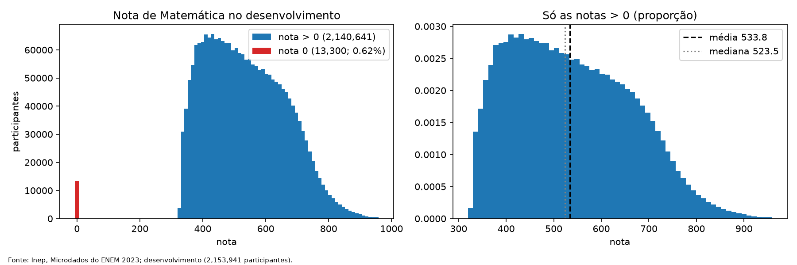

*Figura 1. Distribuição da nota de Matemática no desenvolvimento (2.153.941 participantes); as 13.300 notas zero (0,62%) em vermelho. Fonte: Inep, ENEM 2023.*

**O que fica fora das entradas (vazamento).** Notas de outras áreas e da redação, `TP_PRESENCA_*`, `TP_STATUS_REDACAO`, `TX_RESPOSTAS_*`, `TX_GABARITO_*`, `CO_PROVA_*`, `NU_ANO` e o identificador `NU_INSCRICAO`. Com essas colunas o R² passaria de 0,7, mas elas descrevem a própria prova, não o perfil, e o enunciado as proíbe.

## 3. Protocolo de avaliação e prevenção de vazamento

Todas as escolhas (features, técnicas, hiperparâmetros, tamanho do treino) saíram da validação cruzada no desenvolvimento; o teste foi aberto uma única vez, no fim, com a solução fixada.

| Elemento | Como foi feito |
| --- | --- |
| Partição | `train_test_split(ids_elegiveis, test_size=0.2, random_state=42)`: 80% desenvolvimento, 20% teste. Ids em `dados/splits/`. |
| Validação cruzada | `KFold(n_splits=3, shuffle=True, random_state=42)` só no desenvolvimento, nas mesmas dobras em todas as comparações (`dobras_cv.csv`). Não há outra parcela de validação. |
| Baseline | `DummyRegressor(strategy="mean")`; média recalculada no treino de cada dobra e, no teste, nos 80% de desenvolvimento. |
| Métricas | RMSE (principal), MAE e R², sempre na escala original da nota; média e desvio padrão entre as dobras; tempo por dobra. |
| Pipeline | Tudo que é aprendido dos dados (fusão da situação escolar, padronização, seleção de atributos, PCA, pesos por faixa) é reajustado só no treino de cada dobra. |
| Semente | 42 em tudo que aceita `random_state`. |
| Regra de leitura | Só chamamos de melhora ou piora se a diferença do RMSE médio passa do desvio entre dobras da referência; senão é “sem diferença clara”. |

Os identificadores do teste foram conferidos só quanto à distribuição da nota (média 533,84 e desvio 131,70 no teste, contra 533,83 e 131,63 no desenvolvimento). Nada mais do teste foi usado antes do fim. O script `src/particao.py` recria as partições e confere que os arquivos salvos são iguais aos gerados com a semente 42.

**Vazamento que existia e foi corrigido.** Nos datasets 1 a 3 (notebook 01), a média e o desvio da `FUSAO_1` e as medianas de `Q001` a `Q004` (usadas no “não sei”) foram calculados com todas as linhas, inclusive as do teste. No notebook 04:

- A `FUSAO_1` é refeita dentro do Pipeline (classe `FusaoSituacao`), com média e desvio só do treino de cada dobra, a partir das 4 colunas originais. A receita reproduz a coluna salva com erro máximo de 5e-6.
- As medianas são números inteiros e foram conferidas: a mediana do desenvolvimento é igual à de todas as linhas (Q001 = 4, Q002 = 4, Q003 = 2, Q004 = 1).
- O efeito foi desprezível: a fusão refeita só com o treino dá RMSE 107,051 contra 107,048 com a versão que vazava.

Nenhuma codificação supervisionada por categoria (como target encoding de município) foi usada, então essa fonte de vazamento não existe no pipeline.

## 4. Exploração e preparação dos dados

A preparação seguiu o dicionário do Inep: diferenciar desconhecimento, não informação e ausência, e não assumir distância numérica entre categorias sem ordem. Os gráficos desta etapa estão no notebook `01-exploracao-filtro` e entram abaixo.

**4.1 Valores ausentes.** As colunas da escola têm 75,6% de ausentes na base completa (73,1% entre quem tem nota). O vazio tem significado: é quem já concluiu o ensino médio e não está numa escola no cadastro. `TP_ENSINO` tem 66,0% de ausentes. As colunas de nota e de prova têm 31,6% ou 28,2% de ausentes porque a pessoa faltou ou foi eliminada. Por isso o vazio da escola vira a categoria “sem informação” (referência da codificação 0/1), sem imputar mediana e sem remover linhas (remover deixaria só 724.385 participantes).

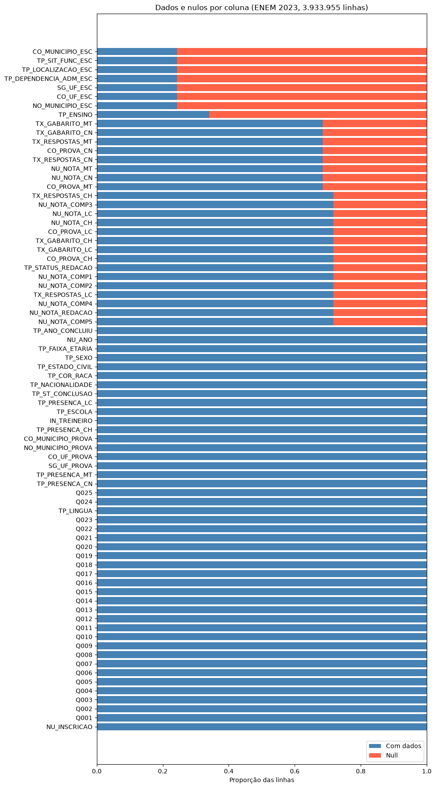

*Figura 2. Proporção de dados e de valores ausentes em cada coluna da base bruta. Fonte: Inep, ENEM 2023.*

**4.2 Codificação.**

- Questionário `Q001` a `Q025`: letras viram números (A=0, B=1, C=2…), mantendo a ordem do dicionário (escolaridade e renda são escadas ordenadas; contagens de bens vão de 0 a 4).
- Sexo em 0/1. Cor/raça, estado civil, nacionalidade, tipo e localização da escola são categorias sem ordem: nos datasets 2 e 3 entram em colunas 0/1.
- “Não sei” em `Q001` a `Q004` (escolaridade e ocupação do pai e da mãe) não é um nível da escala: vira ausente, é preenchido com a mediana de quem respondeu e, no dataset 3, ganha indicador próprio. Quem não sabe tira 40 a 50 pontos a menos, informação que o preenchimento por mediana apagaria.
- `TP_ANO_CONCLUIU = 0` (não informado) vira ausente na fusão da situação escolar.

**4.3 Sexo e língua (descrição).** Antes de qualquer tratamento foi descrito quem faz mais o ENEM e quem tira notas maiores, com as 2.692.427 linhas e sem tomar decisão de modelo a partir disso. Quem escolheu inglês tem média 74,5 pontos maior que quem escolheu espanhol (efeito de 0,60 desvio padrão).

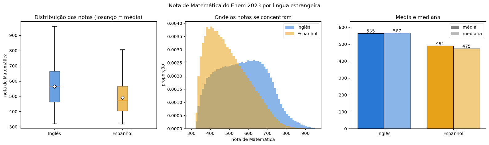

*Figura 3. Nota de Matemática por língua estrangeira (inglês × espanhol), 2.692.427 participantes, descrição sem decisão de modelo. Fonte: Inep, ENEM 2023.*

**4.4 Correlação de Spearman e redundância.** O Spearman (correlação de ranking) mede a relação de cada coluna com a nota e quais colunas se repetem. Limite de redundância: |ρ| > 0,7. Colunas nominais não entram na fusão, porque o código numérico não tem ordem. Quatro colunas da situação escolar (`IN_TREINEIRO`, `TP_ANO_CONCLUIU`, `TP_FAIXA_ETARIA`, `TP_ST_CONCLUSAO`; pares de 0,885, −0,842 e 0,728) foram fundidas na `FUSAO_1`: média dos z-scores, com sinal invertido em `TP_ANO_CONCLUIU` e `TP_FAIXA_ETARIA`. No notebook 04 essa fusão é comparada com manter as quatro colunas separadas (seção 9).

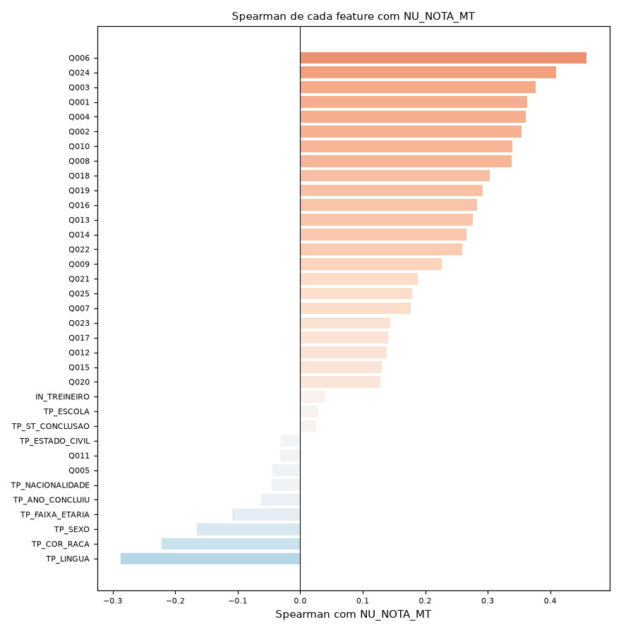

*Figura 4. Spearman de cada feature com a nota, antes da fusão das colunas redundantes. Fonte: Inep, ENEM 2023.*

**Tabela da Figura 4: Spearman de cada coluna com a nota, antes da fusão** (35 colunas, da maior para a menor correlação). Calculado nos 2.692.427 participantes com nota, no notebook 01, antes da partição 80/20; essa correlação não escolheu modelo nem hiperparâmetro (a seleção de atributos do notebook 04 usa só o treino de cada dobra). ρ positivo: quanto mais da coluna, maior a nota. As descrições seguem o dicionário do Inep.

| Coluna | O que é | ρ com a nota |
| --- | --- | --: |
| `Q006` | renda familiar mensal | +0,457 |
| `Q024` | computadores | +0,409 |
| `Q003` | ocupação do pai ou responsável | +0,377 |
| `Q001` | escolaridade do pai ou responsável | +0,364 |
| `Q004` | ocupação da mãe ou responsável | +0,361 |
| `Q002` | escolaridade da mãe ou responsável | +0,354 |
| `Q010` | carros | +0,339 |
| `Q008` | banheiros | +0,339 |
| `Q018` | aspirador de pó | +0,303 |
| `Q019` | televisores | +0,292 |
| `Q016` | micro-ondas | +0,283 |
| `Q013` | freezers | +0,276 |
| `Q014` | máquina de lavar roupa | +0,266 |
| `Q022` | celulares | +0,259 |
| `Q009` | quartos para dormir | +0,227 |
| `Q021` | TV por assinatura | +0,188 |
| `Q025` | acesso à internet | +0,179 |
| `Q007` | empregado doméstico | +0,177 |
| `Q023` | telefone fixo | +0,144 |
| `Q017` | máquina de lavar louça | +0,141 |
| `Q012` | geladeiras | +0,139 |
| `Q015` | máquina de secar roupa | +0,131 |
| `Q020` | aparelho de DVD | +0,128 |
| `IN_TREINEIRO` | treineiro (0/1) | +0,040 |
| `TP_ESCOLA` | tipo de escola (declarado) | +0,029 |
| `TP_ST_CONCLUSAO` | situação de conclusão do ensino médio | +0,026 |
| `TP_ESTADO_CIVIL` | estado civil | −0,031 |
| `Q011` | motocicletas | −0,033 |
| `Q005` | pessoas na residência | −0,045 |
| `TP_NACIONALIDADE` | nacionalidade | −0,047 |
| `TP_ANO_CONCLUIU` | ano de conclusão do ensino médio | −0,063 |
| `TP_FAIXA_ETARIA` | faixa etária | −0,109 |
| `TP_SEXO` | sexo | −0,165 |
| `TP_COR_RACA` | cor/raça | −0,222 |
| `TP_LINGUA` | língua estrangeira (inglês ou espanhol) | −0,287 |

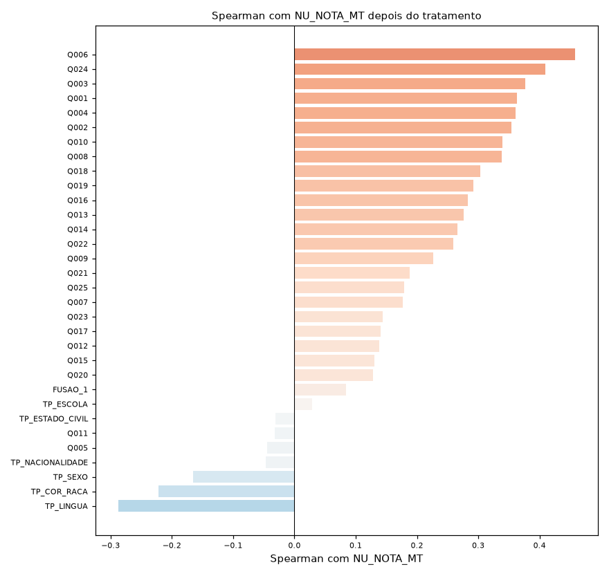

*Figura 5. Spearman de cada feature com a nota, depois da fusão (dataset 1). Fonte: Inep, ENEM 2023.*

**Tabela da Figura 5: Spearman de cada coluna com a nota, depois da fusão** (32 colunas). As quatro colunas de situação escolar (`IN_TREINEIRO`, `TP_ANO_CONCLUIU`, `TP_FAIXA_ETARIA`, `TP_ST_CONCLUSAO`) viram `FUSAO_1`. Estes valores são anteriores ao tratamento do “não sei” em Q001 a Q004 (seção 5); depois dele, veja a tabela da Figura 10.

| Coluna | O que é | ρ com a nota |
| --- | --- | --: |
| `Q006` | renda familiar mensal | +0,457 |
| `Q024` | computadores | +0,409 |
| `Q003` | ocupação do pai ou responsável | +0,377 |
| `Q001` | escolaridade do pai ou responsável | +0,364 |
| `Q004` | ocupação da mãe ou responsável | +0,361 |
| `Q002` | escolaridade da mãe ou responsável | +0,354 |
| `Q010` | carros | +0,339 |
| `Q008` | banheiros | +0,339 |
| `Q018` | aspirador de pó | +0,303 |
| `Q019` | televisores | +0,292 |
| `Q016` | micro-ondas | +0,283 |
| `Q013` | freezers | +0,276 |
| `Q014` | máquina de lavar roupa | +0,266 |
| `Q022` | celulares | +0,259 |
| `Q009` | quartos para dormir | +0,227 |
| `Q021` | TV por assinatura | +0,188 |
| `Q025` | acesso à internet | +0,179 |
| `Q007` | empregado doméstico | +0,177 |
| `Q023` | telefone fixo | +0,144 |
| `Q017` | máquina de lavar louça | +0,141 |
| `Q012` | geladeiras | +0,139 |
| `Q015` | máquina de secar roupa | +0,131 |
| `Q020` | aparelho de DVD | +0,128 |
| `FUSAO_1` | fusão das 4 colunas de situação escolar | +0,084 |
| `TP_ESCOLA` | tipo de escola (declarado) | +0,029 |
| `TP_ESTADO_CIVIL` | estado civil | −0,031 |
| `Q011` | motocicletas | −0,033 |
| `Q005` | pessoas na residência | −0,045 |
| `TP_NACIONALIDADE` | nacionalidade | −0,047 |
| `TP_SEXO` | sexo | −0,165 |
| `TP_COR_RACA` | cor/raça | −0,222 |
| `TP_LINGUA` | língua estrangeira (inglês ou espanhol) | −0,287 |

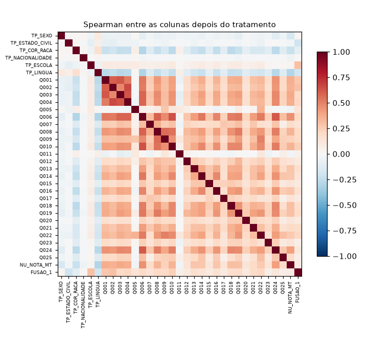

*Figura 6. Matriz de Spearman entre as colunas depois da fusão: nenhum par passa de 0,7. Fonte: Inep, ENEM 2023.*

**Tabela da Figura 6: pares de colunas com |ρ| ≥ 0,50 depois da fusão** (22 pares, valores arredondados em 2 casas, como na matriz da figura). O limite de redundância é 0,70, e nenhum par o atinge; o maior é `Q002` × `Q004` (0,66).

| Coluna 1 | Coluna 2 | ρ |
| --- | --- | --: |
| `Q002` | `Q004` | +0,66 |
| `Q006` | `Q010` | +0,64 |
| `Q003` | `Q004` | +0,63 |
| `Q001` | `Q003` | +0,62 |
| `Q006` | `Q024` | +0,61 |
| `Q001` | `Q002` | +0,60 |
| `Q006` | `Q008` | +0,59 |
| `Q003` | `Q006` | +0,58 |
| `Q004` | `Q006` | +0,58 |
| `Q008` | `Q009` | +0,56 |
| `Q008` | `Q010` | +0,54 |
| `Q001` | `Q006` | +0,53 |
| `Q006` | `Q014` | +0,53 |
| `Q006` | `Q019` | +0,53 |
| `Q001` | `Q004` | +0,52 |
| `Q002` | `Q006` | +0,52 |
| `Q006` | `Q022` | +0,52 |
| `Q008` | `Q019` | +0,52 |
| `Q006` | `Q018` | +0,51 |
| `Q008` | `Q024` | +0,51 |
| `Q010` | `Q024` | +0,51 |
| `Q009` | `Q022` | +0,50 |

**4.5 Colunas que saíram de vários datasets.** `TP_NACIONALIDADE` (97,8% são brasileiros) e `TP_ESCOLA` (61% “não respondeu”) saíram da primeira versão do dataset 1 por serem desproporcionais, e voltaram nos datasets 2 e 3 em colunas 0/1. As quatro colunas `DEP_*` (dependência administrativa da escola) foram retiradas por redundância: `ESCOLA_PRIVADA` × `DEP_PRIVADA` tem ρ = 0,88 e `DEP_ESTADUAL` × `LOC_URBANA` tem 0,73.

## 5. Datasets e features criadas

Foram montados oito datasets, todos com as mesmas 2.692.427 linhas, na ordem de `ids_elegiveis.csv`, sem nenhum valor nulo e com o alvo na última coluna. Os cinco primeiros crescem por camadas; o dataset 3 devolve as colunas que tinham saído por serem desproporcionais.

| Dataset | Features | Composição |
| --- | --: | --- |
| `dataset_1_fundido` | 30 | Perfil (sexo, estado civil, cor/raça, língua), Q001 a Q025 e `FUSAO_1` |
| `dataset_1_features` | 33 | Dataset 1 + 3 features criadas |
| `dataset_2_escola` | 34 | Dataset 1 + 4 colunas de escola (0/1): `ESCOLA_PUBLICA`, `ESCOLA_PRIVADA`, `LOC_URBANA`, `LOC_RURAL` |
| `dataset_2_features_escola` | 37 | Dataset 2 + 3 features criadas |
| `dataset_3_sem_escola` | 38 | Dataset 1 + 4 colunas `NAO_SEI` + 4 colunas de nacionalidade |
| `dataset_3_sem_escola_features` | 41 | Dataset 3 sem escola + 3 features criadas |
| `dataset_3_escola` | 42 | Dataset 2 + `NAO_SEI` + nacionalidade |
| `dataset_3_escola_features` | 45 | Dataset 2 + features + `NAO_SEI` + nacionalidade (o maior) |

**5.1 As 3 features criadas e suas hipóteses.** A primeira versão (renda per capita, escolaridade máxima dos responsáveis e acesso digital) tinha Spearman de 0,89 a 0,94 com as colunas de origem, ou seja, repetia informação, e foi descartada. Entre 29 candidatas, ficaram as que não passam de |ρ| = 0,7 com nenhuma coluna nem entre si.

| Feature | Hipótese | Spearman com a nota |
| --- | --- | --: |
| `PESSOAS_POR_QUARTO` (pessoas ÷ quartos, mínimo 1 quarto) | Casa mais lotada, menos espaço para estudar | −0,221 |
| `CELULAR_POR_MORADOR` (celulares ÷ pessoas) | Mais celulares por pessoa, mais acesso próprio a conteúdo e aulas online | +0,280 |
| `RENDA_MENOS_ESCOL` (renda 0 a 1 − escolaridade máxima 0 a 1) | Renda alta (ou baixa) para o nível de estudo da família carrega informação extra | +0,090 |

Cuidados com aproximações: a renda é uma faixa (a escala 0 a 1 usa a posição da faixa, não um valor em reais), as contagens de bens vão só de 0 a 4 e o denominador de quartos tem mínimo 1, para não dividir por zero. Todas são calculadas linha a linha com colunas da própria linha, então não vazam informação do teste.

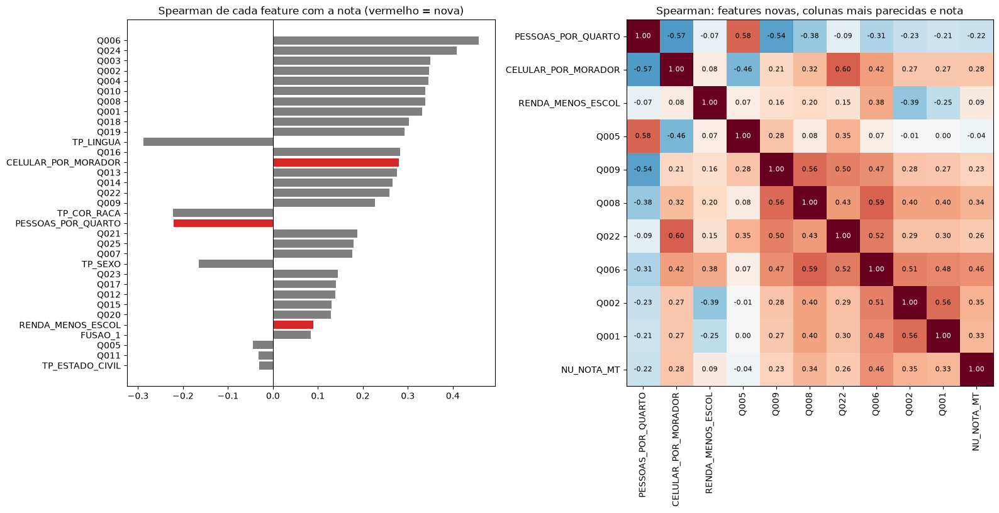

*Figura 7. As três features criadas: Spearman com a nota, com as colunas mais parecidas e matriz resumida. Fonte: Inep, ENEM 2023.*

**Tabela da Figura 7: as três features criadas.** ρ com a nota e as três colunas mais parecidas com cada uma (limite de redundância 0,70; a maior, 0,60, está longe dele).

| Feature criada | O que é | ρ com a nota | Colunas mais parecidas (ρ) |
| --- | --- | --: | --- |
| `PESSOAS_POR_QUARTO` | pessoas na casa por quarto (`Q005` / `Q009`) | −0,221 | `Q005` +0,58; `Q009` −0,54; `Q008` −0,38 |
| `CELULAR_POR_MORADOR` | celulares por morador (`Q022` / `Q005`) | +0,280 | `Q022` +0,60; `Q005` −0,46; `Q006` +0,42 |
| `RENDA_MENOS_ESCOL` | renda menos escolaridade | +0,090 | `Q002` −0,39; `Q006` +0,38; `Q001` −0,25 |

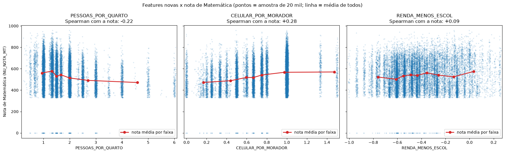

*Figura 8. Features criadas contra a nota de Matemática (pontos: amostra de 20 mil; linha vermelha: nota média por faixa, com todas as linhas). Fonte: Inep, ENEM 2023.*

**5.2 Escola (dataset 2).** O vazio nas colunas da escola (73%) é “sem informação” e fica como referência (todas as colunas de escola em 0). Spearman com a nota: `ESCOLA_PUBLICA` −0,150, `ESCOLA_PRIVADA` +0,217, `LOC_URBANA` +0,068, `LOC_RURAL` −0,028. Nenhum par passa de 0,7 depois de tirar as `DEP_*`.

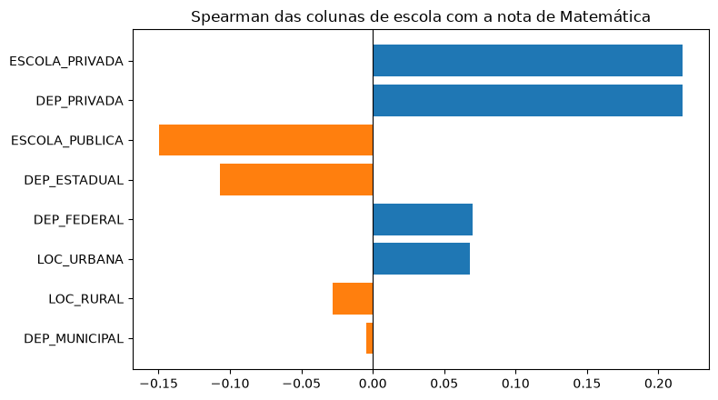

*Figura 9. Spearman das oito colunas de escola com a nota, antes de retirar as `DEP_*`. Fonte: Inep, ENEM 2023.*

**Tabela da Figura 9: as colunas de escola.** ρ com a nota e a coluna mais parecida com cada uma (redundante quando |ρ| > 0,70).

| Coluna | O que é | ρ com a nota | Mais parecida com outra coluna | Situação |
| --- | --- | --: | --- | --- |
| `ESCOLA_PRIVADA` | escola privada (0/1) | +0,217 | `DEP_PRIVADA` (0,880) | redundante |
| `DEP_PRIVADA` | escola privada, pela dependência (0/1) | +0,217 | `ESCOLA_PRIVADA` (0,880) | redundante |
| `ESCOLA_PUBLICA` | escola pública (0/1) | −0,150 | `DEP_ESTADUAL` (0,677) | ok |
| `DEP_ESTADUAL` | escola estadual (0/1) | −0,107 | `LOC_URBANA` (0,727) | redundante |
| `DEP_FEDERAL` | escola federal (0/1) | +0,070 | `ESCOLA_PUBLICA` (0,193) | ok |
| `LOC_URBANA` | escola em zona urbana (0/1) | +0,068 | `DEP_ESTADUAL` (0,727) | redundante |
| `LOC_RURAL` | escola em zona rural (0/1) | −0,028 | `DEP_FEDERAL` (0,152) | ok |
| `DEP_MUNICIPAL` | escola municipal (0/1) | −0,005 | `LOC_URBANA` (0,069) | ok |

**5.3 Não sei e nacionalidade (dataset 3).**

| Coluna | O que é | Pessoas | Nota média de quem marcou | Nota média de quem respondeu |
| --- | --- | --: | --: | --: |
| `Q001_NAO_SEI` | não sabe a escolaridade do pai | 9,3% | 497 | 538 |
| `Q002_NAO_SEI` | não sabe a escolaridade da mãe | 2,9% | 483 | 535 |
| `Q003_NAO_SEI` | não sabe a ocupação do pai | 11,9% | 502 | 538 |
| `Q004_NAO_SEI` | não sabe a ocupação da mãe | 8,7% | 516 | 536 |
| `NAC_*` (4 colunas) | nacionalidade em 0/1 (referência: brasileiro, 97,8%) | 0,05% a 1,8% | 478 a 575 | 535 (brasileiros) |

Nenhum par do dataset 3 passa de 0,7 de Spearman.

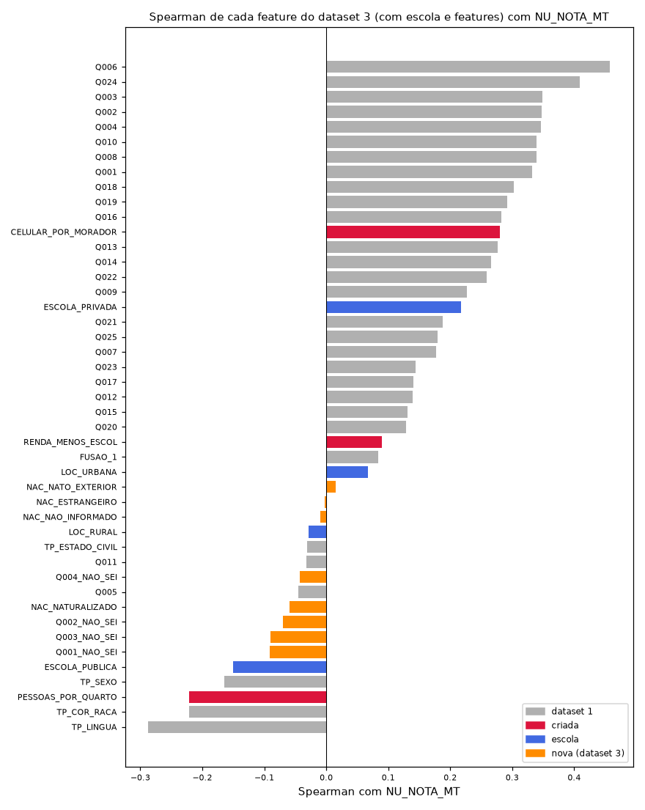

*Figura 10. Dataset 3 (maior tabela): Spearman de cada feature com a nota; em destaque as colunas `NAO_SEI` e de nacionalidade. Fonte: Inep, ENEM 2023.*

**Tabela da Figura 10: Spearman de todas as colunas do dataset 3 com a nota** (45 colunas, depois do tratamento do “não sei”). O gráfico mostra só as 30 colunas originais; esta tabela traz também as criadas, as de escola e os indicadores de “não sei” e de nacionalidade.

| Coluna | O que é | ρ com a nota |
| --- | --- | --: |
| `Q006` | renda familiar mensal | +0,457 |
| `Q024` | computadores | +0,409 |
| `Q003` | ocupação do pai ou responsável | +0,349 |
| `Q002` | escolaridade da mãe ou responsável | +0,347 |
| `Q004` | ocupação da mãe ou responsável | +0,346 |
| `Q010` | carros | +0,339 |
| `Q008` | banheiros | +0,339 |
| `Q001` | escolaridade do pai ou responsável | +0,332 |
| `Q018` | aspirador de pó | +0,303 |
| `Q019` | televisores | +0,292 |
| `Q016` | micro-ondas | +0,283 |
| `CELULAR_POR_MORADOR` | criada: celulares por morador (Q022 / Q005) | +0,280 |
| `Q013` | freezers | +0,276 |
| `Q014` | máquina de lavar roupa | +0,266 |
| `Q022` | celulares | +0,259 |
| `Q009` | quartos para dormir | +0,227 |
| `ESCOLA_PRIVADA` | escola privada (0/1) | +0,217 |
| `Q021` | TV por assinatura | +0,188 |
| `Q025` | acesso à internet | +0,179 |
| `Q007` | empregado doméstico | +0,177 |
| `Q023` | telefone fixo | +0,144 |
| `Q017` | máquina de lavar louça | +0,141 |
| `Q012` | geladeiras | +0,139 |
| `Q015` | máquina de secar roupa | +0,131 |
| `Q020` | aparelho de DVD | +0,128 |
| `RENDA_MENOS_ESCOL` | criada: renda menos escolaridade | +0,090 |
| `FUSAO_1` | fusão das 4 colunas de situação escolar | +0,084 |
| `LOC_URBANA` | escola em zona urbana (0/1) | +0,068 |
| `NAC_NATO_EXTERIOR` | brasileiro nato no exterior (0/1) | +0,015 |
| `NAC_ESTRANGEIRO` | estrangeiro (0/1) | −0,003 |
| `NAC_NAO_INFORMADO` | nacionalidade não informada (0/1) | −0,010 |
| `LOC_RURAL` | escola em zona rural (0/1) | −0,028 |
| `TP_ESTADO_CIVIL` | estado civil | −0,031 |
| `Q011` | motocicletas | −0,033 |
| `Q004_NAO_SEI` | indicador: não sabe a ocupação da mãe | −0,043 |
| `Q005` | pessoas na residência | −0,045 |
| `NAC_NATURALIZADO` | brasileiro naturalizado (0/1) | −0,059 |
| `Q002_NAO_SEI` | indicador: não sabe a escolaridade da mãe | −0,070 |
| `Q003_NAO_SEI` | indicador: não sabe a ocupação do pai | −0,089 |
| `Q001_NAO_SEI` | indicador: não sabe a escolaridade do pai | −0,091 |
| `ESCOLA_PUBLICA` | escola pública (0/1) | −0,150 |
| `TP_SEXO` | sexo | −0,165 |
| `PESSOAS_POR_QUARTO` | criada: pessoas por quarto (Q005 / Q009) | −0,221 |
| `TP_COR_RACA` | cor/raça | −0,222 |
| `TP_LINGUA` | língua estrangeira (inglês ou espanhol) | −0,287 |

## 6. Modelos em configuração inicial

Todos os regressores obrigatórios foram medidos no `dataset_1_fundido` (30 features), nas mesmas 3 dobras, com a configuração inicial registrada antes de qualquer busca. Modelos que usam distância ou pesos (regressão linear, KNN, SVR) têm um `StandardScaler` dentro do Pipeline, ajustado só no treino de cada dobra.

| Modelo | RMSE (média ± desvio) | MAE | R² | Tempo por dobra (s) | Menos erro que o baseline |
| --- | --: | --: | --: | --: | --: |
| Stacking | 107,763 ± 0,226 | 83,804 | 0,330 | 630 | 18,1% |
| Gradient Boosting | 107,770 ± 0,226 | 83,825 | 0,330 | 133 | 18,1% |
| Random Forest | 109,422 ± 0,195 | 85,494 | 0,309 | 103 | 16,9% |
| Pasting | 110,012 ± 0,208 | 85,996 | 0,302 | 20 | 16,4% |
| Bagging | 110,014 ± 0,207 | 85,991 | 0,302 | 24 | 16,4% |
| Árvore de decisão | 110,551 ± 0,190 | 86,381 | 0,295 | 3,0 | 16,0% |
| Ridge (alpha = 1) | 111,153 ± 0,178 | 86,960 | 0,287 | 0,3 | 15,6% |
| Regressão linear | 111,153 ± 0,178 | 86,960 | 0,287 | 0,7 | 15,6% |
| SVR linear (LinearSVR) | 111,153 ± 0,178 | 86,961 | 0,287 | 1,9 | 15,6% |
| KNN (50 vizinhos) | 111,575 ± 0,184 | 87,180 | 0,282 | 476 | 15,2% |
| Baseline (média) | 131,634 ± 0,158 | 107,582 | 0,000 | 0,06 | 0,0% |

**Configurações iniciais.** Árvore com `max_depth=10` e `min_samples_leaf=50`; KNN com 50 vizinhos e `algorithm='brute'`; LinearSVR com `C=1` e `epsilon=0` (o SVR com kernel RBF custa o quadrado do tamanho da base e foi descartado após medição em amostras de 2.000 a 8.000 pessoas); bagging com 20 árvores e `bootstrap=True`; pasting com 20 árvores, `bootstrap=False` e `max_samples=0,5`; Random Forest com 100 árvores, `max_depth=12`, `min_samples_leaf=50` e `max_features=0,5`; Gradient Boosting (`HistGradientBoostingRegressor`) com `learning_rate=0,1`, até 300 árvores de 31 folhas e parada antecipada com 10% do treino da dobra; stacking com Ridge, árvore e Gradient Boosting como base e Ridge como modelo final, com previsões fora da dobra.

**6.1 Baseline.** Prever sempre a média (533,8) erra, em média, o próprio desvio padrão (RMSE 131,634) e tem R² zero. É a régua: qualquer modelo útil precisa ter RMSE menor e R² maior que zero.

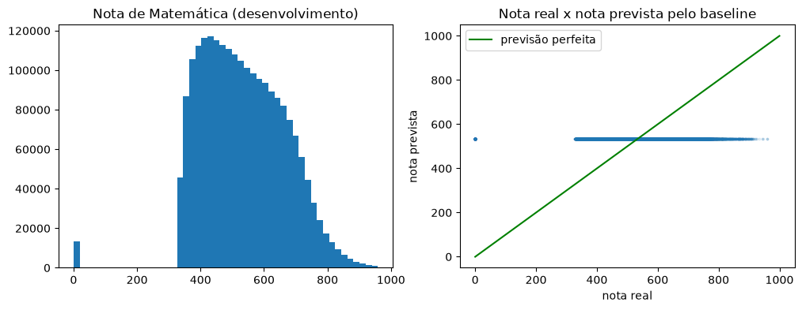

*Figura 11. Baseline: distribuição da nota (esquerda) e nota real × nota prevista (direita): prever a média dá uma reta horizontal. Fonte: Inep, ENEM 2023; desenvolvimento.*

**6.2 Regressão linear.** A nota é uma soma ponderada das features. Pesos em pontos de nota por desvio padrão: renda (`Q006`) +27,2, computadores (`Q024`) +14,8 e escolaridade da mãe (`Q002`) +10,2 são os maiores positivos; língua (espanhol), sexo (feminino) e `FUSAO_1` são os maiores negativos. É associação nos dados, não causa. A reta do modelo tem inclinação de cerca de 0,29: ele puxa as previsões para a média, subestimando notas altas e superestimando as baixas; os zeros são previstos em cerca de 519 pontos. Ridge e regressão linear dão o mesmo resultado: com 2 milhões de linhas e colunas pouco redundantes, a regularização quase não pesa.

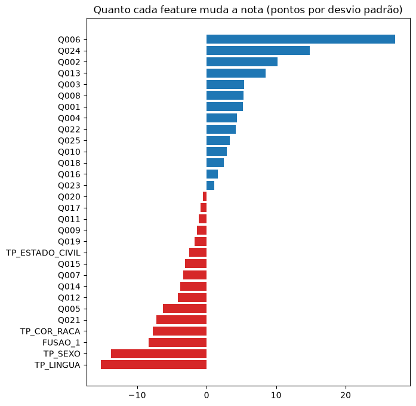

*Figura 12. Regressão linear: peso de cada feature (pontos de nota por desvio padrão). Fonte: Inep, ENEM 2023; desenvolvimento.*


*Figura 13. Regressão linear: nota real × nota prevista (previsões fora da dobra); a inclinação de cerca de 0,29 mostra o achatamento para a média. Fonte: Inep, ENEM 2023; desenvolvimento.*

**6.3 Árvore de decisão.** A primeira pergunta (`Q006` ≤ 4) separa 1,49 milhão de pessoas (nota média 499) de 662 mil (612). Em profundidade 10, treino e validação têm R² parecidos (0,301 e 0,295); a partir de 15 níveis o treino continua subindo (0,328 e 0,345) e a validação cai (0,291 e 0,280): é o início do sobreajuste. `Q006` concentra 62% da importância, seguida de `Q024` (11,8%), `TP_LINGUA` (7,8%), `FUSAO_1` (4,8%) e `TP_SEXO` (3,7%).

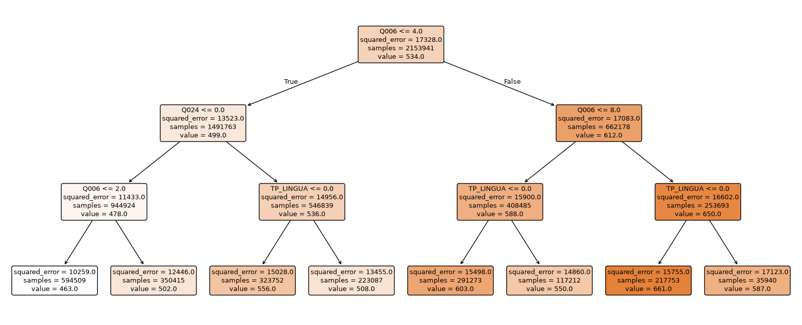

*Figura 14. Árvore pequena (3 níveis) para ilustrar como o modelo divide as pessoas. Fonte: Inep, ENEM 2023; desenvolvimento.*

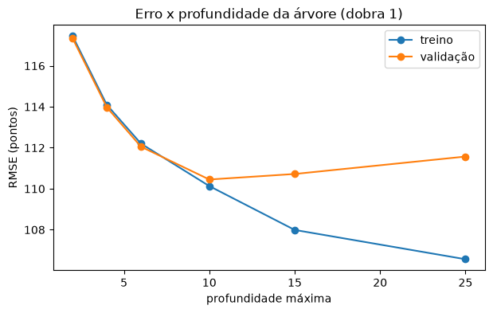

*Figura 15. Erro contra profundidade da árvore (dobra 1): o treino continua caindo e a validação volta a subir a partir de 10 níveis, início do sobreajuste. Fonte: Inep, ENEM 2023; desenvolvimento.*

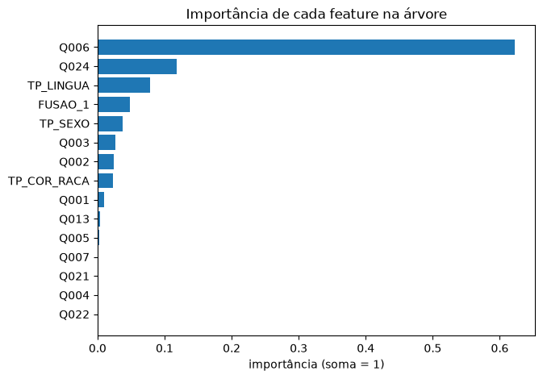

*Figura 16. Importância de cada feature na árvore (soma = 1). Fonte: Inep, ENEM 2023; desenvolvimento.*

**6.4 KNN.** Para cada pessoa acha as 50 mais parecidas e prevê a média da nota delas. É o mais lento (cerca de 476 s por dobra: cada previsão compara com cerca de 1,4 milhão de pessoas) e ficou pior que a regressão linear.

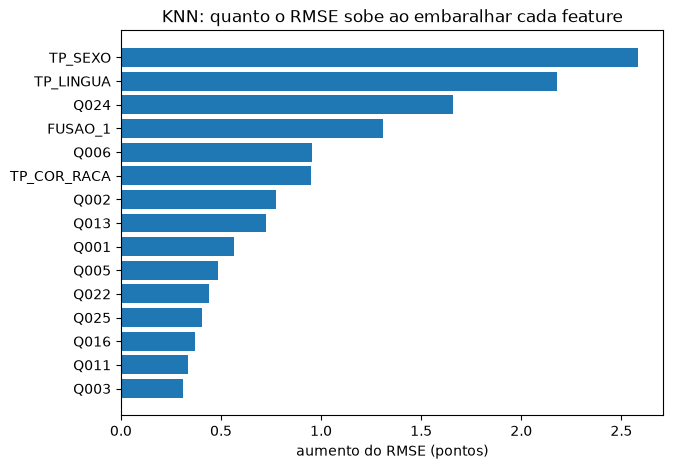

*Figura 17. KNN: importância por permutação (quanto o RMSE sobe ao embaralhar a feature), em 3.000 pessoas da validação da dobra 1. Fonte: Inep, ENEM 2023; desenvolvimento.*

**6.5 SVR linear.** Mesmo resultado da regressão linear (111,153). O SVR com kernel compara todos os pares de pessoas e é inviável para 1,4 milhão de linhas; o `LinearSVR` é permitido pelo enunciado.


*Figura 18. SVR linear: peso de cada feature. Fonte: Inep, ENEM 2023; desenvolvimento.*

**6.6 Bagging e pasting.** Bagging: 20 árvores, cada uma numa amostra sorteada com reposição. Pasting: o mesmo sem reposição, com metade do treino em cada árvore. Ficaram praticamente iguais (110,014 e 110,012).


*Figura 19. Bagging: importância por permutação na dobra 1. Fonte: Inep, ENEM 2023; desenvolvimento.*

**6.7 Random Forest e Gradient Boosting.** A Random Forest é um bagging em que cada divisão só considera uma parte sorteada das features (RMSE 109,422). No boosting as árvores são treinadas em sequência, cada uma corrigindo o erro das anteriores; é o melhor modelo (RMSE 107,770, R² 0,330). A importância por permutação (quanto o RMSE sobe ao embaralhar a coluna) coloca `Q006` (+6,0 pontos), `FUSAO_1` (+4,0), `TP_SEXO` e `TP_LINGUA` (+2,1) e `Q024` (+1,8) no topo.

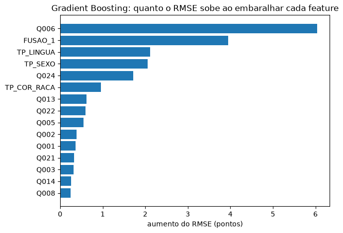

*Figura 20. Gradient Boosting (configuração inicial): quanto o RMSE sobe ao embaralhar cada feature. Fonte: Inep, ENEM 2023; desenvolvimento.*

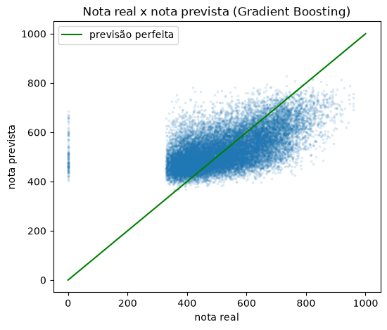

*Figura 21. Gradient Boosting: nota real × nota prevista (20 mil pessoas da validação; as notas zero formam a coluna à esquerda). Fonte: Inep, ENEM 2023; desenvolvimento.*

**6.8 Stacking.** Empata com o Gradient Boosting (diferença de 0,007, muito menor que o desvio de 0,226) e custa cerca de 5 vezes mais tempo: não se justifica.

**6.9 Leitura geral.** Famílias muito diferentes (linear, árvore, KNN) caem no mesmo patamar de 110 a 112 de RMSE, e árvores só ganham 3 a 4 pontos. Se o problema fosse fortemente não linear, os modelos flexíveis ganhariam muito mais: o limite está nas features, não no algoritmo. Os 3 melhores regressores distintos (sem contar o baseline) são stacking, Gradient Boosting e Random Forest; como o stacking custa 5 vezes mais e não ganha, a busca de hiperparâmetros foi feita no Gradient Boosting, no bagging e na Random Forest (os três melhores sem o stacking, por família).

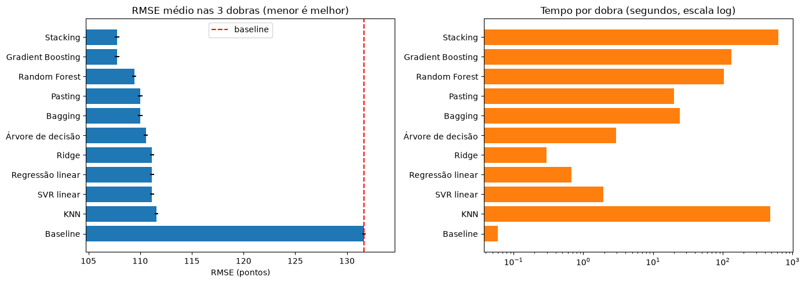

*Figura 22. RMSE médio de cada modelo com o desvio entre as dobras (esquerda) e tempo por dobra em escala logarítmica (direita). Fonte: Inep, ENEM 2023; dataset\_1\_fundido, validação cruzada.*

## 7. Busca de hiperparâmetros

O otimizador foi o `RandomizedSearchCV` do scikit-learn (um dos dois que o enunciado cita): sorteia 10 configurações dentro de faixas definidas pela equipe, mede cada uma nas mesmas 3 dobras pelo RMSE médio, escolhe a de menor RMSE e a reajusta nos 80% do desenvolvimento (Bergstra e Bengio, 2012: a busca aleatória cobre melhor espaços de muitas dimensões que uma grade). Semente 42; o teste não entra. KNN e stacking ficaram sem busca pelo custo (mais de 3 e mais de 2 horas). O Optuna não foi usado: não está instalado no ambiente.

A busca foi feita no `dataset_1_fundido` e cobriu sete modelos; os 3 melhores regressores distintos, sem o stacking, são Gradient Boosting, bagging e Random Forest.

| Modelo | RMSE inicial | RMSE depois da busca | Ganho | R² depois | Tempo da busca |
| --- | --: | --: | --: | --: | --: |
| Bagging | 110,014 | 109,083 ± 0,154 | 0,931 | 0,313 | 17,8 min |
| Pasting | 110,012 | 109,146 ± 0,158 | 0,866 | 0,312 | 12,0 min |
| Random Forest | 109,422 | 109,138 ± 0,159 | 0,284 | 0,313 | 19,7 min |
| Árvore de decisão | 110,551 | 110,337 ± 0,148 | 0,214 | 0,297 | 4,7 min |
| Gradient Boosting | 107,770 | 107,680 ± 0,178 | 0,090 | 0,331 | 54,2 min |
| Ridge | 111,153 | 111,153 ± 0,145 | 0,000 | 0,287 | 0,6 min |
| SVR linear | 111,153 | 111,153 ± 0,145 | 0,000 | 0,287 | 2,0 min |

O RMSE depois da busca é um pouco otimista, porque é o melhor entre 10 sorteados. O maior ganho foi no bagging e no pasting (cerca de 0,9, acima do desvio de 0,15); Random Forest e árvore ganharam 0,2 a 0,3. No Gradient Boosting o ganho (0,09) fica dentro do desvio (0,178): a busca praticamente não melhorou o melhor modelo. Ridge e SVR linear não mudam, porque todas as configurações sorteadas dão o mesmo resultado.

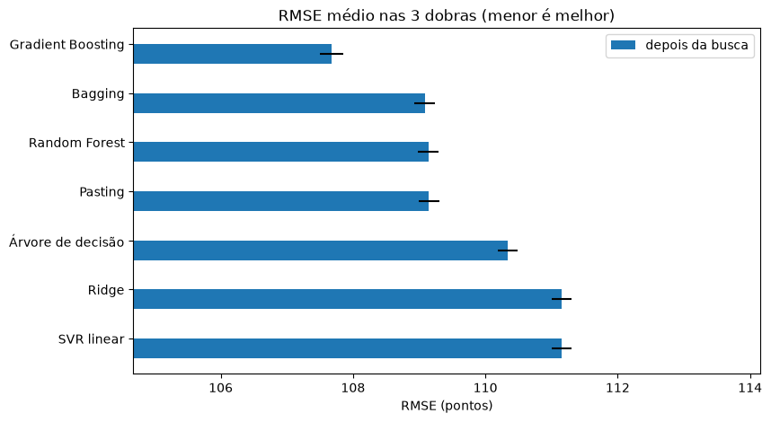

*Figura 23. RMSE de cada modelo depois da busca de hiperparâmetros (dataset\_1\_fundido, validação cruzada). Fonte: Inep, ENEM 2023.*

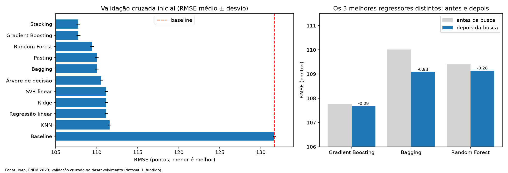

*Figura 24. Comparação inicial de todos os regressores com o baseline (esquerda) e os três melhores regressores distintos antes e depois da busca (direita). Fonte: Inep, ENEM 2023; dataset\_1\_fundido, validação cruzada.*

**Melhores hiperparâmetros.**

- Gradient Boosting: `learning_rate` 0,067; até 500 árvores; 89 folhas; `min_samples_leaf` 137; `l2_regularization` 0,244; parada antecipada com 10% do treino.
- Bagging: 24 árvores, `max_samples` 0,7, `max_features` 0,8, árvore base com `max_depth` 15 e `min_samples_leaf` 34.
- Random Forest: 50 árvores, `max_depth` 15, `max_features` 0,3, `min_samples_leaf` 30.
- Pasting: 24 árvores, `max_samples` 0,3 (mesmos demais valores do bagging).
- Árvore: `max_depth` 25, `max_features` 0,8, `min_samples_leaf` 298. Ridge: `alpha` 461,9. SVR linear: `C` 0,029, `epsilon` 0,78.

**Espaços de busca** (10 configurações cada, mesmas 3 dobras): Ridge `alpha` loguniform de 1e-3 a 1e5; árvore `max_depth` 5 a 30, `min_samples_leaf` 5 a 299, `max_features` None, 0,8 ou 0,5; SVR linear `C` loguniform de 1e-2 a 10, `epsilon` de 0 a 5; bagging `n_estimators` 10 a 40, `max_samples` 0,5, 0,7 ou 1,0, `max_features` 0,6, 0,8 ou 1,0, árvore base `max_depth` 6 a 15 e `min_samples_leaf` 20 a 199; pasting igual com `max_samples` 0,2, 0,3, 0,5 ou 0,7; Random Forest `n_estimators` 50 ou 100, `max_depth` 8 a 15, `min_samples_leaf` 10 a 199, `max_features` 0,3, 0,5 ou 0,7; Gradient Boosting `learning_rate` loguniform de 0,02 a 0,3, `max_iter` 200, 300 ou 500, `max_leaf_nodes` 15 a 99, `min_samples_leaf` 50 a 499, `l2_regularization` loguniform de 1e-3 a 10.

**Limite desta busca.** Foi feita antes da correção do vazamento e do desdobramento da situação escolar, no dataset 1 com 30 colunas. Na solução final (seção 13) os mesmos hiperparâmetros foram reaproveitados; refazer a busca na representação final custaria mais de uma hora e não muda a conclusão, já que o ganho da busca no Gradient Boosting ficou dentro do desvio.

## 8. Variações de dataset e comparação

Foram avaliados **21 conjuntos de entrada** com validação cruzada: **8 datasets salvos** em `dados/processed/` (notebooks 01 e 02) e **13 variações de representação** montadas no notebook 04 a partir da mesma base (tratamento da situação escolar, UF, sem as features criadas, três cortes de seleção e seis blocos retirados). Além deles, 4 testes de diagnóstico à parte (A a D, seção 8.2) não entram nos notebooks, e dois conjuntos ficam fora da conta: o dataset 5 (solução independente de outra IA, seção 8.4) e o dataset 6 (diagnóstico com as notas de outras áreas, seção 8.5).

**8.1 Os 8 datasets salvos** (nenhum é filtrado por linhas: todos têm as 2.692.427 linhas). RMSE médio nas 3 dobras, menor é melhor:

| Dataset | Features | Regressão linear | Gradient Boosting (inicial) | Bagging otimizado |
| --- | --: | --: | --: | --: |
| `dataset_1_fundido` | 30 | 111,153 | 107,770 | 109,083 |
| `dataset_1_features` | 33 | 111,146 | 107,759 | 109,170 |
| `dataset_2_escola` | 34 | 110,747 | 107,261 | 108,720 |
| `dataset_2_features_escola` | 37 | 110,742 | 107,255 | 108,684 |
| `dataset_3_sem_escola` | 38 | 110,752 | 107,551 | 109,089 |
| `dataset_3_sem_escola_features` | 41 | 110,744 | 107,540 | 109,081 |
| `dataset_3_escola` | 42 | 110,384 | 107,056 | 108,597 |
| `dataset_3_escola_features` | 45 | 110,378 | 107,048 | 108,615 |

- O melhor dataset salvo é o `dataset_3_escola_features` (45 features): Gradient Boosting 107,048, 0,72 ponto melhor que o dataset 1.
- A escola dá o ganho mais consistente (cerca de 0,5 ponto no Gradient Boosting e 0,4 na regressão linear); `NAO_SEI` e nacionalidade dão 0,2 a 0,4.
- As 3 features criadas quase não mudam o resultado (cerca de 0,01 ponto), como era de se esperar de colunas calculadas a partir das que já existem.
- Do dataset 1 ao melhor dataset são 0,8 ponto na regressão linear e 0,7 no Gradient Boosting: mais colunas ajudam pouco.

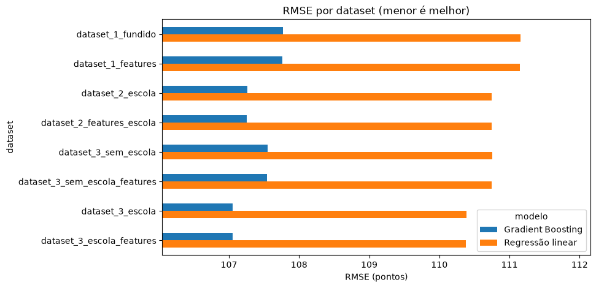

*Figura 25. RMSE por dataset salvo (menor é melhor): regressão linear e Gradient Boosting. Fonte: Inep, ENEM 2023; validação cruzada.*

**8.2 Teste de diagnóstico à parte** (Gradient Boosting leve, 150 árvores, dataset 1 como base): a UF da prova (27 colunas 0/1) e as colunas que a `FUSAO_1` havia juntado ajudam, e os efeitos se somam.

| Conjunto | Colunas | RMSE (± desvio) | R² | Ganho |
| --- | --: | --: | --: | --: |
| A. Dataset 1 | 30 | 107,977 ± 0,185 | 0,327 |  |
| B. A + UF da prova (one-hot) | 57 | 107,334 ± 0,169 | 0,335 | 0,64 |
| C. A + idade, situação, ano e treineiro separados | 34 | 107,505 ± 0,152 | 0,333 | 0,47 |
| D. A + B + C | 61 | 106,830 ± 0,139 | 0,341 | 1,15 |

Esse diagnóstico motivou as hipóteses das seções 9.1 e 9.2, agora medidas dentro do Pipeline, com o dataset 3 como base.

**8.3 As 13 variações do notebook 04.** Base: as 44 colunas do `dataset_3_escola_features` sem a `FUSAO_1`, mais as 4 colunas originais da situação escolar (48) e, quando indicado, 26 colunas de UF. Gradient Boosting inicial, mesmas dobras.

| Variação | Colunas | RMSE (± desvio) | Em relação à referência |
| --- | --: | --: | --- |
| 1a. Fusão da situação refeita só com o treino | 48 | 107,051 ± 0,192 | referência da seção 9.1 |
| 1b. 4 colunas de situação separadas | 48 | 106,726 ± 0,189 | −0,325: melhora |
| 2. 1b + UF da prova | 74 | 106,025 ± 0,188 | −0,701 sobre 1b: melhora |
| 3. Sem as 3 features criadas | 71 | 106,038 ± 0,167 | +0,013 sobre a variação 2: sem diferença |
| 4a/4b/4c. Seleção k = 22 / 37 / 51 colunas | 74 de entrada | 110,607 / 107,436 / 107,069 | piora (+4,58 / +1,41 / +1,04) |
| 6a. Sem renda | 72 | 106,893 ± 0,194 | +0,868 |
| 6b. Sem escolaridade e ocupação dos responsáveis | 66 | 106,559 ± 0,168 | +0,534 |
| 6c. Sem bens e domicílio | 52 | 107,356 ± 0,174 | +1,331 |
| 6d. Sem escola | 70 | 106,439 ± 0,185 | +0,414 |
| 6e. Sem localização (UF) | 48 | 106,726 ± 0,189 | +0,701 |
| 6f. Sem perfil e trajetória | 62 | 110,445 ± 0,189 | +4,420 |

A conclusão de cada linha está nas seções 9, 11 e 12.

**8.4 Dataset 5: a solução independente de outra IA.** Pedimos a outra IA um treino “só com o enunciado e o CSV”, sem nenhum contexto do nosso trabalho (pasta `treino_projeto2/`, script `treino_enem.py`). O teste dela é **o mesmo nosso**: os 538.486 identificadores são idênticos aos de `dados/splits/teste_ids.csv`. O dataset 5 é a definição de entradas dela, não um arquivo:

- **45 colunas de entrada:** 41 categóricas originais (16 de perfil, trajetória, escola e UF, mais `Q001` a `Q025`) e 4 derivadas (`QTD_QUESTIONARIO_PREENCHIDO`, `QTD_PERFIL_PREENCHIDO`, `RESPONSAVEIS_ESCOLARIDADE_IGUAL` e `UF_ESCOLA_PROVA_IGUAL`). Inclui colunas que nós tiramos (`TP_ENSINO`, `SG_UF_ESC`, `TP_DEPENDENCIA_ADM_ESC`, `TP_SIT_FUNC_ESC`) e não usa as nossas features criadas.
- **Codificação:** one-hot de **todas** as categóricas, inclusive as escadas do questionário, com a ausência como categoria própria e categorias com menos de 50 pessoas agrupadas; as contagens passam por mediana e padronização. O Gradient Boosting dela usa codificação ordinal. Tudo dentro de Pipelines.
- **Protocolo dela:** mesma partição 80/20 com semente 42; **sem validação cruzada, busca de hiperparâmetros, PCA, seleção ou balanceamento**, com configurações fixas e leves (Gradient Boosting com 50 árvores e 15 folhas, bagging e pasting com 5 árvores) e avaliação direto no teste. O próprio README dela diz que não substitui as etapas obrigatórias.

Resultado no teste (RMSE em pontos), junto com as nossas referências:

| Modelo | RMSE no teste | MAE | R² | Ajuste (s) |
| --- | --: | --: | --: | --: |
| **Nossa solução final (Gradient Boosting, 74 colunas)** | **105,81** | **82,00** | **0,354** | 165 |
| Dataset 5: Ridge | 107,53 | 83,63 | 0,333 | 55 |
| Dataset 5: SVR linear | 107,89 | 83,30 | 0,329 | 60 |
| Dataset 5: Gradient Boosting (50 árvores) | 108,07 | 84,46 | 0,327 | 15 |
| Dataset 5: Random Forest (30 árvores) | 108,13 | 84,32 | 0,326 | 4.904 |
| Nossa regressão linear sem regularização | 108,86 | 84,89 | 0,317 | 4 |
| Dataset 5: pasting, bagging, regressão linear | 109,62 a 109,70 | 84,05 a 85,80 | 0,306 a 0,307 | 82 a 302 |
| Dataset 5: árvore de decisão | 110,02 | 85,65 | 0,302 | 685 |
| Dataset 5: AdaBoost | 114,09 | 90,04 | 0,250 | 177 |
| Baseline (média) | 131,70 | 107,64 | 0,000 | 0 |

**Leitura.** Nenhum modelo do dataset 5 supera a nossa solução final: o melhor dele (Ridge, 107,53) fica 1,7 ponto atrás. O ganho dela aparece nos modelos lineares: o Ridge com one-hot de tudo erra 1,33 ponto a menos que a nossa regressão linear, o que confirma a limitação que já tínhamos anotado (cor/raça, estado civil e as escadas do questionário como números prejudicam a regressão linear). Sua regressão linear sem regularização (109,70) fica pior que a nossa (108,86): o ganho vem do one-hot somado à regularização. O Gradient Boosting dela é bem mais leve que o nosso (50 contra até 500 árvores) e termina 2,3 pontos atrás. **Cuidados:** a comparação é só de teste (não há validação cruzada do lado dela), então nada pode ser escolhido a partir dela sem refazer a validação cruzada no desenvolvimento. Esse cuidado foi atendido depois: reproduzimos a preparação dela e a avaliamos por validação cruzada nas nossas dobras (notebook 06, Apêndice G.6): o Ridge fez 107,51, igual ao teste dela (107,53), e a nossa solução fica 1,6 ponto melhor. Onde ficou o material: a pasta original (treino\_projeto2, 365 MB) foi apagada depois de arquivar o essencial em resultados/dataset5\_replicacao\_independente: o script treino\_enem.py (que define o dataset 5), as métricas de teste, o diagnóstico e o README dela. Não foram guardados o ambiente virtual, os modelos joblib, os ids (idênticos aos nossos) e as previsões de teste (61 MB); as métricas por modelo estão na tabela acima.

**8.5 Dataset 6: diagnóstico com as notas de outras áreas (fora da solução).** As notas de outras matérias influenciam a nota de Matemática? Sim, e muito, mas usar essas notas é o vazamento que o enunciado proíbe (elas descrevem a própria prova, não o perfil), então o dataset 6 existe só para medir o tamanho do efeito (notebook `05-diagnostico-notas-outras-areas`). Ele é o `dataset_3_escola_features` (45 colunas) mais as notas de Ciências da Natureza (mesmo dia da prova de Matemática), Ciências Humanas, Linguagens e Redação (as três do primeiro dia): 53 colunas, sem nulos (a nota ausente vira 0 e ganha uma coluna indicadora). Foi avaliado só por validação cruzada no desenvolvimento; o teste não foi aberto, e o dataset não entra na solução final nem em nenhuma tabela de teste.

Correlação de Pearson de cada nota com a de Matemática (desenvolvimento): Natureza 0,71, Humanas 0,63, Linguagens 0,62 e Redação 0,50. Entre os participantes com nota de Matemática, só 0,5% não têm as notas do primeiro dia e todos têm a de Natureza.

| Entrada | Colunas | Gradient Boosting: RMSE (± desvio) | R² | Regressão linear: RMSE | R² |
| --- | --: | --: | --: | --: | --: |
| Só o perfil | 45 | 107,05 ± 0,20 | 0,339 | 110,38 | 0,297 |
| + Natureza (mesmo dia) | 47 | 82,83 ± 0,06 | 0,604 | 86,05 | 0,573 |
| + Humanas, Linguagens e Redação (dia 1) | 51 | 85,96 ± 0,23 | 0,574 | 89,69 | 0,536 |
| **+ as quatro notas** | 53 | **74,43 ± 0,03** | **0,680** | 79,63 | 0,634 |

**Leitura.** Com as quatro notas o RMSE cai de 107,0 para 74,4 e o R² sobe de 0,34 para 0,68: a nota de outra área sozinha (Natureza) já tira 24 pontos do erro. Isso confirma que o limite de R² de cerca de 0,35 dos outros experimentos vem da informação disponível sobre o perfil, e não do modelo. Mesmo com o vazamento o R² chega a 0,68, não a 1: cerca de um terço da variação da nota de Matemática não é explicada nem por outras provas feitas pela mesma pessoa. A regressão linear também ganha muito (110,4 para 79,6), mas fica 5 pontos atrás do Gradient Boosting.

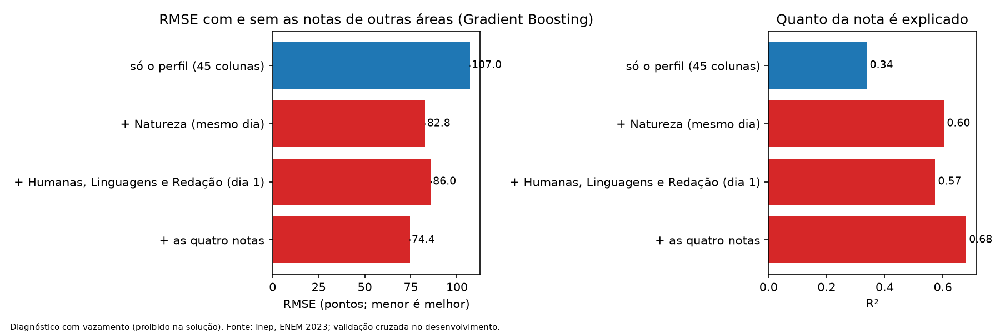

*Figura 25b. Diagnóstico com vazamento (dataset 6, fora da solução): RMSE e R² do Gradient Boosting só com o perfil e com as notas de outras áreas. Fonte: Inep, ENEM 2023; validação cruzada no desenvolvimento.*

**8.5.1 Spearman do dataset 6** (só desenvolvimento). As quatro notas de outras áreas são as colunas mais associadas à nota de Matemática, acima de qualquer coluna do perfil: Humanas 0,656, Linguagens 0,643, Natureza 0,643 e Redação 0,527, contra 0,457 da renda (`Q006`) e 0,409 dos computadores (`Q024`). Quatro pares passam do limite de redundância (|ρ| > 0,7): Humanas × Linguagens (0,788) e as três colunas `AUSENTE_CH`, `AUSENTE_LC` e `AUSENTE_REDACAO`, que são **idênticas** (ρ = 1,000: quem não fez o primeiro dia não fez nenhuma das três). Entre as próprias notas: Natureza × Humanas 0,66, Natureza × Linguagens 0,64 e Redação de 0,46 a 0,52 com as outras. `AUSENTE_CN` é constante (ninguém no desenvolvimento deixou de fazer Natureza), então o Spearman dela é indefinido e ela fica fora dos gráficos. A correlação de Pearson da Natureza (0,71) é maior que a de Spearman (0,64); uma explicação provável, não testada, é que quem zerou Matemática também zerou Natureza (8.5.2), e esses pontos em (0, 0) pesam mais no Pearson.

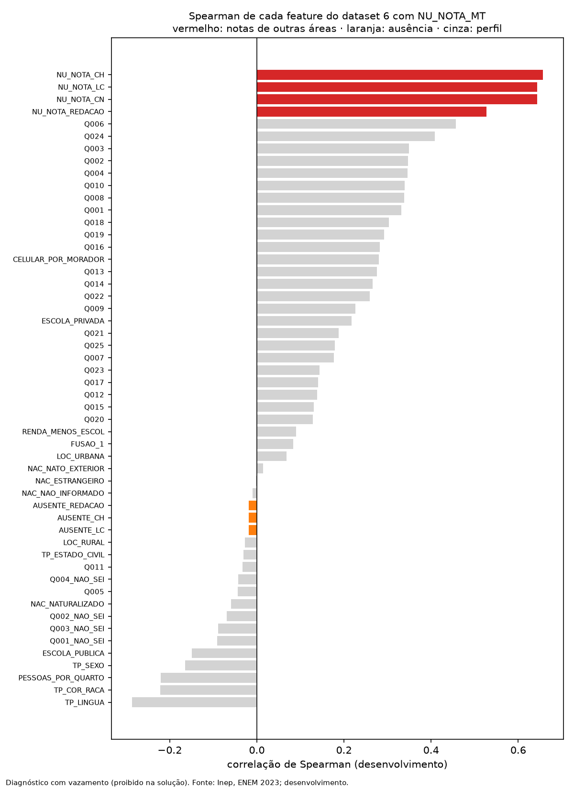

*Figura 25c. Spearman de cada feature do dataset 6 com a nota de Matemática (vermelho: notas de outras áreas; laranja: indicadoras de ausência; cinza: perfil). Fonte: Inep, ENEM 2023; desenvolvimento. Diagnóstico com vazamento.*

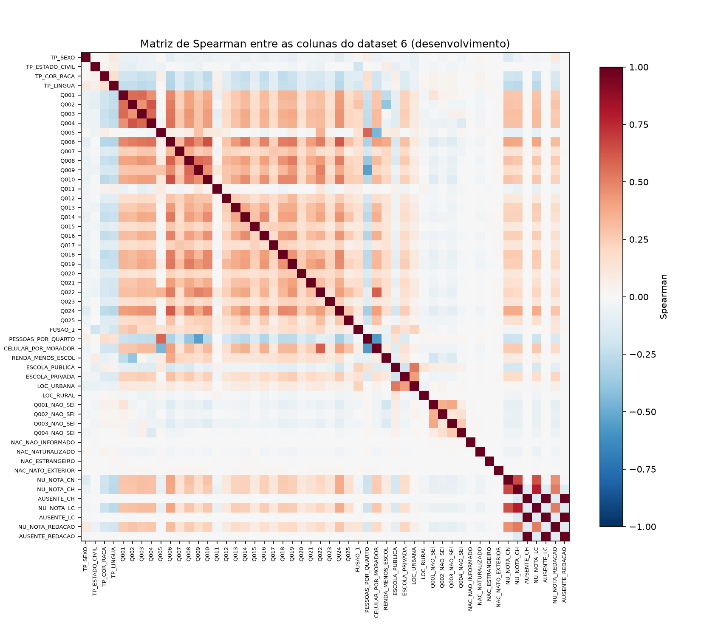

*Figura 25d. Matriz de Spearman entre as colunas do dataset 6: as notas formam um bloco entre si e as três indicadoras de ausência aparecem como um bloco de correlação 1. Fonte: Inep, ENEM 2023; desenvolvimento.*

**8.5.2 Dataset 6 sem as notas zero no treino.** As 13.300 pessoas com nota 0 em Matemática (0,62%) respondem por 13,7% do erro ao quadrado da regressão linear só com o perfil. Com as notas de outras áreas, o modelo consegue **reconhecê-las**: **98,3% de quem zerou Matemática também tem nota 0 em Natureza** (a prova do mesmo dia), 17,3% zeraram a Redação e 2,1% não têm as notas do primeiro dia. As notas zero saíram **só do treino de cada dobra**; a validação manteve todos, inclusive os zeros (regra do enunciado).

| Entrada | Modelo | Zeros no treino | RMSE geral (± desvio) | RMSE de quem não zerou | RMSE dos zeros | R² |
| --- | --- | --- | --: | --: | --: | --: |
| Só o perfil | Gradient Boosting | sim | 107,05 ± 0,20 | 99,41 | 515,1 | 0,339 |
| Só o perfil | Gradient Boosting | não | 107,12 ± 0,20 | 99,36 | 519,1 | 0,338 |
| Só o perfil | Regressão linear | sim | 110,38 ± 0,19 | 102,82 | 521,2 | 0,297 |
| Só o perfil | Regressão linear | não | 110,43 ± 0,20 | 102,76 | 524,8 | 0,296 |
| + as quatro notas | Gradient Boosting | sim | **74,43 ± 0,03** | 74,46 | **69,0** | **0,680** |
| + as quatro notas | Gradient Boosting | não | 82,81 ± 0,14 | 74,30 | 471,3 | 0,604 |
| + as quatro notas | Regressão linear | sim | 79,63 ± 0,06 | 78,33 | 198,8 | 0,634 |
| + as quatro notas | Regressão linear | não | 80,51 ± 0,04 | 77,70 | 279,1 | 0,626 |

**Leitura.** Com só o perfil, tirar os zeros do treino não muda nada (107,12 contra 107,05, dentro do desvio), como já tínhamos visto no notebook 02 sem zeros. Com as notas de outras áreas acontece o contrário: **tirar os zeros do treino piora muito** o erro geral (82,81 contra 74,43 no Gradient Boosting), porque o modelo nunca viu um zero e passa a prever cerca de 470 para eles (RMSE de 471 nos zeros, contra 69 quando eles estão no treino). Para quem não zerou a diferença é pequena (74,30 sem zeros contra 74,46 com, diferença de 0,16). Ou seja, as notas zero deixam de ser ruído quando se conhece a nota de Natureza: elas são um grupo identificável (provavelmente quem teve a prova do dia anulada ou foi eliminado; isso não foi verificado nos dados), e retirá-las do treino joga fora essa informação. Com só o perfil elas continuam imprevisíveis, o que explica o RMSE de cerca de 515 nelas.

## 9. Hipóteses e aprofundamento

Seis hipóteses além do mínimo, todas com o mesmo modelo (Gradient Boosting de configuração inicial), as mesmas dobras e a regra de leitura da seção 3. As tabelas completas por dobra estão em `resultados/experimentos.csv`.

**9.1 Situação escolar: fundir ou separar.** *Hipótese:* fundir as 4 colunas redundantes (`IN_TREINEIRO`, `TP_ANO_CONCLUIU`, `TP_FAIXA_ETARIA`, `TP_ST_CONCLUSAO`) numa só joga fora informação. *Resultado:* a fusão refeita só com o treino dá RMSE 107,051 ± 0,192; as 4 colunas separadas dão 106,726 ± 0,189 (−0,325, maior que o desvio: melhora). Escolhemos as 4 separadas. *Leitura:* a fusão, que existia para eliminar redundância por Spearman, custava informação; modelos de árvores não sofrem com colunas parecidas, e manter separado também resolve o vazamento da média e do desvio da fusão.

**9.2 Localização: UF da prova.** *Hipótese:* o estado acrescenta contexto (rede de ensino, desigualdade regional) que o perfil não tem. A UF entra em 26 colunas 0/1 (referência SP, a mais frequente); é a UF onde a pessoa fez a prova, não onde mora. *Resultado:* 106,025 ± 0,188, −0,701 sobre 106,726 (melhora). Adotada. Município não foi testado: teria de entrar com target encoding dentro do Pipeline, e fica como próximo passo.

**9.3 As 3 features criadas ajudam?** *Hipótese:* `PESSOAS_POR_QUARTO`, `CELULAR_POR_MORADOR` e `RENDA_MENOS_ESCOL` acrescentam sinal que as colunas originais não têm. *Resultado:* sem elas, 106,038 ± 0,167; com elas, 106,025: diferença de 0,013, sem diferença clara. *Leitura:* eram combinações de colunas que o Gradient Boosting já consegue formar sozinho. Mantidas na solução por não piorarem e por documentarem a engenharia pedida, mas não são responsáveis por ganho algum.

**9.4 Quanto vale cada bloco de informação.** *Hipótese:* cada bloco contribui. Retiramos um bloco por vez da representação de 74 colunas (RMSE de referência 106,025) e medimos quanto o erro sobe. Toda retirada piorou mais que o desvio (0,188):

| Bloco retirado | Colunas que saem | RMSE | Aumento |
| --- | --: | --: | --: |
| Perfil e trajetória (sexo, estado civil, cor/raça, língua, nacionalidade, idade, situação de conclusão, ano, treineiro) | 12 | 110,445 | +4,420 |
| Bens e domicílio (`Q005`, `Q007` a `Q025`, pessoas por quarto, celular por morador) | 22 | 107,356 | +1,331 |
| Renda (`Q006`, renda menos escolaridade) | 2 | 106,893 | +0,868 |
| Localização (UF) | 26 | 106,726 | +0,701 |
| Escolaridade e ocupação dos responsáveis (`Q001` a `Q004` e `NAO_SEI`) | 8 | 106,559 | +0,534 |
| Escola (pública, privada, urbana, rural) | 4 | 106,439 | +0,414 |

*Leitura:* o perfil e a trajetória pesam mais que todos os blocos socioeconômicos (a idade e a situação de conclusão carregam a maior parte, algo que não separamos: o bloco mistura as duas coisas); bens e renda vêm em seguida. Os blocos são parcialmente redundantes entre si (renda, bens e escolaridade andam juntos), então o aumento de cada um subestima o valor de tê-lo sozinho.

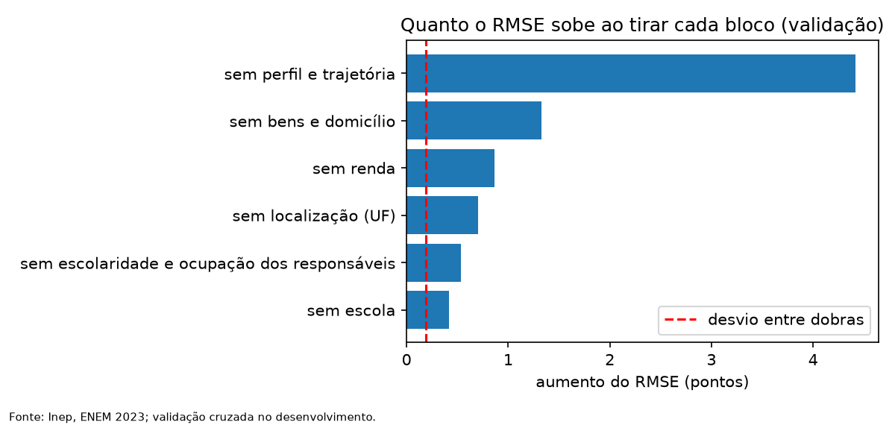

*Figura 26. Quanto o RMSE sobe ao tirar cada bloco de informação (linha vermelha: desvio entre dobras). Fonte: Inep, ENEM 2023; validação cruzada.*

**9.5 Notas zero fora do treino.** *Hipótese:* tirar as 13.300 notas zero do treino reduz o erro nas outras faixas. A classe `SemZerosNoTreino` descarta as pessoas com nota 0 só nas duas dobras de treino; a validação mantém todos. *Resultado (dataset 1, hiperparâmetros da busca):*

| Modelo | RMSE com zeros | RMSE sem zeros | Diferença | Desvio entre dobras | Veredito |
| --- | --: | --: | --: | --: | --- |
| Regressão linear | 111,153 | 111,202 | −0,049 | 0,178 | sem diferença clara |
| Ridge | 111,153 | 111,202 | −0,049 | 0,178 | sem diferença clara |
| Árvore de decisão | 110,337 | 110,331 | +0,006 | 0,181 | sem diferença clara |
| Gradient Boosting | 107,680 | 107,737 | −0,057 | 0,218 | sem diferença clara |

Por faixa de nota (regressão linear), o erro dos zeros e das notas baixas sobe um pouco sem eles (de 522,6 para 526,0 nos zeros) e o erro das notas altas cai um pouco (de 210,4 para 207,7 acima de 800). Os zeros são previstos em cerca de 519 pontos nos dois casos. Eles são 0,62% das pessoas e geram 13,7% do erro ao quadrado da regressão linear; o RMSE entre quem não zerou é 103,6, uma média que descreve outra população e não comprova melhoria.

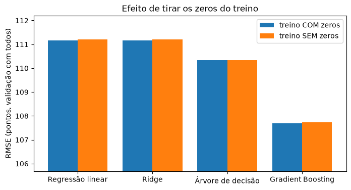

*Figura 27. RMSE de cada modelo treinando com e sem as notas zero (validação com todos os participantes). Fonte: Inep, ENEM 2023; validação cruzada.*

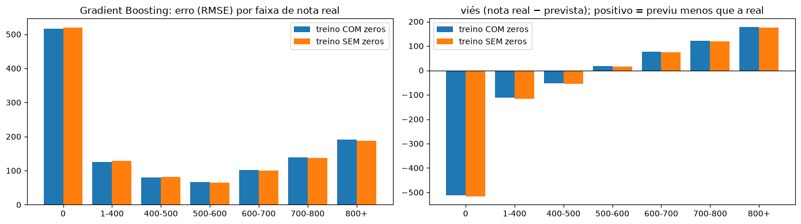

*Figura 28. Gradient Boosting: RMSE e viés por faixa de nota real, com e sem zeros no treino. Fonte: Inep, ENEM 2023; validação cruzada.*

**9.6 Perfis semelhantes: K-means.** *Hipótese:* grupos de perfil (clusters) acrescentam informação como features. O `MiniBatchKMeans` foi rodado para k de 2 a 10 nos 2,15 milhões de pessoas padronizadas. A silhueta é maior com k = 2 (0,207) e cai para menos de 0,11 de k = 3 em diante: as pessoas formam um contínuo, não ilhas. Os dois grupos separam o perfil de maior renda e escolaridade (705.499 pessoas, nota média 607,5, `Q006` médio 7,6) do de menor (1.448.442 pessoas, nota média 497,9, `Q006` médio 2,0), mas a nota varia muito dentro de cada grupo (desvios de 116 e 131). Dar o grupo ao modelo (distâncias aos centros, com o K-means reajustado só no treino de cada dobra) não ajuda: Gradient Boosting 107,770 sem e 107,789 com as distâncias (+0,019, dentro do desvio de 0,226).

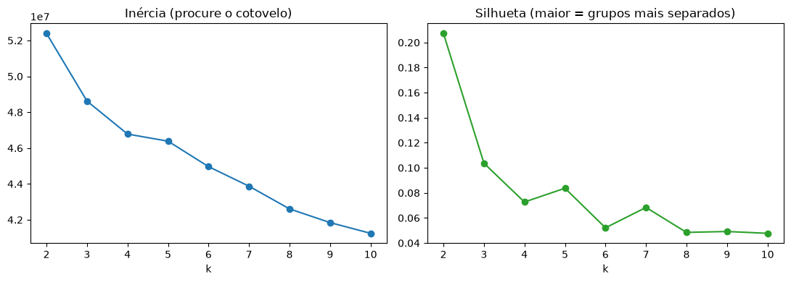

*Figura 29. K-means (k de 2 a 10): inércia e silhueta. Fonte: Inep, ENEM 2023; desenvolvimento.*

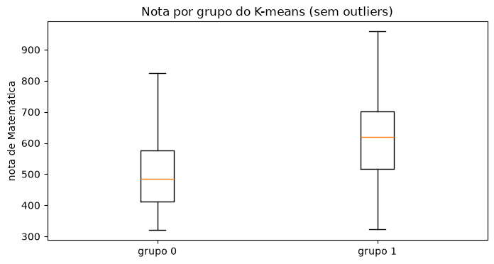

*Figura 30. Nota por grupo do K-means (k = 2), sem outliers. Fonte: Inep, ENEM 2023; desenvolvimento.*

## 10. PCA, t-SNE e K-means

O PCA (análise de componentes principais) gira as colunas padronizadas em novos eixos ordenados por quanta variação carregam. Foi aplicado depois do tratamento e da codificação, com `StandardScaler` antes (o PCA é sensível à escala), dentro do Pipeline, reajustado só no treino de cada dobra, em dois regressores (regressão linear e Gradient Boosting), no `dataset_1_fundido` (30 colunas).

**10.1 Variância explicada.** Com todo o desenvolvimento padronizado, são necessários 7 componentes para 50% da variância, **18 para 80%**, 23 para 90% e 26 para 95% (de 30). Os dados quase não se comprimem: as colunas carregam informações independentes, o que combina com nenhum par passar de 0,7 de Spearman. O primeiro componente (renda e bens da casa) tem correlação de 0,463 com a nota; o segundo, −0,152.

**10.2 PCA dentro do Pipeline.** Testados k = 5, 10, 15, 20 e 25 componentes e o modelo sem PCA, nas mesmas dobras.

| Componentes | Regressão linear: RMSE | Regressão linear: R² | Gradient Boosting: RMSE | Gradient Boosting: R² |
| --- | --: | --: | --: | --: |
| sem PCA | 111,153 | 0,287 | 107,770 | 0,330 |
| 25 | 111,658 | 0,280 | 110,165 | 0,300 |
| 20 | 111,887 | 0,278 | 110,432 | 0,296 |
| 15 | 112,718 | 0,267 | 111,148 | 0,287 |
| 10 | 113,047 | 0,262 | 111,551 | 0,282 |
| 5 | 114,425 | 0,244 | 113,210 | 0,260 |

**Resultado.** O PCA piora os dois regressores, e o RMSE cresce à medida que se cortam componentes. Nenhum k testado fica dentro de 1 desvio do modelo sem PCA (desvio de 0,18 a 0,23). A regressão linear só se aproximaria do resultado sem PCA com todos os componentes (o PCA completo é só uma rotação); o Gradient Boosting perde mais, porque o PCA mistura as colunas e dificulta as divisões das árvores. **Justificativa do número de componentes:** para 80% da variância seriam 18, mas nenhum corte melhora o erro; a melhor escolha para o modelo final é não usar PCA, e esse resultado sem ganho é legítimo e vai para o artigo.

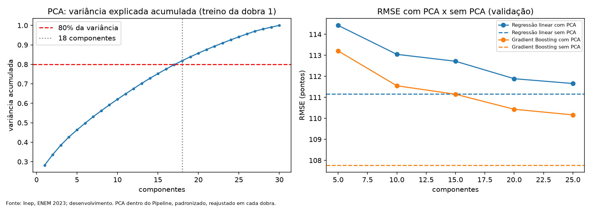

*Figura 31. Esquerda: variância explicada acumulada do PCA; 18 componentes (de 30) chegam a 80%. Direita: RMSE com e sem PCA na regressão linear e no Gradient Boosting. Fonte: Inep, ENEM 2023; desenvolvimento.*

**10.3 t-SNE (diagnóstico).** O t-SNE desenha as pessoas em 2 dimensões mantendo perto as parecidas e não entra em nenhum modelo (não sabe transformar pessoas novas). Foi usada uma amostra de 15 mil pessoas do desenvolvimento, o que o enunciado aceita por ser diagnóstico. Distâncias grandes entre grupos não devem ser lidas ao pé da letra: o t-SNE preserva vizinhanças, não distâncias. O desenho mostra pouca estrutura além de um gradiente renda × nota.

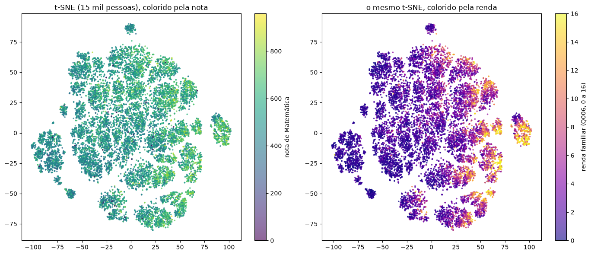

*Figura 32. t-SNE de 15 mil pessoas do desenvolvimento, coloridas pela nota (esquerda) e pela renda familiar `Q006` (direita). Fonte: Inep, ENEM 2023.*

**10.4 K-means.** Resultados na seção 9.6: dois grupos de perfil, sem ganho como feature.

## 11. Seleção de atributos

**Método.** `SelectKBest(f_regression, k)`: dá a cada coluna uma nota (teste F da correlação linear com a nota) e fica com as `k` maiores. Roda **dentro do Pipeline**, então as notas são recalculadas só com o treino de cada dobra. É rápido nos 2 milhões de linhas, mas mede só relação linear individual; por isso o notebook também calcula a importância por permutação do modelo final.

**Hipótese (solução mais simples).** Dá para manter o RMSE com menos colunas e menos tempo. Testamos `k` = 30%, 50% e 70% das 74 colunas (22, 37 e 51), no Gradient Boosting e na regressão linear. Regra de escolha, decidida antes de ver os resultados: o menor `k` cujo RMSE médio fica dentro de 1 desvio entre dobras do RMSE com todas as colunas; se nenhum, usamos todas.

| Colunas | Gradient Boosting: RMSE | Aumento | Regressão linear: RMSE | Aumento |
| --- | --: | --: | --: | --: |
| Todas (74) | 106,025 |  | 108,868 |  |
| k = 51 | 107,069 | +1,044 | 110,198 | +1,329 |
| k = 37 | 107,436 | +1,412 | 110,526 | +1,657 |
| k = 22 | 110,607 | +4,582 | 112,251 | +3,382 |

**Resultado.** Cortar colunas piora os dois modelos, em todos os `k`, e a perda cresce quando o corte aumenta. Nenhum `k` ficou dentro do limite (106,025 + 0,188), então a regra manteve **todas as colunas**. Explicação provável (não testada): o teste F mede só a relação linear de cada coluna isolada, e o Gradient Boosting aproveita colunas com pouco sinal individual, como as UF, e combinações entre colunas. O método de seleção foi testado, comparado com a representação completa e não adotado, e esse é o resultado a reportar.

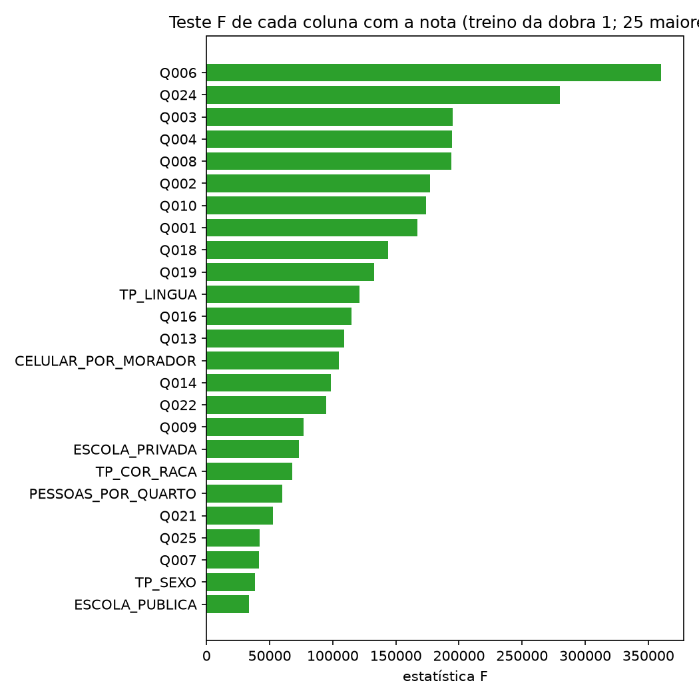

*Figura 33. Teste F de cada coluna com a nota (treino da dobra 1; 25 maiores). Fonte: Inep, ENEM 2023; desenvolvimento.*

A comparação pedida entre **features originais, novas features e seleção** fica assim: sem as 3 features criadas 106,038; com elas 106,025; com seleção (k = 51) 107,069.

## 12. Balanceamento por ponderação de faixas

**Problema.** As notas muito baixas e muito altas são raras e o modelo erra mais nelas: ele puxa tudo para o meio (regressão à média). O enunciado pede testar ao menos uma estratégia adequada à regressão, definida só com o treino de cada dobra, preservando a distribuição original na validação.

**Estratégia: ponderação.** O treino da dobra é agrupado em **faixas de 50 pontos** (a nota 0 numa faixa própria) e cada linha recebe peso `(pessoas na faixa)^(−α)`, normalizado para média 1, via `sample_weight` do Gradient Boosting. Os pesos usam só as notas do treino da dobra; o alvo continua sendo a nota numérica, não uma classe; nada de SMOTE. α = 0,5 dá um peso moderado (raiz do inverso da frequência); α = 1,0 equilibra todas as faixas (inverso da frequência). Regra de adoção, decidida antes: só adotar se o RMSE médio geral ficar menor que o do mesmo modelo sem pesos.

**Efeito geral (validação, 3 dobras).**

| Peso | RMSE | MAE | R² | Em relação a sem pesos |
| --- | --: | --: | --: | --- |
| Sem pesos | 106,025 ± 0,188 | 82,196 | 0,351 | referência |
| α = 0,5 | 108,140 ± 0,188 | 82,820 | 0,325 | +2,115: piora |
| α = 1,0 | 123,459 ± 0,149 | 94,826 | 0,120 | +17,434: piora |

**Efeito por faixa de nota** (RMSE e viés = nota real − prevista; positivo = o modelo subestima; média das 3 dobras):

| Faixa | Pessoas por dobra | RMSE sem pesos | RMSE α = 0,5 | RMSE α = 1,0 | Viés sem pesos | Viés α = 0,5 | Viés α = 1,0 |
| --- | --: | --: | --: | --: | --: | --: | --: |
| 0 | 4.433 | 513,8 | 510,4 | 489,5 | −509,1 | −503,3 | −475,4 |
| 1 a 400 | 111.778 | 122,6 | 120,1 | 112,2 | −109,2 | −99,9 | −67,7 |
| 400 a 500 | 198.921 | 78,8 | 85,3 | 100,6 | −50,2 | −44,6 | −18,1 |
| 500 a 600 | 175.776 | 66,8 | 80,6 | 115,6 | 18,3 | 17,7 | 33,0 |
| 600 a 700 | 144.449 | 100,3 | 105,5 | 134,7 | 74,6 | 63,7 | 58,9 |
| 700 a 800 | 67.509 | 134,9 | 125,7 | 135,2 | 116,7 | 91,9 | 62,3 |
| 800 ou mais | 15.114 | 184,9 | 155,4 | 131,7 | 172,4 | 131,8 | 81,1 |

**Leitura.** A ponderação faz o que promete nas pontas: nas notas acima de 800 o RMSE cai de 184,9 para 155,4 (α = 0,5) e 131,7 (α = 1,0), e o viés encolhe de 172 para 81. O preço é o erro das faixas do meio, onde estão quase todos: a faixa de 500 a 600 vai de 66,8 para 80,6 e 115,6. Como a maior parte das pessoas está no meio, o RMSE geral piora, e a regra de adoção rejeitou os dois pesos. A escolha entre eles é uma decisão de objetivo, não técnica: se o interesse for identificar as notas altas, α = 0,5 dá um compromisso melhor que α = 1,0; se for o erro médio, nenhum peso. Nenhuma das duas corrige o viés dos zeros (previstos em cerca de 500 pontos a mais), que não têm como ser previstos pelo perfil.

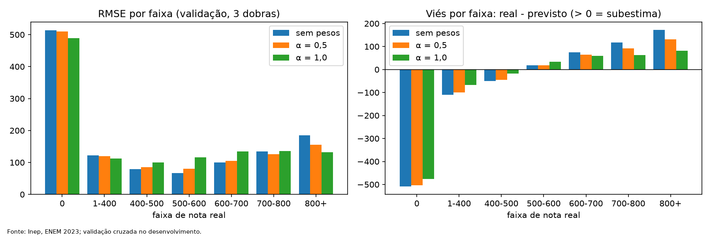

*Figura 34. RMSE e viés por faixa de nota (validação, 3 dobras) sem pesos e com pesos α = 0,5 e α = 1,0. Fonte: Inep, ENEM 2023; validação cruzada.*

## 13. Solução final, validação cruzada e curva de aprendizado

A solução final é o **Gradient Boosting** (`HistGradientBoostingRegressor`) com os hiperparâmetros da busca (seção 7: `learning_rate` 0,067, até 500 árvores, 89 folhas, `min_samples_leaf` 137, `l2_regularization` 0,244, parada antecipada com 10% do treino da dobra), sobre a representação que ganhou nas seções 9, 11 e 12:

- **74 colunas, nenhum nulo:** as 44 colunas do dataset 3 (escola, `NAO_SEI`, nacionalidade, 3 features criadas) sem a `FUSAO_1`, mais as **4 colunas de situação escolar separadas** e **26 colunas de UF da prova**.
- Sem fusão, sem seleção de atributos, sem PCA, sem pesos por faixa (cada um foi testado e não adotado).
- Escolhida **só pela validação cruzada**: 105,864 ± 0,169, contra 106,025 ± 0,188 do mesmo modelo com a configuração inicial (−0,161, dentro do desvio de 0,188: a busca quase não ajuda).

**13.1 Validação cruzada na representação final** (média ± desvio nas 3 dobras):

| Modelo | RMSE | MAE | R² | Tempo por dobra (s) |
| --- | --: | --: | --: | --: |
| Baseline (média) | 131,63 ± 0,16 | 107,58 ± 0,06 | 0,000 | 0,2 |
| Regressão linear (sem regularização) | 108,87 ± 0,16 | 84,86 ± 0,04 | 0,316 ± 0,001 | 2,8 |
| Gradient Boosting, configuração inicial | 106,03 ± 0,19 | 82,20 | 0,351 | 40 |
| **Solução final** (hiperparâmetros da busca) | **105,86 ± 0,17** | **82,02 ± 0,05** | **0,353 ± 0,001** | 91 |

RMSE da solução final por dobra: 105,80; 105,74; 106,06. A regressão linear também melhorou com a nova representação (111,15 no dataset 1 para 108,87), o que mostra que o ganho da UF e da situação escolar desdobrada não é só do Gradient Boosting.

**13.2 Importância das colunas** (importância por permutação: quanto o RMSE sobe ao embaralhar a coluna na validação da dobra 1, 5 mil pessoas, 3 repetições): `TP_ANO_CONCLUIU` +6,35 pontos, `Q006` (renda) +6,33, `TP_FAIXA_ETARIA` +5,59, `TP_SEXO` +2,29, `TP_LINGUA` +2,02, `Q024` (computadores) +1,53, `TP_COR_RACA` +0,90 e `ESCOLA_PRIVADA` +0,80. As três maiores são idade, ano de conclusão e renda; é associação, não causa.

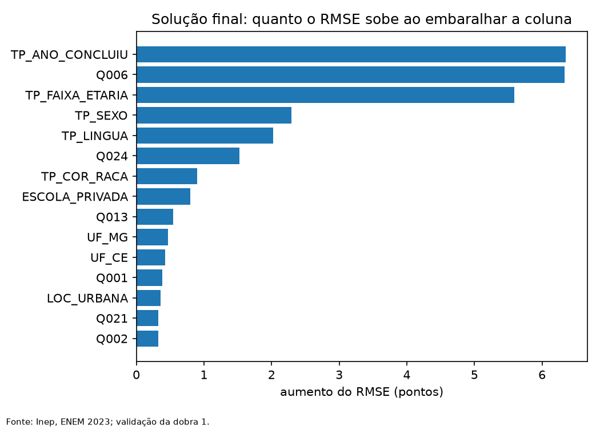

*Figura 35. Solução final: quanto o RMSE sobe ao embaralhar cada coluna (validação da dobra 1). Fonte: Inep, ENEM 2023; desenvolvimento.*

**13.3 Curva de aprendizado** (obrigatória). Em cada uma das 3 dobras, a validação fica fixa e o treino da dobra é embaralhado com a semente 42; usamos os primeiros 10%, 25%, 50%, 75% e 100% das linhas (subconjuntos progressivos, de 143.596 a 1.435.961 linhas). Para cada tamanho todo o Pipeline é reajustado, com os hiperparâmetros fixos; o RMSE de treino é medido no próprio subconjunto e o de validação na validação da dobra. O teste não entra.

| Treino (% da dobra) | Linhas (média) | RMSE treino | RMSE validação | Diferença (val. − treino) |
| --- | --: | --: | --: | --: |
| 10% | 143.596 | 102,61 ± 0,42 | 106,68 ± 0,17 | 4,07 |
| 25% | 358.990 | 103,70 ± 0,22 | 106,25 ± 0,19 | 2,55 |
| 50% | 717.980 | 104,19 ± 0,13 | 106,02 ± 0,19 | 1,82 |
| 75% | 1.076.971 | 104,60 ± 0,21 | 105,93 ± 0,18 | 1,33 |
| 100% | 1.435.961 | 104,77 ± 0,10 | 105,86 ± 0,21 | 1,09 |

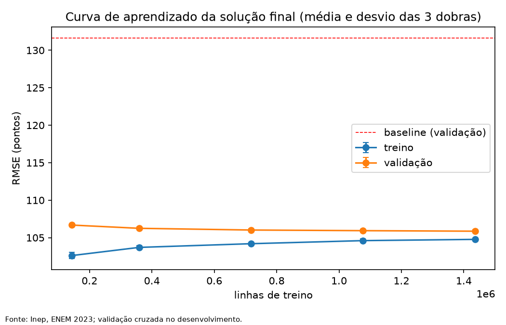

*Figura 36. Curva de aprendizado da solução final: RMSE de treino e de validação (média e desvio das 3 dobras) com 10%, 25%, 50%, 75% e 100% do treino da dobra; linha vermelha: baseline. Fonte: Inep, ENEM 2023; validação cruzada no desenvolvimento.*

**Diagnóstico.** As duas curvas se aproximam e ficam altas: o erro de treino sobe de 102,6 para 104,8 (com pouco dado o modelo decora um pouco mais) e o de validação cai de 106,7 para 105,9, terminando separados por só 1,1 ponto. Isso **não indica sobreajuste forte**, que apareceria como erro de treino bem menor que o de validação. De 75% para 100% do treino a validação melhora só 0,07 ponto, menos que o desvio entre dobras (0,2): dobrar o volume de dados não resolveria. Erros altos e próximos podem ser subajuste, mas também falta de informação nas features; aqui há indícios de que é informação: modelos muito diferentes (linear, árvores, KNN, bagging, boosting) terminam todos entre 106 e 112, e um Gradient Boosting com muito mais capacidade (500 árvores, 89 folhas) pouco ganha sobre o inicial (−0,16). O erro restante é em grande parte variância que o perfil não explica, como o esforço de estudo, a qualidade do ensino e as circunstâncias do dia da prova.

## 14. Teste final

O teste foi aberto **uma única vez**, com a solução fixada. No desenvolvimento completo (2.153.941 pessoas) foram ajustados o baseline, a regressão linear sem regularização e a solução final; os três foram avaliados nos mesmos 538.486 participantes. Faixas de nota e grupos foram definidos no desenvolvimento (seção 12 e abaixo) e mantidos. Nada do teste voltou para a escolha de features, técnicas ou hiperparâmetros.

**14.1 Métricas.** Validação cruzada (média ± desvio nas 3 dobras) separada do teste:

| Modelo | CV RMSE | CV MAE | CV R² | Teste RMSE | Teste MAE | Teste R² | Ajuste no teste (s) |
| --- | --: | --: | --: | --: | --: | --: | --: |
| Baseline (média) | 131,63 ± 0,16 | 107,58 ± 0,06 | 0,000 | 131,70 | 107,64 | 0,000 | 0 |
| Regressão linear (sem regularização) | 108,87 ± 0,16 | 84,86 ± 0,04 | 0,316 | 108,86 | 84,89 | 0,317 | 4 |
| **Solução final (Gradient Boosting)** | **105,86 ± 0,17** | **82,02 ± 0,05** | **0,353** | **105,81** | **82,00** | **0,354** | 165 |

O teste confirma a validação: o RMSE da solução final é 105,81 no teste e 105,86 na validação, diferença de 0,05, bem menor que o desvio entre dobras (0,17). Não há sinal de que a escolha da solução tenha sido ajustada demais à validação. A solução final erra **19,7% menos que o baseline** (105,81 contra 131,70) e 2,8% menos que a regressão linear (3,05 pontos). Em média ela erra cerca de 82 pontos por participante.

**14.2 Resíduos** (nota observada − prevista). A média dos resíduos é 0,1 e o desvio, 105,8 (praticamente o RMSE). Contra a nota prevista, a média do resíduo fica perto de zero em toda a faixa prevista, sem tendência, mas a dispersão é grande e as previsões ficam concentradas entre cerca de 350 e 850, enquanto as notas reais vão de 0 a 1000: é a regressão à média, que aparece como o “leque” do gráfico. As notas zero formam uma faixa diagonal isolada, com resíduos de −370 a −770, e uma pequena corcova perto de −500 no histograma; fora elas, o histograma é aproximadamente simétrico.

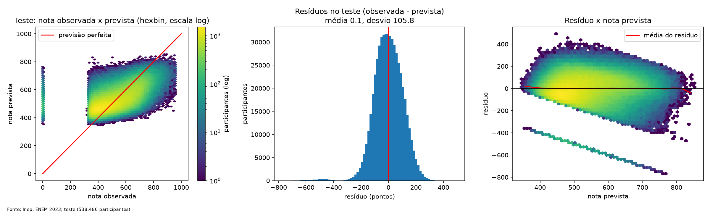

*Figura 37. Teste (538.486 participantes): nota observada × prevista pela solução final em células hexagonais (a reta vermelha é a previsão perfeita), histograma dos resíduos e resíduo × nota prevista. Fonte: Inep, ENEM 2023; teste.*

**14.3 Erro por faixa de nota** (tamanhos dos grupos no teste):

| Faixa | Participantes | Nota média | RMSE | MAE | Viés (real − previsto) |
| --- | --: | --: | --: | --: | --: |
| 0 | 3.338 | 0,0 | 515,0 | 510,4 | −510,4 |
| 1 a 400 | 84.129 | 369,2 | 121,8 | 108,6 | −108,5 |
| 400 a 500 | 148.789 | 449,5 | 78,8 | 60,8 | −49,8 |
| 500 a 600 | 131.742 | 548,7 | 67,1 | 54,8 | +18,6 |
| 600 a 700 | 108.434 | 647,5 | 100,3 | 84,6 | +74,2 |
| 700 a 800 | 50.811 | 738,8 | 133,9 | 117,3 | +115,5 |
| 800 ou mais | 11.243 | 844,1 | 183,7 | 171,0 | +171,0 |

O erro é mínimo perto da média (faixa 500 a 600: 67) e cresce nas pontas, com viés de sinal oposto: o modelo superestima as notas baixas e subestima as altas. As notas zero (0,62%) são previstas em cerca de 510 pontos acima do real e não têm como ser identificadas pelo perfil: eliminar ou faltar parte da prova não aparece no questionário socioeconômico.

**14.4 Erro por grupo de perfil e de localização** (grupos definidos no desenvolvimento):

| Grupo | Participantes | Nota média | RMSE | MAE | Viés |
| --- | --: | --: | --: | --: | --: |
| Região Norte | 57.603 | 487,9 | 97,9 | 75,2 | −0,6 |
| Região Nordeste | 199.339 | 511,6 | 103,5 | 80,8 | 0,0 |
| Região Centro-Oeste | 44.000 | 533,5 | 107,0 | 82,8 | −0,7 |
| Região Sudeste | 179.317 | 565,9 | 108,7 | 84,5 | +0,6 |
| Região Sul | 58.227 | 557,2 | 111,0 | 84,5 | −0,1 |
| Renda até 1 salário mínimo | 187.962 | 472,9 | 97,3 | 74,8 | −0,1 |
| Renda de 1 a 3 salários | 210.263 | 530,8 | 108,1 | 84,9 | +0,1 |
| Renda de 3 a 6 salários | 76.867 | 594,9 | 113,1 | 88,7 | +0,6 |
| Renda de 6 a 10 salários | 34.469 | 634,3 | 113,3 | 87,3 | +0,3 |
| Renda acima de 10 salários | 28.925 | 669,8 | 112,9 | 84,3 | −0,2 |
| Escola pública | 166.819 | 503,7 | 102,1 | 79,7 | −0,3 |
| Escola privada | 44.281 | 630,9 | 108,9 | 85,9 | +0,3 |
| Escola sem informação | 327.386 | 536,1 | 107,3 | 82,7 | +0,2 |
| Feminino | 330.626 | 516,9 | 101,2 | 78,3 | 0,0 |
| Masculino | 207.860 | 560,9 | 112,8 | 87,9 | +0,2 |

Salário mínimo de 2023: R$ 1.320. Por UF, o RMSE vai de 95,3 (AP) a 116,2 (SC); a tabela completa das 27 UF está em `resultados/tabelas/teste_erros_por_grupo.csv`.

*Leitura:* o viés médio de cada grupo de região, renda, escola e sexo é quase zero (menos de 1 ponto; por UF chega a 2,5, no Apêndice D.2), então o modelo não favorece nem prejudica sistematicamente nenhum grupo em média. O RMSE varia mais do que o viés: de 97 a 102 no Norte, na renda até 1 salário e na escola pública, a 111 a 113 no Sul, na renda acima de 3 salários e no sexo masculino. O R² dentro de cada faixa de renda é parecido (0,17 a 0,21), então o RMSE maior nos grupos de renda alta acompanha uma nota mais dispersa dentro do grupo, não um modelo pior para eles. Os grupos têm tamanhos muito diferentes (de 2.992 no Acre a 330.626 mulheres); a leitura vale para o grupo, não para a pessoa.

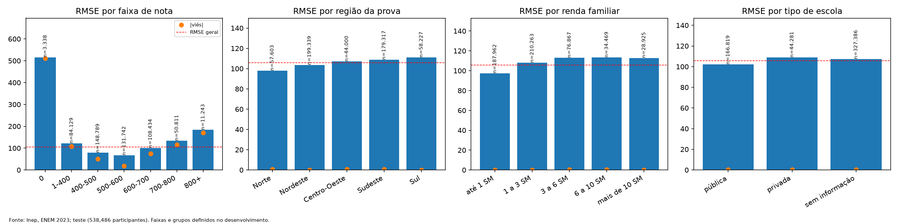

*Figura 38. Teste: RMSE por faixa de nota, região da prova, faixa de renda e tipo de escola, com o tamanho de cada grupo (n); laranja: valor absoluto do viés; linha vermelha: RMSE geral. Fonte: Inep, ENEM 2023; teste.*

## 15. Discussão, limitações e o que não funcionou

**15.1 Por que o R² fica em torno de 0,35.**

- As features descrevem o perfil (renda, escolaridade dos pais, bens, escola, UF, idade). O que mais pesa na nota de Matemática (horas de estudo, base escolar, qualidade do ensino, circunstâncias do dia da prova) não está nos dados. Pessoas com o mesmo perfil tiram notas muito diferentes.
- Famílias de modelos muito diferentes (linear, árvore, KNN, bagging, boosting) terminam num intervalo estreito (106 a 112 de RMSE) e as árvores só ganham 3 a 4 pontos sobre a regressão linear. A curva de aprendizado mostra treino e validação separados por só 1,1 ponto e quase sem ganho de 75% para 100% do treino. Tudo aponta para um limite de informação, não de algoritmo nem de volume de dados.
- A base de 2023 não traz o código da escola (só município e UF), então não dá para usar a nota média da escola, que seria um dos melhores preditores. As colunas da escola existem para cerca de 27% dos participantes.
- Usar as notas de outras áreas elevaria o R² de 0,34 para 0,68 (dataset 6, seção 8.5; presença e respostas não foram testadas), mas é vazamento e o enunciado proíbe. Prever pelo perfil é o objetivo.
- O erro maior nas pontas é regressão à média: o modelo não enxerga o que separa uma nota 800 de uma 600 com o mesmo perfil, e os zeros (quem faltou parte da prova ou foi eliminado) não têm relação com o questionário.

**15.2 O que funcionou e o que não funcionou** (RMSE de validação; negativo = melhora):

| Alavanca | Efeito no RMSE | Avaliação |
| --- | --- | --- |
| Modelos de árvores (Gradient Boosting) contra regressão linear | −3,4 (dataset 1) | Funcionou, maior ganho |
| UF da prova | −0,70 | Funcionou, pequeno |
| Situação escolar separada em vez de fundida | −0,33 | Funcionou, pequeno |
| Informação de escola | −0,4 a −0,5 | Funcionou, pequeno |
| `NAO_SEI` e nacionalidade | −0,2 a −0,4 | Pequeno |
| Busca de hiperparâmetros | −0,93 no bagging; −0,09 a −0,16 no Gradient Boosting | Ajudou só nos modelos de bagging |
| 3 features criadas | +0,01 | Sem efeito prático |
| Stacking contra Gradient Boosting | −0,007 | Não vale o custo (5 vezes mais tempo) |
| Treino sem as notas zero | −0,06 a +0,01 | Sem efeito mensurável |
| K-means como feature | +0,02 | Sem efeito |
| Seleção de atributos (`SelectKBest`) | +1,0 a +4,6 | Piora |
| PCA (Gradient Boosting, 5 a 25 componentes) | +2,4 a +5,4 | Piora |
| Balanceamento por ponderação | +2,1 (α = 0,5) e +17,4 (α = 1,0) | Piora o geral; melhora as notas acima de 800 |
| KNN e SVR linear | +0,4 e 0,0 contra a regressão linear | Lentos e sem ganho |

**15.3 Limitações e riscos.**

- **Associação não é causa.** Renda, idade ou escola privada estão associadas à nota; não determinam a capacidade de uma pessoa, e o modelo não serve para decidir sobre indivíduos (erro médio de 82 pontos).
- **A divisão avalia novos participantes da mesma edição**, não escolas ou municípios inéditos. A UF é a da prova e a escola é a do cadastro; nenhuma delas é residência.
- **Hiperparâmetros buscados no dataset 1** (30 colunas, antes da correção da fusão) e reaproveitados na representação final. O RMSE de uma busca é otimista (o melhor entre 10).
- **Colunas nominais** (cor/raça, estado civil) entram como números em escada; árvores toleram, a regressão linear não. Não testamos one-hot nelas.
- **Spearman não mede redundância entre colunas sem ordem**; faltou V de Cramér para esses pares.
- **Município** (cerca de 1.750 categorias) não entrou na solução final; era o maior sinal ainda não explorado. Testado depois no notebook 06 (Apêndice G.3), com target encoding dentro do Pipeline, melhorou 0,30 ponto na validação cruzada (0,13 sobre a solução final) e não foi adotado, porque o teste já havia sido aberto.
- **Uma só semente** (42) em tudo; o desvio entre dobras mede a variação por dobra, não por semente.
- Os arquivos `resultados/tabelas/busca_<modelo>.csv` são gravados com o mesmo nome pelo notebook otimizado e pelo notebook sem zeros; rodar um depois do outro sobrescreve o anterior.
- Os notebooks 02 e 03 usam o dataset 1 (com a fusão calculada em todas as linhas, efeito medido em 0,003 ponto de RMSE); só o notebook 04 está sem esse vazamento.

## 16. Reprodutibilidade, arquivos e mapa para o artigo e o pitch

**Ambiente.** Python 3.14.8, pandas 3.1.0, numpy 2.5.4, scipy 1.18.1, scikit-learn 1.9.1, matplotlib 3.11.2, em um computador com 10 núcleos e 16 GB; os estimadores usados rodam em CPU. Semente 42 em tudo que aceita `random_state`. Versões fixadas em `requirements.txt`.

**Ordem de execução** (notebooks, a partir da pasta `notebooks/`):

1. Obter `MICRODADOS_ENEM_2023.csv` no Inep e colocar em `dados/raw/DADOS/`.
2. `01-exploracao-filtro`: triagem, filtro dos participantes com nota, codificação, features criadas e os 8 datasets em `dados/processed/`.
3. `python src/particao.py` (opcional): confere que `dados/splits/` é igual à partição gerada com a semente 42.
4. `02-treino-modelos`: todos os regressores em configuração inicial e a comparação dos 8 datasets.
5. `02-treino-modelos-optimized`: `RandomizedSearchCV` (10 configurações).
6. `02-treino-modelos-sem-zeros-optimized`: treino sem as notas zero.
7. `03-reducao-dimensionalidade`: PCA, t-SNE e K-means.
8. `04-avaliacao-final`: fusão sem vazamento, UF, features criadas, seleção, balanceamento, blocos, solução final, curva de aprendizado e teste (cerca de 52 minutos). Opcional: notebook 05-diagnostico-notas-outras-areas (dataset 6, cerca de 5 minutos; fora da solução).

**Saídas.** `resultados/experimentos.csv` (uma linha por experimento: hipótese, features, preparação, modelo, parâmetros, conjunto avaliado, métricas por dobra, média, desvio, tempo e conclusão; as linhas `T_*` são do teste); `resultados/previsoes_teste.csv` (identificador, nota observada e previsões do baseline, da regressão linear e da solução final); `resultados/tabelas/` e `resultados/figuras/` (10 figuras do notebook 04); `models/*.joblib` (fora do git).

**Mapa para o artigo e o pitch.** O enunciado pede estas figuras e tabela no artigo e as mesmas evidências no pitch:

| Evidência exigida | Onde está neste documento | Arquivo |
| --- | --- | --- |
| Distribuição da nota com os zeros em destaque | Seção 2 | `distribuicao_nota_dev.png` |
| Modelos contra o baseline e os 3 melhores antes/depois da busca | Seções 6 e 7 | `comparacao_modelos.png` |
| Variância explicada do PCA, com o número de componentes e a justificativa | Seção 10 | `pca_variancia_e_rmse.png` |
| Curva de aprendizado do modelo final | Seção 13 | `curva_aprendizado.png` |
| Observada contra prevista no teste e resíduos | Seção 14 | `teste_real_previsto_residuos.png` |
| Erro por faixa de nota e por grupo, com tamanhos | Seção 14 | `teste_erros_por_faixa_e_grupo.png` |
| Tabela de RMSE, MAE, R² e tempo: CV (média e desvio) separada do teste | Seções 1 e 14 | `tabela_final_cv_e_teste.csv` |

O artigo foi escrito no padrão IEEE (duas colunas), com 10 páginas, 10 figuras e 9 tabelas, e inclui a replicação independente (dataset 5, subseção III-F) e o diagnóstico com as notas de outras áreas (dataset 6, subseção III-G, rotulado como fora da solução) e as extensões finais do notebook 06 (subseção III-H, Apêndice G). Os slides do pitch têm 26 slides, um gráfico por slide, com dois deles para esses dois conjuntos. Para o artigo, as seções 2 a 5 viram “Metodologia”, 6 a 14 viram “Resultados”, 15 vira “Discussão” e 1 vira “Resumo” e “Conclusão”. Os detalhes por modelo (seção 6), os espaços de busca (seção 7) e as tabelas completas por UF ficam no repositório.

**Equipe.** João Igor Vidal de Andrade, Raquel Albuquerque Quirino, Amanda Lira e Sofya Oliveira. Repositório: [github.com/Alyra004/ciencia-de-dados-unifor-projeto-2](https://github.com/Alyra004/ciencia-de-dados-unifor-projeto-2).

**Referências.** Inep, Microdados do ENEM 2023 e dicionário de variáveis (2024); Pedregosa et al., Scikit-learn: Machine learning in Python, JMLR 12 (2011); Friedman, Greedy function approximation: a gradient boosting machine, Annals of Statistics 29(5) (2001); Breiman, Bagging predictors, Machine Learning 24(2) (1996) e Random forests, Machine Learning 45(1) (2001); Wolpert, Stacked generalization, Neural Networks 5(2) (1992); Bergstra e Bengio, Random search for hyper-parameter optimization, JMLR 13 (2012); Hoerl e Kennard, Ridge regression, Technometrics 12(1) (1970); Jolliffe, Principal Component Analysis, 2ª ed. (Springer, 2002); Ke et al., LightGBM, NIPS (2017); van der Maaten e Hinton, Visualizing data using t-SNE, JMLR 9 (2008); Spearman, The proof and measurement of association between two things, American Journal of Psychology 15(1) (1904).

## 17. Apêndice A: figuras complementares

Todas as figuras dos notebooks que não aparecem no corpo do documento (as do corpo vão de 1 a 38). Elas estão numeradas de A1 a A45 e agrupadas pelo notebook de origem: 01 (exploração e Spearman), 02 (modelos em configuração inicial), 02 otimizado (modelos depois da busca) e 03 (PCA). Os gráficos de importância mostram quanto cada coluna pesa; os de “real × previsto” mostram 20 mil pessoas da validação (a reta verde é a previsão perfeita e as notas zero formam a coluna da esquerda).

### A.1 Notebook 01: exploração, Spearman e datasets 2 e 3

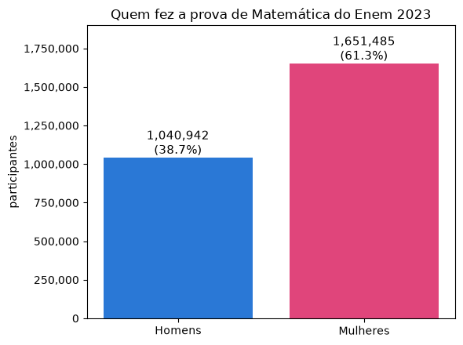

*Figura A1. Participantes por sexo (com nota de Matemática). Fonte: Inep, ENEM 2023.*

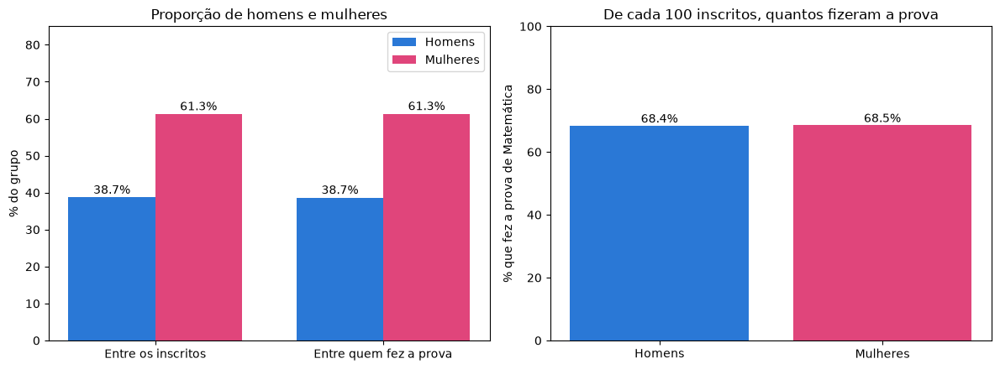

*Figura A2. Participantes por sexo entre todos os inscritos, inclusive quem não tem nota. Fonte: Inep, ENEM 2023.*

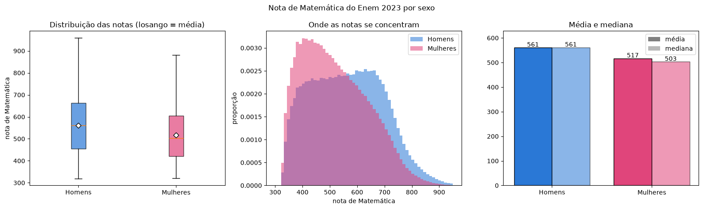

*Figura A3. Nota de Matemática por sexo. Fonte: Inep, ENEM 2023.*

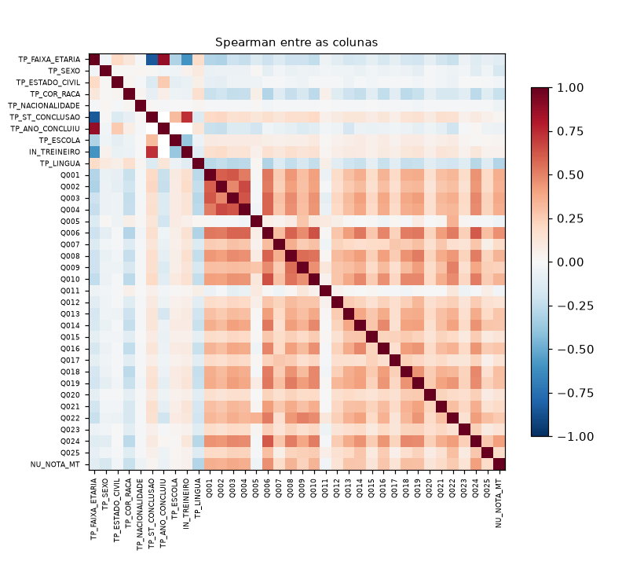

*Figura A4. Matriz de Spearman entre as colunas, antes da fusão. Fonte: Inep, ENEM 2023.*

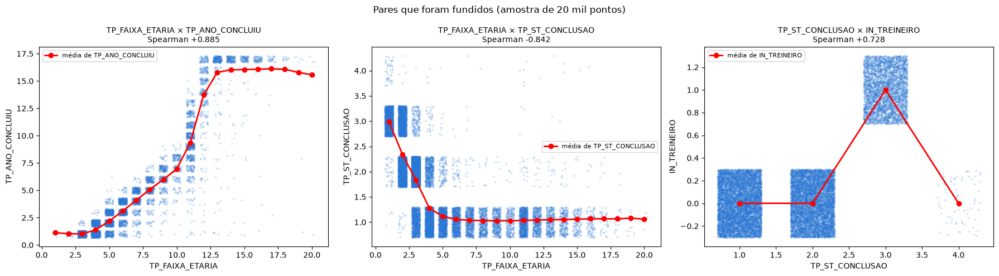

*Figura A5. Exemplos de pares de colunas com Spearman alto (candidatos à fusão). Fonte: Inep, ENEM 2023.*

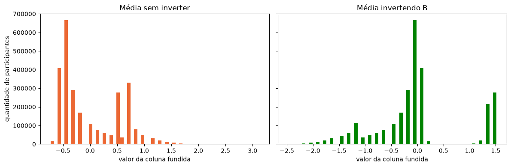

*Figura A6. Fusão de IN\_TREINEIRO e TP\_FAIXA\_ETARIA: média sem inverter o sinal contra média invertendo uma das colunas. Fonte: Inep, ENEM 2023.*

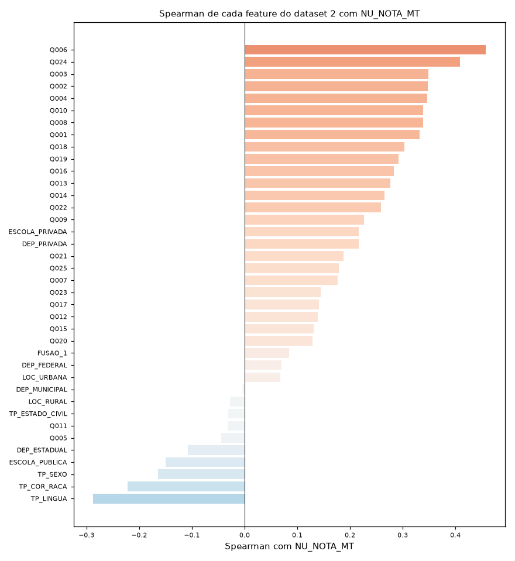

*Figura A7. Dataset 2 antes da retirada das quatro colunas DEP: Spearman de cada feature com a nota. Fonte: Inep, ENEM 2023.*

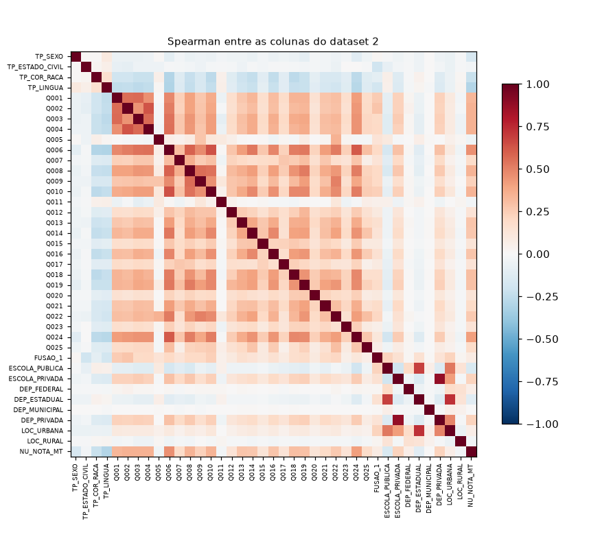

*Figura A8. Dataset 2 antes da retirada das quatro colunas DEP: matriz de Spearman. Fonte: Inep, ENEM 2023.*

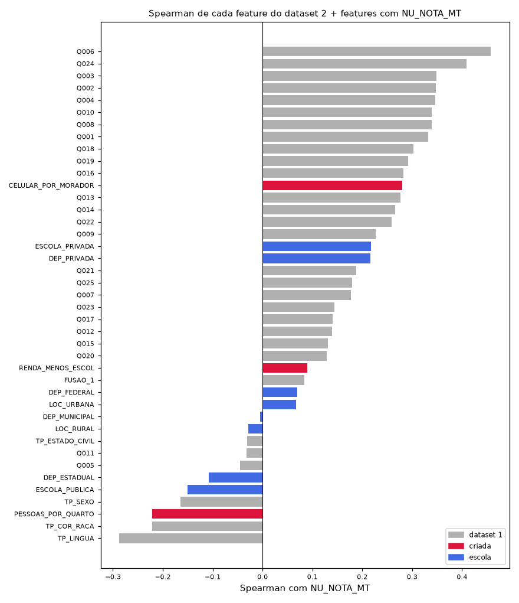

*Figura A9. Dataset 2 + features antes da retirada das quatro colunas DEP: Spearman com a nota. Fonte: Inep, ENEM 2023.*

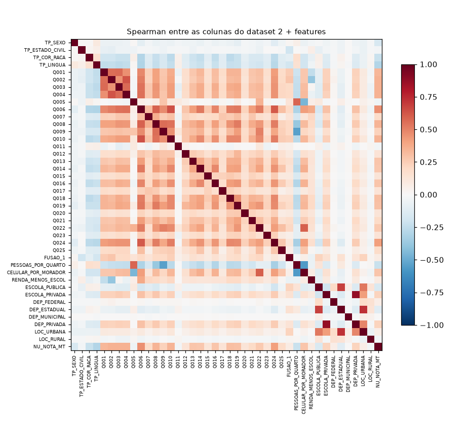

*Figura A10. Dataset 2 + features antes da retirada das quatro colunas DEP: matriz de Spearman. Fonte: Inep, ENEM 2023.*

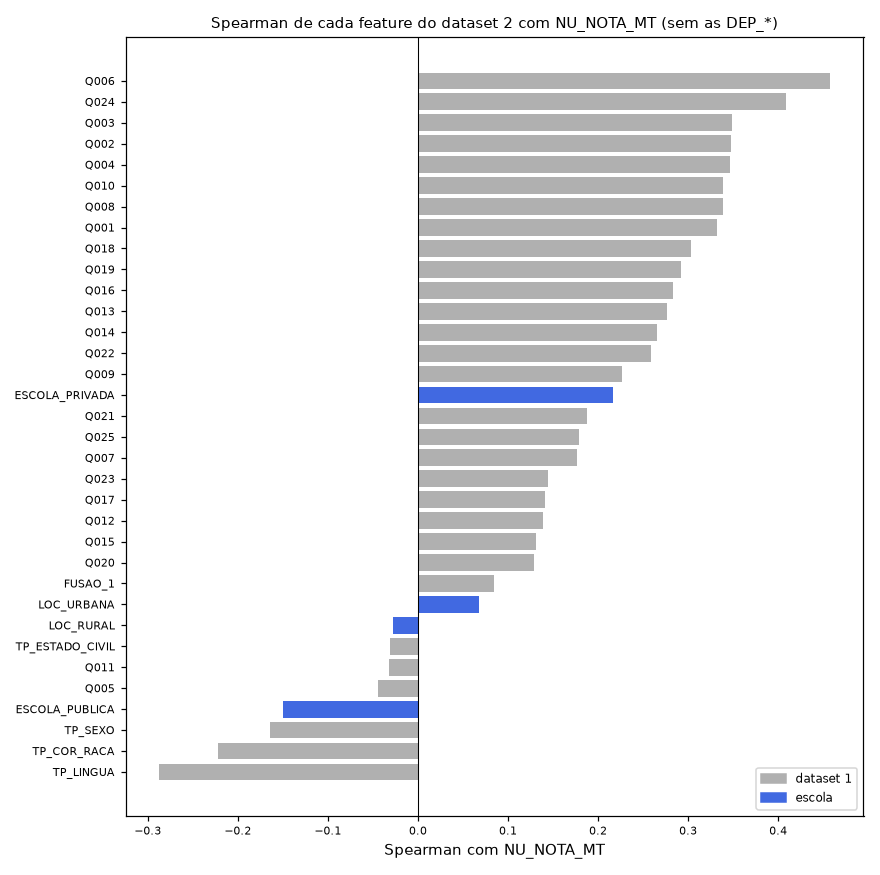

*Figura A11. Dataset 2 final (sem as colunas DEP): Spearman de cada feature com a nota. Fonte: Inep, ENEM 2023.*

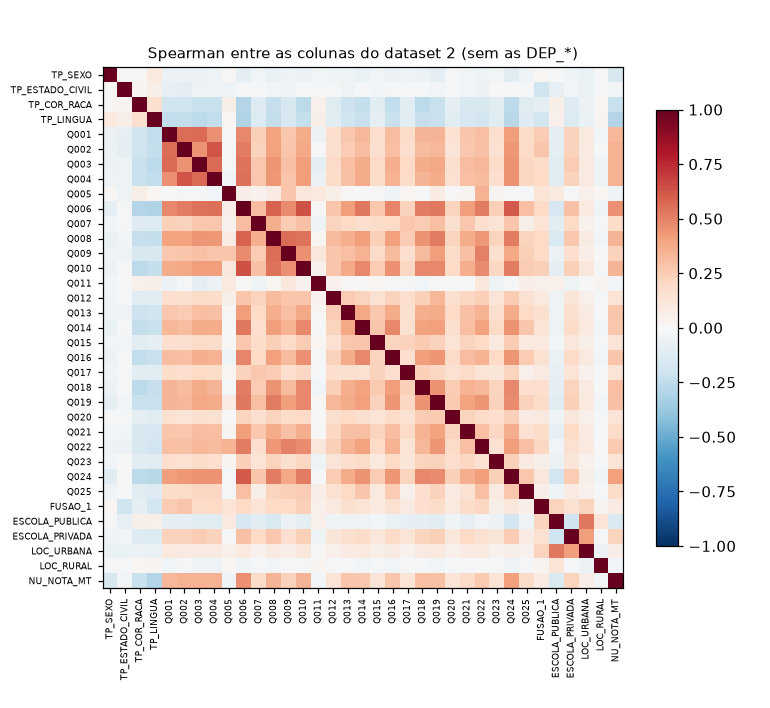

*Figura A12. Dataset 2 final: matriz de Spearman. Fonte: Inep, ENEM 2023.*


*Figura A13. Dataset 2 + features final: Spearman de cada feature com a nota. Fonte: Inep, ENEM 2023.*


*Figura A14. Dataset 2 + features final: matriz de Spearman. Fonte: Inep, ENEM 2023.*


*Figura A15. Dataset 3 (maior tabela): matriz de Spearman. Fonte: Inep, ENEM 2023.*

### A.2 Notebook 02: modelos em configuração inicial (gráficos que não estão no corpo)


*Figura A16. Árvore de decisão: nota real × nota prevista (faixas horizontais, uma por folha). Fonte: Inep, ENEM 2023.*


*Figura A17. KNN: nota real × nota prevista. Fonte: Inep, ENEM 2023.*


*Figura A18. SVR linear: nota real × nota prevista. Fonte: Inep, ENEM 2023.*


*Figura A19. Bagging: nota real × nota prevista. Fonte: Inep, ENEM 2023.*


*Figura A20. Pasting: importância por permutação. Fonte: Inep, ENEM 2023.*


*Figura A21. Pasting: nota real × nota prevista. Fonte: Inep, ENEM 2023.*


*Figura A22. Random Forest: importância nativa (soma = 1). Fonte: Inep, ENEM 2023.*


*Figura A23. Random Forest: importância por permutação. Fonte: Inep, ENEM 2023.*


*Figura A24. Random Forest: nota real × nota prevista. Fonte: Inep, ENEM 2023.*


*Figura A25. Stacking: importância por permutação. Fonte: Inep, ENEM 2023.*


*Figura A26. Stacking: nota real × nota prevista. Fonte: Inep, ENEM 2023.*

### A.3 Notebook 02 otimizado: modelos depois da busca de hiperparâmetros


*Figura A27. Ridge otimizado: peso de cada feature. Fonte: Inep, ENEM 2023.*


*Figura A28. Ridge otimizado: nota real × nota prevista. Fonte: Inep, ENEM 2023.*


*Figura A29. Árvore de decisão otimizada: importância de cada feature. Fonte: Inep, ENEM 2023.*


*Figura A30. Árvore de decisão otimizada: nota real × nota prevista. Fonte: Inep, ENEM 2023.*


*Figura A31. SVR linear otimizado: peso de cada feature. Fonte: Inep, ENEM 2023.*


*Figura A32. SVR linear otimizado: nota real × nota prevista. Fonte: Inep, ENEM 2023.*


*Figura A33. Bagging otimizado: importância por permutação. Fonte: Inep, ENEM 2023.*


*Figura A34. Bagging otimizado: nota real × nota prevista. Fonte: Inep, ENEM 2023.*


*Figura A35. Pasting otimizado: importância por permutação. Fonte: Inep, ENEM 2023.*


*Figura A36. Pasting otimizado: nota real × nota prevista. Fonte: Inep, ENEM 2023.*


*Figura A37. Random Forest otimizada: importância nativa. Fonte: Inep, ENEM 2023.*


*Figura A38. Random Forest otimizada: nota real × nota prevista. Fonte: Inep, ENEM 2023.*


*Figura A39. Gradient Boosting otimizado: importância por permutação. Fonte: Inep, ENEM 2023.*


*Figura A40. Gradient Boosting otimizado: nota real × nota prevista. Fonte: Inep, ENEM 2023.*


*Figura A41. RMSE por dataset: regressão linear e bagging otimizado (menor é melhor). Fonte: Inep, ENEM 2023.*

### A.4 Notebook 03: PCA


*Figura A42. PCA: variância explicada por cada componente e variância acumulada. Fonte: Inep, ENEM 2023.*


*Figura A43. PCA: cargas das 10 maiores features nos 3 primeiros componentes. Fonte: Inep, ENEM 2023.*


*Figura A44. PCA: as duas primeiras componentes (20 mil pessoas), coloridas pela nota. Fonte: Inep, ENEM 2023.*


*Figura A45. PCA: RMSE em função do número de componentes, regressão linear e Gradient Boosting (linha vermelha: sem PCA, com a faixa de 1 desvio). Fonte: Inep, ENEM 2023.*

## 18. Apêndice B: todos os experimentos registrados

Uma linha por experimento do arquivo `resultados/experimentos.csv` (82 linhas). Os que começam com `H_` (39 linhas) vêm dos notebooks 02 e 03; como esses notebooks só guardaram média e desvio, o **notebook 07 refez cada um com a mesma configuração** e gravou as três dobras (a média refeita difere da antiga em no máximo 0,0005 ponto de RMSE). `S1` a `S6` e `F_` são do notebook 04 com as três dobras; `E1` a `E6` (18 linhas) são das extensões finais do notebook 06 (Apêndice G); `T_` são do **teste final**, separados da validação cruzada e colocados por último. RMSE por dobra em pontos (dobra 1 / 2 / 3); MAE e R² são médias; tempo em segundos por dobra (nos testes, tempo de ajuste). Nas linhas `H_`, o tempo é o dos notebooks originais quando eles o registraram; o refazimento do notebook 07 rodou com a máquina menos carregada e foi mais rápido (por exemplo, o stacking levou 63 s por dobra, contra 630 s), e esse tempo fica na coluna de conclusão do CSV (onde o original não registrou o tempo, a tabela mostra o do notebook 07). O prefixo `H_dataset_` é fixo, então os ids de comparação de datasets repetem a palavra (`H_dataset_dataset_1_fundido_GB`). O arquivo CSV tem também hipótese, features, preparação, modelo, parâmetros e conclusão de cada linha.

| Experimento | Avaliado | RMSE (média ± desvio) | RMSE por dobra | MAE | R² | Tempo (s) |
| --- | --- | --: | --: | --: | --: | --: |
| H\_inicial\_Baseline | validação cruzada | 131,634 ± 0,158 | 131,52 / 131,57 / 131,81 | 107,58 | -0,000 | 0 |
| H\_inicial\_Regressão linear | validação cruzada | 111,153 ± 0,178 | 111,05 / 111,05 / 111,36 | 86,96 | 0,287 | 1 |
| H\_inicial\_Ridge | validação cruzada | 111,153 ± 0,178 | 111,05 / 111,05 / 111,36 | 86,96 | 0,287 | 0 |
| H\_inicial\_Árvore de decisão | validação cruzada | 110,551 ± 0,190 | 110,45 / 110,44 / 110,77 | 86,38 | 0,295 | 3 |
| H\_inicial\_KNN | validação cruzada | 111,575 ± 0,184 | 111,47 / 111,47 / 111,79 | 87,18 | 0,282 | 476 |
| H\_inicial\_SVR linear | validação cruzada | 111,153 ± 0,178 | 111,05 / 111,05 / 111,36 | 86,96 | 0,287 | 2 |
| H\_inicial\_Bagging | validação cruzada | 110,014 ± 0,207 | 109,92 / 109,87 / 110,25 | 85,99 | 0,302 | 24 |
| H\_inicial\_Pasting | validação cruzada | 110,012 ± 0,208 | 109,92 / 109,87 / 110,25 | 86,00 | 0,302 | 20 |
| H\_inicial\_Random Forest | validação cruzada | 109,422 ± 0,195 | 109,32 / 109,30 / 109,65 | 85,49 | 0,309 | 103 |
| H\_inicial\_Gradient Boosting | validação cruzada | 107,770 ± 0,226 | 107,71 / 107,58 / 108,02 | 83,82 | 0,330 | 133 |
| H\_inicial\_Stacking | validação cruzada | 107,763 ± 0,226 | 107,71 / 107,57 / 108,01 | 83,80 | 0,330 | 630 |
| H\_busca\_Gradient Boosting | validação cruzada | 107,680 ± 0,218 | 107,65 / 107,48 / 107,91 | 83,71 | 0,331 | 224 |
| H\_busca\_Bagging | validação cruzada | 109,083 ± 0,189 | 108,98 / 108,97 / 109,30 | 85,27 | 0,313 | 24 |
| H\_busca\_Random Forest | validação cruzada | 109,138 ± 0,194 | 109,03 / 109,02 / 109,36 | 85,24 | 0,313 | 19 |
| H\_dataset\_dataset\_1\_fundido\_GB | validação cruzada | 107,770 ± 0,226 | 107,71 / 107,58 / 108,02 | 83,82 | 0,330 | 18 |
| H\_dataset\_dataset\_1\_features\_GB | validação cruzada | 107,759 ± 0,239 | 107,71 / 107,55 / 108,02 | 83,81 | 0,330 | 19 |
| H\_dataset\_dataset\_2\_escola\_GB | validação cruzada | 107,261 ± 0,202 | 107,21 / 107,09 / 107,48 | 83,36 | 0,336 | 20 |
| H\_dataset\_dataset\_2\_features\_escola\_GB | validação cruzada | 107,255 ± 0,194 | 107,21 / 107,09 / 107,47 | 83,36 | 0,336 | 21 |
| H\_dataset\_dataset\_3\_sem\_escola\_GB | validação cruzada | 107,551 ± 0,211 | 107,49 / 107,38 / 107,79 | 83,61 | 0,332 | 20 |
| H\_dataset\_dataset\_3\_sem\_escola\_features\_GB | validação cruzada | 107,540 ± 0,223 | 107,48 / 107,35 / 107,79 | 83,60 | 0,333 | 22 |
| H\_dataset\_dataset\_3\_escola\_GB | validação cruzada | 107,056 ± 0,187 | 107,00 / 106,91 / 107,27 | 83,16 | 0,339 | 21 |
| H\_dataset\_dataset\_3\_escola\_features\_GB | validação cruzada | 107,048 ± 0,196 | 106,99 / 106,89 / 107,27 | 83,16 | 0,339 | 26 |
| H\_semzeros\_Regressão linear | validação cruzada | 111,202 ± 0,187 | 111,09 / 111,09 / 111,42 | 87,05 | 0,286 | 1 |
| H\_semzeros\_Ridge | validação cruzada | 111,202 ± 0,187 | 111,09 / 111,09 / 111,42 | 87,05 | 0,286 | 0 |
| H\_semzeros\_Árvore de decisão | validação cruzada | 110,331 ± 0,210 | 110,21 / 110,21 / 110,57 | 86,16 | 0,297 | 3 |
| H\_semzeros\_Gradient Boosting | validação cruzada | 107,737 ± 0,204 | 107,63 / 107,61 / 107,97 | 83,81 | 0,330 | 30 |
| H\_pca\_Regressão linear\_sem PCA | validação cruzada | 111,153 ± 0,178 | 111,05 / 111,05 / 111,36 | 86,96 | 0,287 | 1 |
| H\_pca\_Regressão linear\_5 | validação cruzada | 114,425 ± 0,174 | 114,30 / 114,36 / 114,62 | 90,05 | 0,244 | 0 |
| H\_pca\_Regressão linear\_10 | validação cruzada | 113,047 ± 0,190 | 112,90 / 112,98 / 113,26 | 88,66 | 0,262 | 0 |
| H\_pca\_Regressão linear\_15 | validação cruzada | 112,718 ± 0,184 | 112,60 / 112,63 / 112,93 | 88,40 | 0,267 | 0 |
| H\_pca\_Regressão linear\_20 | validação cruzada | 111,887 ± 0,177 | 111,78 / 111,79 / 112,09 | 87,67 | 0,278 | 1 |
| H\_pca\_Regressão linear\_25 | validação cruzada | 111,658 ± 0,181 | 111,54 / 111,56 / 111,87 | 87,47 | 0,280 | 1 |
| H\_pca\_Gradient Boosting\_sem PCA | validação cruzada | 107,770 ± 0,226 | 107,71 / 107,58 / 108,02 | 83,82 | 0,330 | 17 |
| H\_pca\_Gradient Boosting\_5 | validação cruzada | 113,210 ± 0,168 | 113,11 / 113,11 / 113,40 | 88,93 | 0,260 | 3 |
| H\_pca\_Gradient Boosting\_10 | validação cruzada | 111,551 ± 0,152 | 111,46 / 111,46 / 111,73 | 87,33 | 0,282 | 6 |
| H\_pca\_Gradient Boosting\_15 | validação cruzada | 111,148 ± 0,181 | 111,03 / 111,06 / 111,36 | 86,98 | 0,287 | 9 |
| H\_pca\_Gradient Boosting\_20 | validação cruzada | 110,432 ± 0,172 | 110,36 / 110,30 / 110,63 | 86,32 | 0,296 | 9 |
| H\_pca\_Gradient Boosting\_25 | validação cruzada | 110,165 ± 0,183 | 110,05 / 110,07 / 110,38 | 86,06 | 0,300 | 10 |
| H\_kmeans\_Gradient Boosting | validação cruzada | 107,789 ± 0,232 | 107,74 / 107,58 / 108,04 | 83,84 | 0,329 | 73 |
| S1a\_fusao\_no\_treino | validação cruzada | 107,051 ± 0,192 | 106,99 / 106,90 / 107,27 | 83,16 | 0,339 | 25 |
| S1b\_colunas\_separadas | validação cruzada | 106,726 ± 0,189 | 106,64 / 106,60 / 106,94 | 82,84 | 0,343 | 27 |
| S2\_com\_uf | validação cruzada | 106,025 ± 0,188 | 105,95 / 105,89 / 106,24 | 82,20 | 0,351 | 40 |
| S3\_sem\_features\_criadas | validação cruzada | 106,038 ± 0,167 | 105,95 / 105,94 / 106,23 | 82,21 | 0,351 | 38 |
| S4\_gb\_k22 | validação cruzada | 110,607 ± 0,191 | 110,49 / 110,51 / 110,83 | 86,36 | 0,294 | 14 |
| S4\_gb\_k37 | validação cruzada | 107,436 ± 0,208 | 107,30 / 107,34 / 107,68 | 83,45 | 0,334 | 24 |
| S4\_gb\_k51 | validação cruzada | 107,069 ± 0,199 | 106,95 / 106,96 / 107,30 | 83,11 | 0,338 | 30 |
| S4\_linear\_todas | validação cruzada | 108,868 ± 0,162 | 108,78 / 108,77 / 109,06 | 84,86 | 0,316 | 2 |
| S4\_linear\_k22 | validação cruzada | 112,251 ± 0,165 | 112,14 / 112,17 / 112,44 | 88,01 | 0,273 | 1 |
| S4\_linear\_k37 | validação cruzada | 110,526 ± 0,198 | 110,38 / 110,45 / 110,75 | 86,26 | 0,295 | 1 |
| S4\_linear\_k51 | validação cruzada | 110,198 ± 0,196 | 110,06 / 110,12 / 110,42 | 85,95 | 0,299 | 1 |
| S5\_peso\_alfa\_0.5 | validação cruzada | 108,140 ± 0,188 | 108,07 / 108,00 / 108,35 | 82,82 | 0,325 | 40 |
| S5\_peso\_alfa\_1.0 | validação cruzada | 123,459 ± 0,149 | 123,43 / 123,33 / 123,62 | 94,83 | 0,120 | 24 |
| S6\_sem\_renda | validação cruzada | 106,893 ± 0,194 | 106,79 / 106,77 / 107,12 | 83,03 | 0,341 | 44 |
| S6\_sem\_escolaridade | validação cruzada | 106,559 ± 0,168 | 106,50 / 106,43 / 106,75 | 82,71 | 0,345 | 46 |
| S6\_sem\_bens | validação cruzada | 107,356 ± 0,174 | 107,29 / 107,22 / 107,55 | 83,39 | 0,335 | 33 |
| S6\_sem\_escola | validação cruzada | 106,439 ± 0,185 | 106,37 / 106,30 / 106,65 | 82,56 | 0,346 | 47 |
| S6\_sem\_localização | validação cruzada | 106,726 ± 0,189 | 106,64 / 106,60 / 106,94 | 82,84 | 0,343 | 33 |
| S6\_sem\_perfil | validação cruzada | 110,445 ± 0,189 | 110,35 / 110,32 / 110,66 | 86,24 | 0,296 | 35 |
| F\_baseline\_cv | validação cruzada | 131,634 ± 0,158 | 131,52 / 131,57 / 131,81 | 107,58 | -0,000 | 0 |
| F\_regressao\_linear\_cv | validação cruzada | 108,868 ± 0,162 | 108,78 / 108,77 / 109,06 | 84,86 | 0,316 | 3 |
| F\_final\_cv | validação cruzada | 105,864 ± 0,169 | 105,80 / 105,74 / 106,06 | 82,02 | 0,353 | 91 |
| E1\_linear\_A\_numeros | validação cruzada | 108,868 ± 0,162 | 108,78 / 108,77 / 109,06 | 84,86 | 0,316 | 1 |
| E1\_ridge\_A\_numeros | validação cruzada | 108,868 ± 0,162 | 108,78 / 108,77 / 109,06 | 84,86 | 0,316 | 1 |
| E1\_linear\_B\_onehot\_nominais | validação cruzada | 108,629 ± 0,163 | 108,54 / 108,53 / 108,82 | 84,66 | 0,319 | 2 |
| E1\_ridge\_B\_onehot\_nominais | validação cruzada | 108,630 ± 0,163 | 108,54 / 108,53 / 108,82 | 84,66 | 0,319 | 1 |
| E1\_linear\_C\_onehot\_todas | validação cruzada | 107,888 ± 0,178 | 107,79 / 107,78 / 108,09 | 83,95 | 0,328 | 5 |
| E1\_ridge\_C\_onehot\_todas | validação cruzada | 107,891 ± 0,179 | 107,79 / 107,78 / 108,10 | 83,96 | 0,328 | 6 |
| E3\_com\_municipio\_TE | validação cruzada | 105,730 ± 0,171 | 105,65 / 105,61 / 105,93 | 81,92 | 0,355 | 25 |
| E3\_sem\_municipio | validação cruzada | 106,025 ± 0,188 | 105,95 / 105,89 / 106,24 | 82,20 | 0,351 | 27 |
| E4\_semente\_0 | validação cruzada | 105,862 ± 0,182 | 105,80 / 105,72 / 106,07 | 82,02 | 0,353 | 60 |
| E4\_semente\_1 | validação cruzada | 105,871 ± 0,192 | 105,78 / 105,74 / 106,09 | 82,03 | 0,353 | 55 |
| E4\_semente\_2 | validação cruzada | 105,868 ± 0,184 | 105,79 / 105,74 / 106,08 | 82,03 | 0,353 | 61 |
| E5\_gb\_busca | validação cruzada | 105,859 ± 0,181 | 105,79 / 105,72 / 106,06 | 82,02 | 0,353 | 66 |
| E5\_bagging\_busca | validação cruzada | 107,878 ± 0,172 | 107,80 / 107,76 / 108,08 | 84,22 | 0,328 | 41 |
| E5\_rf\_busca | validação cruzada | 107,919 ± 0,192 | 107,83 / 107,79 / 108,14 | 84,18 | 0,328 | 39 |
| E6\_dataset5\_regressao\_linear | validação cruzada | 111,287 ± 2,393 | 113,65 / 111,35 / 108,87 | 84,20 | 0,285 | 39 |
| E6\_dataset5\_ridge | validação cruzada | 107,508 ± 0,197 | 107,41 / 107,38 / 107,73 | 83,60 | 0,333 | 15 |
| E6\_dataset5\_svr\_linear | validação cruzada | 107,903 ± 0,206 | 107,80 / 107,77 / 108,14 | 83,30 | 0,328 | 18 |
| E6\_dataset5\_gradient\_boosting | validação cruzada | 107,992 ± 0,210 | 107,91 / 107,84 / 108,23 | 84,35 | 0,327 | 7 |
| T\_baseline | teste | 131,703 | — | 107,64 | -0,000 | 0 |
| T\_regressao\_linear | teste | 108,863 | — | 84,89 | 0,317 | 4 |
| T\_final | teste | 105,815 | — | 82,00 | 0,354 | 165 |

Os experimentos do dataset 6 (diagnóstico com as notas de outras áreas) ficam em arquivos separados, de propósito, para não se misturarem com os da solução: `resultados/tabelas/diagnostico_dataset6_notas_outras_areas.csv`, `diagnostico_dataset6_sem_zeros.csv` e os dois arquivos de Spearman.

## 19. Apêndice C: colunas usadas, criadas e removidas

A solução final tem **74 colunas**: as 44 do `dataset_3_escola_features` sem a `FUSAO_1`, as 4 colunas de situação escolar separadas e 26 de UF da prova.

| Coluna(s) | Situação | Justificativa |
| --- | --- | --- |
| `NU_NOTA_MT` | Alvo (y) | Nota de Matemática; só participantes com nota observada |
| `TP_SEXO`, `TP_ESTADO_CIVIL`, `TP_COR_RACA`, `TP_LINGUA` | Usadas | Perfil demográfico; as nominais entram como número em escada (limitação para modelos lineares) |
| `Q001` a `Q025` | Usadas | Questionário socioeconômico; “não sei” de `Q001` a `Q004` preenchido com a mediana |
| `IN_TREINEIRO`, `TP_ANO_CONCLUIU`, `TP_FAIXA_ETARIA`, `TP_ST_CONCLUSAO` | Fundidas na `FUSAO_1` nos datasets 1 a 3; **separadas** na solução final | Spearman acima de 0,7 entre si (redundantes), mas desdobrar melhora o erro (−0,33); a fusão refeita só com o treino foi comparada no notebook 04 |
| `PESSOAS_POR_QUARTO`, `CELULAR_POR_MORADOR`, `RENDA_MENOS_ESCOL` | Criadas | Hipóteses na seção 5.1; sem efeito mensurável no erro |
| `ESCOLA_PUBLICA`, `ESCOLA_PRIVADA`, `LOC_URBANA`, `LOC_RURAL` | Datasets 2 em diante e solução | `TP_ESCOLA` e `TP_LOCALIZACAO_ESC` em 0/1; vazio = “sem informação” (referência) |
| `Q001_NAO_SEI` a `Q004_NAO_SEI`, `NAC_NAO_INFORMADO`, `NAC_NATURALIZADO`, `NAC_ESTRANGEIRO`, `NAC_NATO_EXTERIOR` | Dataset 3 e solução | Desproporcionais, mas com sinal (`NAO_SEI`: −40 a −50 pontos) |
| `SG_UF_PROVA` (26 colunas `UF_*`, referência SP) | Solução final (notebook 04) | Melhora o erro (−0,70); UF da prova, não residência; fora dos datasets 1 a 3 |
| `FUSAO_1` | Datasets 1 a 3 (não está na solução final) | Média de z-scores das 4 colunas de trajetória; média e desvio com todas as linhas nos datasets salvos; refeita só com o treino no notebook 04 |
| `DEP_FEDERAL`, `DEP_ESTADUAL`, `DEP_MUNICIPAL`, `DEP_PRIVADA` | Removidas | Redundantes com `ESCOLA_*` e `LOC_*` (0,88 e 0,73); `DEP_MUNICIPAL` tem 0,2% das linhas |
| `CO_MUNICIPIO_ESC`, `NO_MUNICIPIO_ESC`, `CO_UF_ESC`, `SG_UF_ESC`, `TP_SIT_FUNC_ESC`, `TP_ENSINO` | Removidas (usadas só no dataset 5) | 66% a 76% de ausentes, alta cardinalidade ou categorias muito raras |
| `CO_MUNICIPIO_PROVA`, `NO_MUNICIPIO_PROVA`, `CO_UF_PROVA` | Removidas (por ora) | O município (cerca de 1.750 categorias) só entraria com codificação supervisionada dentro do Pipeline |
| `NU_NOTA_CN`, `NU_NOTA_CH`, `NU_NOTA_LC`, `NU_NOTA_REDACAO` | **Proibidas** na solução; usadas só no dataset 6 (diagnóstico) | Vazamento: descrevem a própria prova |
| `NU_NOTA_COMP1` a `NU_NOTA_COMP5`, `TP_PRESENCA_*`, `CO_PROVA_*`, `TX_RESPOSTAS_*`, `TX_GABARITO_*`, `TP_STATUS_REDACAO`, `NU_ANO` | **Proibidas** | Vazamento: resultados ou informações da própria prova |
| `NU_INSCRICAO` | Identificador | Guardado à parte em `ids_elegiveis.csv`; não é entrada do modelo |

## 20. Apêndice D: tabelas completas do teste e da curva de aprendizado

**D.1 Curva de aprendizado por dobra** (`resultados/tabelas/curva_aprendizado.csv`). Subconjuntos progressivos do treino de cada dobra, semente 42, pipeline reajustado a cada tamanho.

| Dobra | % do treino | Linhas de treino | RMSE de treino | RMSE de validação | Tempo (s) |
| --- | --: | --: | --: | --: | --: |
| 1 | 10% | 143.596 | 102,91 | 106,59 | 14 |
| 1 | 25% | 358.990 | 103,59 | 106,18 | 31 |
| 1 | 50% | 717.980 | 104,05 | 105,93 | 75 |
| 1 | 75% | 1.076.970 | 104,83 | 105,88 | 83 |
| 1 | 100% | 1.435.960 | 104,72 | 105,78 | 140 |
| 2 | 10% | 143.596 | 102,13 | 106,56 | 18 |
| 2 | 25% | 358.990 | 103,56 | 106,10 | 36 |
| 2 | 50% | 717.980 | 104,21 | 105,89 | 73 |
| 2 | 75% | 1.076.971 | 104,57 | 105,79 | 108 |
| 2 | 100% | 1.435.961 | 104,70 | 105,71 | 143 |
| 3 | 10% | 143.596 | 102,80 | 106,88 | 14 |
| 3 | 25% | 358.990 | 103,95 | 106,46 | 29 |
| 3 | 50% | 717.980 | 104,32 | 106,23 | 62 |
| 3 | 75% | 1.076.971 | 104,42 | 106,13 | 95 |
| 3 | 100% | 1.435.961 | 104,88 | 106,10 | 102 |

**D.2 Erro no teste por UF da prova** (ordenado pelo RMSE; `resultados/tabelas/teste_erros_por_grupo.csv`). O viés é nota real menos prevista; por UF ele chega a −2,5 pontos (MT) e +2,1 (ES), maior que nos outros grupos.

| UF | Participantes | Nota média | RMSE | MAE | Viés |
| --- | --: | --: | --: | --: | --: |
| AP | 3.642 | 481,0 | 95,3 | 73,5 | -1,9 |
| AM | 9.946 | 483,4 | 96,5 | 73,4 | -1,4 |
| AC | 2.992 | 490,5 | 97,4 | 74,8 | 0,7 |
| PA | 30.824 | 483,9 | 97,8 | 74,7 | -0,5 |
| MA | 22.560 | 483,4 | 98,1 | 75,8 | 0,2 |
| TO | 4.368 | 504,3 | 99,2 | 78,4 | -1,6 |
| RR | 1.225 | 520,7 | 99,7 | 78,3 | 1,6 |
| BA | 44.474 | 505,8 | 100,6 | 78,4 | -0,3 |
| RO | 4.606 | 504,1 | 101,7 | 79,8 | 0,9 |
| RN | 14.581 | 525,0 | 103,1 | 80,5 | 0,2 |
| SE | 9.520 | 511,2 | 103,5 | 80,4 | 1,6 |
| PI | 14.196 | 502,9 | 103,7 | 81,4 | -0,3 |
| AL | 11.100 | 506,3 | 104,0 | 80,8 | -0,9 |
| MS | 6.356 | 528,5 | 104,1 | 81,8 | -0,3 |
| PB | 17.300 | 512,7 | 105,2 | 81,3 | -1,6 |
| PE | 30.562 | 527,8 | 105,7 | 83,5 | 1,8 |
| GO | 19.133 | 532,2 | 106,3 | 83,0 | -0,1 |
| SP | 82.185 | 572,1 | 106,4 | 83,5 | 0,6 |
| RS | 22.179 | 558,8 | 106,8 | 82,4 | 0,4 |
| CE | 35.046 | 521,9 | 107,7 | 84,6 | -0,5 |
| DF | 10.051 | 555,7 | 107,7 | 82,2 | -0,6 |
| MT | 8.460 | 513,7 | 109,9 | 83,9 | -2,5 |
| ES | 10.064 | 557,4 | 109,9 | 85,0 | 2,1 |
| RJ | 36.876 | 553,4 | 110,5 | 84,7 | 1,9 |
| MG | 50.192 | 566,7 | 111,0 | 85,9 | -0,6 |
| PR | 23.253 | 553,4 | 112,1 | 85,9 | -0,1 |
| SC | 12.795 | 561,4 | 116,2 | 85,6 | -1,0 |

## 21. Apêndice E: o que está feito e o que falta

**Feito e rodado:** protocolo e partição; exploração e 8 datasets; todos os regressores obrigatórios em configuração inicial; busca de hiperparâmetros em 7 modelos; PCA em dois regressores, t-SNE e K-means; treino sem zeros; as 13 variações do notebook 04 (fusão sem vazamento, UF, features criadas, seleção, balanceamento, blocos); solução final; curva de aprendizado; teste final aberto uma vez; dataset 5 (métricas de teste da solução independente); dataset 6 (diagnóstico); as extensões finais do notebook 06 (one-hot, V de Cramér, município com target encoding, três sementes, busca na representação final e dataset 5 por validação cruzada, Apêndice G); as métricas por dobra das 39 linhas históricas (notebook 07, Apêndice B); as correções dos notebooks 02 (KNN no fim, seção 12 robusta e busca do notebook sem zeros com nome próprio); artigo, pitch, README e este documento; commits na branch `do-zero`.

**Pendente ou em aberto** (nada disto bloqueia a entrega):

1. **Município com target encoding:** melhorou 0,30 ponto na validação cruzada (0,13 sobre a solução final), mas **não foi adotado** porque o teste já foi aberto. Fica como próximo passo; adotá-lo agora exigiria reabrir o teste, o que desfaz o protocolo.
2. **Stacking e KNN** nunca passaram por busca de hiperparâmetros (custo); nenhum dos dois ganhou do Gradient Boosting na configuração inicial.
3. **Corte de 400 s nos notebooks 02:** o pedido era 120 s; não foi aplicado de propósito, porque mudaria o modelo escolhido (Gradient Boosting) e os resultados documentados.
4. **Entrega:** push para o GitHub, abrir este documento no Word para checar o layout, ensaiar o pitch (todos precisam dominar as decisões) e conferir o nome da universidade e da equipe no artigo.

## 22. Apêndice F: o artigo e o pitch

**Artigo** (`docs/artigo.pdf`): padrão IEEE em duas colunas, 10 páginas (limite de 10), 10 figuras e 9 tabelas, 12 referências, com os e-mails e a instituição (UNIFOR) na primeira página; a mesma versão em LaTeX está em docs/artigo.tex. Estrutura: resumo e abstract; I Introdução; II Metodologia (A dados e protocolo, B features e preparação, C modelos, PCA, seleção, balanceamento e busca, D curva de aprendizado e métodos novos, E conjuntos de entrada e verificações adicionais); III Resultados (A distribuição da nota e comparação inicial, B PCA, C hipóteses, D solução final e curva, E teste final, F dataset 5, G dataset 6); IV Discussão; V Conclusão; Referências. O dataset 6 aparece sempre rotulado como diagnóstico fora da solução.

**Pitch** (`docs/pitch.pdf`): 26 slides, para 10 a 15 minutos, com visual limpo, a mensagem principal logo abaixo do título e diagramas que mostram o caminho dos dados: o funil das linhas (do Inep às dobras), o protocolo das dobras, o funil das colunas (de 76 a 74), a árvore dos 8 datasets com o RMSE de cada um, a matriz das 21 combinações e a cascata do que reduziu o erro.

| Slide | Conteúdo | Quem apresenta |
| --: | --- | --- |
| 1 | Capa | Raquel |
| 2 | A pergunta | Raquel |
| 3 | Do Inep às dobras de validação (funil das linhas) | Raquel |
| 4 | Validação cruzada sem vazamento (diagrama das dobras e do Pipeline) | Amanda |
| 5 | A nota de Matemática | Amanda |
| 6 | Como escolhemos as colunas (funil de 76 a 74) | Amanda |
| 7 | Decisões de preparação | Amanda |
| 8 | Três features criadas, cada uma com uma hipótese | Sofya |
| 9 | Os 8 datasets e a representação final (árvore) | Amanda |
| 10 | As 21 combinações testadas (matriz) | Sofya |
| 11 | Dez regressores na configuração inicial | João Igor |
| 12 | Busca de hiperparâmetros | João Igor |
| 13 | PCA | Sofya |
| 14 | O que reduziu o erro, passo a passo (cascata) | Sofya |
| 15 | Quanto vale cada bloco de informação | Sofya |
| 16 | Balanceamento por pesos | João Igor |
| 17 | A solução final | João Igor |
| 18 | Curva de aprendizado | João Igor |
| 19 | Teste: observada contra prevista | Raquel |
| 20 | Onde o modelo erra mais | Raquel |
| 21 | Erros por região, renda e escola | Raquel |
| 22 | Replicação independente (dataset 5) | João Igor |
| 23 | Diagnóstico com as notas de outras áreas (dataset 6) | Sofya |
| 24 | Extensões depois do teste | Amanda |
| 25 | As perguntas que fizemos e as respostas | Sofya |
| 26 | O que aprendemos | Raquel |

Raquel apresenta 7 slides (com a capa), Sofya 7 e Amanda e João Igor 6 cada. Os gráficos são gerados por `src/figuras_pitch_graficos.py`; os diagramas são desenhados no próprio script dos slides.

## 23. Apêndice G: extensões finais (notebook 06)

Este apêndice fecha as pendências do Apêndice E. Tudo foi rodado **só com validação cruzada no desenvolvimento** (as mesmas 3 dobras, semente 42). O teste já tinha sido aberto uma vez no notebook 04, então **nada daqui altera a solução final**: são hipóteses extras, medidas e registradas no `experimentos.csv` (linhas `E1_*` a `E6_*`). As notas das outras áreas (dataset 6) não entram em nenhum destes experimentos.

### G.1 One-hot nas categóricas, em modelos lineares (E1)

**Hipótese:** nas colunas sem ordem (cor/raça, estado civil), tratar o código como número obriga o modelo linear a supor uma ordem que não existe; o one-hot deve ajudar, com efeito esperado de cerca de 1 ponto, como sugeria a solução independente (dataset 5). Três versões das mesmas 74 colunas, com regressão linear e Ridge (alfa 10); `OneHotEncoder(min_frequency=50)` dentro do Pipeline.

| Versão | Regressão linear (RMSE médio ± desvio) | Ridge | R² | Ganho sobre A |
| --- | --- | --- | --- | --- |
| A. Tudo como número | 108,868 ± 0,162 | 108,868 | 0,316 | — |
| B. One-hot só em cor/raça e estado civil | 108,629 ± 0,163 | 108,630 | 0,319 | −0,24 |
| C. One-hot em todas as categóricas (faixa etária, situação, ano de conclusão, Q001 a Q025 e as nominais) | 107,888 ± 0,178 | 107,891 | 0,328 | −0,98 |

**Resultado:** a hipótese se confirma. O ganho das duas nominais sozinhas é pequeno (0,24, dentro de 1,5 desvio entre dobras); o ganho de cerca de 1 ponto vem de abrir **todas** as categóricas (C). Ridge e regressão linear dão o mesmo resultado, pois com mais de 1 milhão de linhas de treino a regularização quase não pesa. Mesmo no melhor caso, o modelo linear (107,89) fica a 2 pontos do Gradient Boosting final (105,86): a não linearidade explica o resto.

### G.2 V de Cramér entre colunas sem ordem (E2)

O V de Cramér mede a associação entre duas colunas categóricas (0 = nenhuma, 1 = uma determina a outra). Foi calculado para os pares entre as 9 colunas sem ordem (sexo, estado civil, cor/raça, língua, situação de conclusão, tipo e localização da escola, nacionalidade e UF da prova), numa amostra de 400 mil pessoas do desenvolvimento. O limite de redundância é o mesmo dos outros datasets (0,7).


*Figura G1. V de Cramér entre as colunas categóricas. Fonte: Inep, ENEM 2023.*

| Par | V de Cramér |
| --- | --- |
| Situação de conclusão × tipo de escola | 0,707 |
| Tipo de escola × localização da escola | 0,546 |
| Situação de conclusão × localização da escola | 0,534 |
| Língua estrangeira × UF da prova | 0,249 |
| Cor/raça × língua estrangeira | 0,178 |

**Resultado:** a redundância se concentra no trio **situação de conclusão, tipo e localização da escola**; só o par situação × tipo de escola passa do limite de 0,7 (0,707). É o mesmo grupo que a fusão `FUSAO_1` do notebook 04 já tratava. Todos os demais pares ficam abaixo de 0,25, então não há outro grupo de colunas nominais para fundir. Tabelas completas: `resultados/tabelas/e2_cramer_v_matriz.csv` e `e2_cramer_v_pares.csv`.

### G.3 Município com target encoding (E3)

**Hipótese:** o município da prova é o maior sinal ainda não usado; codificá-lo pela nota média (aprendida só no treino de cada dobra, com `TargetEncoder(cv=KFold(5))` dentro do Pipeline) deve reduzir o erro. Comparação com o mesmo modelo sem o município (`S2_com_uf`, 74 colunas).

| Experimento | Colunas | RMSE por dobra | RMSE médio ± desvio | MAE | R² |
| --- | --- | --- | --- | --- | --- |
| Sem município (`E3_sem_municipio`) | 74 | 105,949 / 105,887 / 106,239 | 106,025 ± 0,188 | 82,196 | 0,351 |
| Com município (`E3_com_municipio_TE`) | 75 | 105,651 / 105,612 / 105,926 | 105,730 ± 0,171 | 81,916 | 0,355 |

**Resultado:** ganho de **0,295 ponto de RMSE**, em todas as 3 dobras, e maior que o desvio entre dobras (0,19): o município ajuda de forma pequena mas consistente. Contra a solução final (105,864, com hiperparâmetros buscados), o ganho cai para 0,13, dentro do desvio. **Não foi adotado**: o teste já foi aberto, e trocar a solução depois de olhar o teste desfaria o protocolo. Fica como o melhor próximo passo.

### G.4 Mais de uma semente (E4)

A solução final (semente 42) foi treinada de novo com as sementes 0, 1 e 2.

| Semente | RMSE médio ± desvio | R² |
| --- | --- | --- |
| 42 (`F_final_cv`) | 105,864 ± 0,169 | 0,353 |
| 0 | 105,862 ± 0,182 | 0,353 |
| 1 | 105,871 ± 0,192 | 0,353 |
| 2 | 105,868 ± 0,184 | 0,353 |

**Resultado:** as quatro sementes diferem em **0,009 ponto** (de 105,862 a 105,871), cerca de 20 vezes menos que o desvio entre dobras (0,17). A semente não explica nenhuma diferença que tenhamos medido neste trabalho.

### G.5 Busca de hiperparâmetros na representação final (E5)

A busca original foi feita no dataset de 30 colunas. Aqui, `RandomizedSearchCV` (10 sorteios, `refit=False`, mesmas dobras) nas 74 colunas finais, para os 3 melhores modelos. Não substitui a solução final.

| Modelo | RMSE médio ± desvio | MAE | R² |
| --- | --- | --- | --- |
| Gradient Boosting (`E5_gb_busca`) | 105,859 ± 0,181 | 82,018 | 0,353 |
| Bagging (`E5_bagging_busca`) | 107,878 ± 0,172 | 84,217 | 0,328 |
| Random Forest (`E5_rf_busca`) | 107,919 ± 0,192 | 84,175 | 0,328 |

**Resultado:** o Gradient Boosting reencontra o mesmo patamar (105,859 contra 105,864 da solução final: diferença de 0,005, praticamente zero), e os dois modelos de árvores independentes ficam 2 pontos atrás. Ou seja, a busca feita antes, em 30 colunas, **já estava no limite do que o modelo entrega**; a representação nova não pedia outros hiperparâmetros. Stacking e KNN continuam sem busca por custo (cerca de 10 e 8 minutos por dobra).

### G.6 Dataset 5 por validação cruzada (E6)

A preparação da solução independente (colunas categóricas originais mais 4 derivadas, one-hot de tudo, 45 colunas de entrada) foi reproduzida com o script arquivado em `resultados/dataset5_replicacao_independente/` e avaliada nas **nossas** 3 dobras do desenvolvimento, para comparar com o resto em pé de igualdade. Antes, o dataset 5 só tinha métrica de teste da outra solução.

| Modelo no dataset 5 | RMSE por dobra | RMSE médio ± desvio | MAE | R² |
| --- | --- | --- | --- | --- |
| Regressão linear | 113,650 / 111,345 / 108,865 | 111,287 ± 2,393 | 84,203 | 0,285 |
| Ridge | 107,412 / 107,378 / 107,734 | 107,508 ± 0,197 | 83,599 | 0,333 |
| SVR linear | 107,796 / 107,771 / 108,141 | 107,903 ± 0,206 | 83,298 | 0,328 |
| Gradient Boosting leve (50 árvores) | 107,909 / 107,837 / 108,231 | 107,992 ± 0,210 | 84,353 | 0,327 |
| *Solução final (74 colunas, para comparar)* | *105,800 / 105,737 / 106,055* | *105,864 ± 0,169* | *82,025* | *0,353* |

**Resultado:** o melhor do dataset 5 (Ridge, 107,51) bate com a métrica de teste que a outra solução tinha achado (107,5): a validação cruzada confirma o número. Nossa solução final fica **1,6 ponto melhor** (RMSE) e sobe o R² de 0,333 para 0,353. A regressão linear simples é instável nesse conjunto (desvio de 2,4 entre dobras, com a dobra 1 em 113,65): com one-hot de todas as colunas, o modelo sem regularização fica sensível a categorias raras e a dobra 1 sofre mais; o Ridge, que regulariza, fica estável (desvio de 0,2). Não investigamos mais a fundo a causa.

### G.7 Conclusão do apêndice

Seis hipóteses extras, **nenhuma muda a conclusão**: o erro fica em cerca de 106 pontos (R² ≈ 0,35). O que ainda tem ganho mensurável é pequeno (município, 0,3; one-hot em modelos lineares, 1,0 sobre modelos que já perdem por 2) e nada chega perto de fechar a distância para o limite de informação já medido (curva de aprendizado e diagnóstico do dataset 6).

### G.8 Tabelas completas do E5 e do E2

**E5: as 10 configurações sorteadas em cada busca** (74 colunas finais, 3 dobras; ordenadas pelo RMSE médio; a primeira linha de cada modelo é a de menor erro). O desvio desta tabela é o do `RandomizedSearchCV` (divide por 3), por isso é menor que o das outras tabelas (divide por 2). Repare que a segunda linha do Gradient Boosting (105,864) tem exatamente os hiperparâmetros da solução final: com a mesma semente, a busca sorteou as mesmas configurações de antes, e na representação de 74 colunas outra configuração ficou apenas 0,005 à frente.

*Gradient Boosting*

| Posição | RMSE médio ± desvio | l2\_regularization | learning\_rate | max\_iter | max\_leaf\_nodes | min\_samples\_leaf |
| --: | --: | --: | --: | --: | --: | --: |
| 1 | 105,859 ± 0,148 | 0,0292 | 0,0688 | 500 | 76 | 100 |
| 2 | 105,864 ± 0,138 | 0,2440 | 0,0669 | 500 | 89 | 137 |
| 3 | 105,937 ± 0,147 | 0,0534 | 0,0440 | 500 | 56 | 237 |
| 4 | 105,961 ± 0,144 | 7,2867 | 0,1786 | 200 | 67 | 435 |
| 5 | 105,998 ± 0,151 | 9,3078 | 0,1065 | 300 | 36 | 302 |
| 6 | 106,071 ± 0,143 | 0,0315 | 0,2625 | 500 | 86 | 238 |
| 7 | 106,086 ± 0,149 | 7,5795 | 0,1906 | 300 | 16 | 241 |
| 8 | 106,147 ± 0,142 | 0,0339 | 0,2867 | 200 | 17 | 356 |
| 9 | 106,182 ± 0,143 | 0,0216 | 0,0294 | 500 | 36 | 358 |
| 10 | 106,344 ± 0,150 | 0,5263 | 0,0677 | 300 | 18 | 138 |

*Bagging*

| Posição | RMSE médio ± desvio | estimator\_\_max\_depth | estimator\_\_min\_samples\_leaf | max\_features | max\_samples | n\_estimators |
| --: | --: | --: | --: | --: | --: | --: |
| 1 | 107,878 ± 0,140 | 15 | 34 | 0,8 | 0,7 | 24 |
| 2 | 108,137 ± 0,148 | 14 | 68 | 1 | 1 | 40 |
| 3 | 108,216 ± 0,149 | 13 | 40 | 1 | 0,7 | 28 |
| 4 | 108,498 ± 0,154 | 13 | 171 | 1 | 0,7 | 30 |
| 5 | 108,564 ± 0,137 | 12 | 94 | 1 | 0,5 | 13 |
| 6 | 108,816 ± 0,144 | 12 | 199 | 0,6 | 1 | 20 |
| 7 | 108,845 ± 0,160 | 10 | 180 | 0,8 | 0,7 | 38 |
| 8 | 109,048 ± 0,156 | 10 | 70 | 1 | 0,5 | 18 |
| 9 | 110,045 ± 0,142 | 8 | 127 | 1 | 0,5 | 12 |
| 10 | 110,152 ± 0,193 | 7 | 107 | 0,8 | 0,7 | 11 |

*Random Forest*

| Posição | RMSE médio ± desvio | max\_depth | max\_features | min\_samples\_leaf | n\_estimators |
| --: | --: | --: | --: | --: | --: |
| 1 | 107,919 ± 0,157 | 15 | 0,3 | 30 | 50 |
| 2 | 108,033 ± 0,155 | 14 | 0,3 | 24 | 50 |
| 3 | 108,207 ± 0,151 | 15 | 0,3 | 109 | 100 |
| 4 | 108,216 ± 0,155 | 15 | 0,7 | 159 | 50 |
| 5 | 108,368 ± 0,147 | 15 | 0,3 | 170 | 100 |
| 6 | 108,766 ± 0,160 | 11 | 0,7 | 199 | 100 |
| 7 | 109,021 ± 0,164 | 10 | 0,7 | 179 | 100 |
| 8 | 109,300 ± 0,167 | 9 | 0,5 | 47 | 100 |
| 9 | 109,320 ± 0,170 | 9 | 0,5 | 98 | 50 |
| 10 | 109,369 ± 0,165 | 9 | 0,7 | 84 | 50 |

**E2: matriz completa do V de Cramér** (amostra de 400 mil pessoas do desenvolvimento).

|  | TP\_SEXO | TP\_ESTADO\_CIVIL | TP\_COR\_RACA | TP\_LINGUA | TP\_ST\_CONCLUSAO | TIPO\_ESCOLA | LOCALIZACAO\_ESCOLA | NACIONALIDADE | UF\_PROVA |
| --- | --: | --: | --: | --: | --: | --: | --: | --: | --: |
| TP\_SEXO | 1,000 | 0,016 | 0,014 | 0,095 | 0,044 | 0,049 | 0,074 | 0,023 | 0,036 |
| TP\_ESTADO\_CIVIL | 0,016 | 1,000 | 0,040 | 0,088 | 0,121 | 0,096 | 0,074 | 0,012 | 0,034 |
| TP\_COR\_RACA | 0,014 | 0,040 | 1,000 | 0,178 | 0,067 | 0,109 | 0,055 | 0,038 | 0,176 |
| TP\_LINGUA | 0,095 | 0,088 | 0,178 | 1,000 | 0,143 | 0,138 | 0,073 | 0,037 | 0,249 |
| TP\_ST\_CONCLUSAO | 0,044 | 0,121 | 0,067 | 0,143 | 1,000 | 0,707 | 0,534 | 0,014 | 0,099 |
| TIPO\_ESCOLA | 0,049 | 0,096 | 0,109 | 0,138 | 0,707 | 1,000 | 0,546 | 0,019 | 0,132 |
| LOCALIZACAO\_ESCOLA | 0,074 | 0,074 | 0,055 | 0,073 | 0,534 | 0,546 | 1,000 | 0,011 | 0,126 |
| NACIONALIDADE | 0,023 | 0,012 | 0,038 | 0,037 | 0,014 | 0,019 | 0,011 | 1,000 | 0,033 |
| UF\_PROVA | 0,036 | 0,034 | 0,176 | 0,249 | 0,099 | 0,132 | 0,126 | 0,033 | 1,000 |

## 24. Apêndice H: valores de Spearman (tabelas das figuras)

As figuras de Spearman mostram os gráficos, mas não dão para ler o valor de cada coluna. Este apêndice traz os números. O Spearman de uma coluna com a nota não depende das outras colunas do conjunto, então a tabela da Figura 10 (45 colunas do dataset 3) vale para todos os datasets que contenham a coluna. ρ positivo: quanto mais da coluna, maior a nota. Os valores do notebook 01 foram calculados nos 2.692.427 participantes com nota (antes da partição 80/20); os do dataset 6 (notebook 05) só no desenvolvimento. As matrizes completas ficam nas figuras; aqui estão os pares com |ρ| ≥ 0,50 (limite de redundância: 0,70).

### H.1 Dataset 2 antes de retirar as colunas DEP (Figura A7)

38 colunas, incluindo as quatro de dependência administrativa da escola (`DEP_*`), retiradas depois.

| Coluna | O que é | ρ com a nota |
| --- | --- | --: |
| `Q006` | renda familiar mensal | +0,457 |
| `Q024` | computadores | +0,409 |
| `Q003` | ocupação do pai ou responsável | +0,349 |
| `Q002` | escolaridade da mãe ou responsável | +0,347 |
| `Q004` | ocupação da mãe ou responsável | +0,346 |
| `Q010` | carros | +0,339 |
| `Q008` | banheiros | +0,339 |
| `Q001` | escolaridade do pai ou responsável | +0,332 |
| `Q018` | aspirador de pó | +0,303 |
| `Q019` | televisores | +0,292 |
| `Q016` | micro-ondas | +0,283 |
| `Q013` | freezers | +0,276 |
| `Q014` | máquina de lavar roupa | +0,266 |
| `Q022` | celulares | +0,259 |
| `Q009` | quartos para dormir | +0,227 |
| `ESCOLA_PRIVADA` | escola privada (0/1) | +0,217 |
| `DEP_PRIVADA` | escola privada, pela dependência (0/1) | +0,217 |
| `Q021` | TV por assinatura | +0,188 |
| `Q025` | acesso à internet | +0,179 |
| `Q007` | empregado doméstico | +0,177 |
| `Q023` | telefone fixo | +0,144 |
| `Q017` | máquina de lavar louça | +0,141 |
| `Q012` | geladeiras | +0,139 |
| `Q015` | máquina de secar roupa | +0,131 |
| `Q020` | aparelho de DVD | +0,128 |
| `FUSAO_1` | fusão das 4 colunas de situação escolar | +0,084 |
| `DEP_FEDERAL` | escola federal (0/1) | +0,070 |
| `LOC_URBANA` | escola em zona urbana (0/1) | +0,068 |
| `DEP_MUNICIPAL` | escola municipal (0/1) | −0,005 |
| `LOC_RURAL` | escola em zona rural (0/1) | −0,028 |
| `TP_ESTADO_CIVIL` | estado civil | −0,031 |
| `Q011` | motocicletas | −0,033 |
| `Q005` | pessoas na residência | −0,045 |
| `DEP_ESTADUAL` | escola estadual (0/1) | −0,107 |
| `ESCOLA_PUBLICA` | escola pública (0/1) | −0,150 |
| `TP_SEXO` | sexo | −0,165 |
| `TP_COR_RACA` | cor/raça | −0,222 |
| `TP_LINGUA` | língua estrangeira (inglês ou espanhol) | −0,287 |

### H.2 Pares de colunas com |ρ| ≥ 0,50, por matriz

**Antes da fusão (Figura A4; 26 pares, 2 casas como na matriz).** Os três primeiros pares (acima de 0,70) levaram à fusão das quatro colunas de situação escolar.

| Coluna 1 | Coluna 2 | ρ |
| --- | --- | --: |
| `TP_FAIXA_ETARIA` | `TP_ANO_CONCLUIU` | +0,88 |
| `TP_FAIXA_ETARIA` | `TP_ST_CONCLUSAO` | −0,84 |
| `TP_ST_CONCLUSAO` | `IN_TREINEIRO` | +0,73 |
| `Q002` | `Q004` | +0,66 |
| `Q006` | `Q010` | +0,64 |
| `Q003` | `Q004` | +0,63 |
| `Q001` | `Q003` | +0,62 |
| `Q006` | `Q024` | +0,61 |
| `Q001` | `Q002` | +0,60 |
| `TP_FAIXA_ETARIA` | `IN_TREINEIRO` | −0,60 |
| `Q006` | `Q008` | +0,59 |
| `Q003` | `Q006` | +0,58 |
| `Q004` | `Q006` | +0,58 |
| `Q008` | `Q009` | +0,56 |
| `Q008` | `Q010` | +0,54 |
| `Q001` | `Q006` | +0,53 |
| `Q006` | `Q014` | +0,53 |
| `Q006` | `Q019` | +0,53 |
| `Q001` | `Q004` | +0,52 |
| `Q002` | `Q006` | +0,52 |
| `Q006` | `Q022` | +0,52 |
| `Q008` | `Q019` | +0,52 |
| `Q006` | `Q018` | +0,51 |
| `Q008` | `Q024` | +0,51 |
| `Q010` | `Q024` | +0,51 |
| `Q009` | `Q022` | +0,50 |

**Dataset 2 antes de retirar as `DEP_*` (Figura A8; 24 pares).**

| Coluna 1 | Coluna 2 | ρ |
| --- | --- | --: |
| `ESCOLA_PRIVADA` | `DEP_PRIVADA` | +0,88 |
| `DEP_ESTADUAL` | `LOC_URBANA` | +0,73 |
| `ESCOLA_PUBLICA` | `DEP_ESTADUAL` | +0,68 |
| `Q006` | `Q010` | +0,64 |
| `Q002` | `Q004` | +0,63 |
| `Q006` | `Q024` | +0,61 |
| `Q006` | `Q008` | +0,59 |
| `Q001` | `Q003` | +0,57 |
| `Q003` | `Q004` | +0,57 |
| `Q001` | `Q002` | +0,56 |
| `Q008` | `Q009` | +0,56 |
| `Q004` | `Q006` | +0,55 |
| `Q003` | `Q006` | +0,54 |
| `Q008` | `Q010` | +0,54 |
| `ESCOLA_PUBLICA` | `LOC_URBANA` | +0,53 |
| `Q006` | `Q014` | +0,53 |
| `Q006` | `Q019` | +0,53 |
| `Q006` | `Q022` | +0,52 |
| `Q008` | `Q019` | +0,52 |
| `Q002` | `Q006` | +0,51 |
| `Q006` | `Q018` | +0,51 |
| `Q008` | `Q024` | +0,51 |
| `Q010` | `Q024` | +0,51 |
| `Q009` | `Q022` | +0,50 |

**Dataset 2 mais features antes de retirar as `DEP_*` (Figura A10; 28 pares).**

| Coluna 1 | Coluna 2 | ρ |
| --- | --- | --: |
| `ESCOLA_PRIVADA` | `DEP_PRIVADA` | +0,88 |
| `DEP_ESTADUAL` | `LOC_URBANA` | +0,73 |
| `ESCOLA_PUBLICA` | `DEP_ESTADUAL` | +0,68 |
| `Q006` | `Q010` | +0,64 |
| `Q002` | `Q004` | +0,63 |
| `Q006` | `Q024` | +0,61 |
| `Q022` | `CELULAR_POR_MORADOR` | +0,60 |
| `Q006` | `Q008` | +0,59 |
| `Q005` | `PESSOAS_POR_QUARTO` | +0,58 |
| `PESSOAS_POR_QUARTO` | `CELULAR_POR_MORADOR` | −0,57 |
| `Q001` | `Q003` | +0,57 |
| `Q003` | `Q004` | +0,57 |
| `Q001` | `Q002` | +0,56 |
| `Q008` | `Q009` | +0,56 |
| `Q004` | `Q006` | +0,55 |
| `Q003` | `Q006` | +0,54 |
| `Q008` | `Q010` | +0,54 |
| `Q009` | `PESSOAS_POR_QUARTO` | −0,54 |
| `ESCOLA_PUBLICA` | `LOC_URBANA` | +0,53 |
| `Q006` | `Q014` | +0,53 |
| `Q006` | `Q019` | +0,53 |
| `Q006` | `Q022` | +0,52 |
| `Q008` | `Q019` | +0,52 |
| `Q002` | `Q006` | +0,51 |
| `Q006` | `Q018` | +0,51 |
| `Q008` | `Q024` | +0,51 |
| `Q010` | `Q024` | +0,51 |
| `Q009` | `Q022` | +0,50 |

**Dataset 2 final, sem as `DEP_*` (Figura A12; 21 pares, 3 casas).**

| Coluna 1 | Coluna 2 | ρ |
| --- | --- | --: |
| `Q006` | `Q010` | +0,640 |
| `Q002` | `Q004` | +0,628 |
| `Q006` | `Q024` | +0,615 |
| `Q006` | `Q008` | +0,589 |
| `Q003` | `Q004` | +0,571 |
| `Q001` | `Q003` | +0,570 |
| `Q008` | `Q009` | +0,565 |
| `Q001` | `Q002` | +0,562 |
| `Q004` | `Q006` | +0,554 |
| `Q008` | `Q010` | +0,544 |
| `Q003` | `Q006` | +0,538 |
| `Q006` | `Q019` | +0,531 |
| `ESCOLA_PUBLICA` | `LOC_URBANA` | +0,531 |
| `Q006` | `Q014` | +0,529 |
| `Q008` | `Q019` | +0,519 |
| `Q006` | `Q022` | +0,516 |
| `Q006` | `Q018` | +0,514 |
| `Q008` | `Q024` | +0,512 |
| `Q010` | `Q024` | +0,511 |
| `Q002` | `Q006` | +0,508 |
| `Q009` | `Q022` | +0,501 |

**Dataset 2 mais features final (Figura A14) e dataset 3 (Figura A15; 25 pares, 3 casas; os dois dão a mesma lista, porque as colunas extras do dataset 3 não chegam a 0,50 com ninguém).**

| Coluna 1 | Coluna 2 | ρ |
| --- | --- | --: |
| `Q006` | `Q010` | +0,640 |
| `Q002` | `Q004` | +0,628 |
| `Q006` | `Q024` | +0,615 |
| `Q022` | `CELULAR_POR_MORADOR` | +0,595 |
| `Q006` | `Q008` | +0,589 |
| `Q005` | `PESSOAS_POR_QUARTO` | +0,581 |
| `Q003` | `Q004` | +0,571 |
| `Q001` | `Q003` | +0,570 |
| `PESSOAS_POR_QUARTO` | `CELULAR_POR_MORADOR` | −0,567 |
| `Q008` | `Q009` | +0,565 |
| `Q001` | `Q002` | +0,562 |
| `Q004` | `Q006` | +0,554 |
| `Q009` | `PESSOAS_POR_QUARTO` | −0,545 |
| `Q008` | `Q010` | +0,544 |
| `Q003` | `Q006` | +0,538 |
| `Q006` | `Q019` | +0,531 |
| `ESCOLA_PUBLICA` | `LOC_URBANA` | +0,531 |
| `Q006` | `Q014` | +0,529 |
| `Q008` | `Q019` | +0,519 |
| `Q006` | `Q022` | +0,516 |
| `Q006` | `Q018` | +0,514 |
| `Q008` | `Q024` | +0,512 |
| `Q010` | `Q024` | +0,511 |
| `Q002` | `Q006` | +0,508 |
| `Q009` | `Q022` | +0,501 |

### H.3 Dataset 6, com as notas de outras áreas (diagnóstico, fora da solução)

Spearman de cada coluna com a nota de Matemática no desenvolvimento (notebook 05; 52 colunas). As quatro notas são as colunas mais associadas, e as três colunas `AUSENTE_*` do primeiro dia são idênticas (ρ = 1). A coluna `AUSENTE_CN` é constante e foi retirada.

| Coluna | O que é | ρ com a nota |
| --- | --- | --: |
| `NU_NOTA_CH` | nota de Ciências Humanas | +0,656 |
| `NU_NOTA_LC` | nota de Linguagens e Códigos | +0,643 |
| `NU_NOTA_CN` | nota de Ciências da Natureza | +0,643 |
| `NU_NOTA_REDACAO` | nota de Redação | +0,527 |
| `Q006` | renda familiar mensal | +0,457 |
| `Q024` | computadores | +0,409 |
| `Q003` | ocupação do pai ou responsável | +0,349 |
| `Q002` | escolaridade da mãe ou responsável | +0,347 |
| `Q004` | ocupação da mãe ou responsável | +0,346 |
| `Q010` | carros | +0,339 |
| `Q008` | banheiros | +0,339 |
| `Q001` | escolaridade do pai ou responsável | +0,332 |
| `Q018` | aspirador de pó | +0,303 |
| `Q019` | televisores | +0,292 |
| `Q016` | micro-ondas | +0,283 |
| `CELULAR_POR_MORADOR` | criada: celulares por morador (Q022 / Q005) | +0,280 |
| `Q013` | freezers | +0,276 |
| `Q014` | máquina de lavar roupa | +0,266 |
| `Q022` | celulares | +0,259 |
| `Q009` | quartos para dormir | +0,227 |
| `ESCOLA_PRIVADA` | escola privada (0/1) | +0,217 |
| `Q021` | TV por assinatura | +0,188 |
| `Q025` | acesso à internet | +0,179 |
| `Q007` | empregado doméstico | +0,177 |
| `Q023` | telefone fixo | +0,144 |
| `Q017` | máquina de lavar louça | +0,141 |
| `Q012` | geladeiras | +0,139 |
| `Q015` | máquina de secar roupa | +0,131 |
| `Q020` | aparelho de DVD | +0,129 |
| `RENDA_MENOS_ESCOL` | criada: renda menos escolaridade | +0,090 |
| `FUSAO_1` | fusão das 4 colunas de situação escolar | +0,084 |
| `LOC_URBANA` | escola em zona urbana (0/1) | +0,068 |
| `NAC_NATO_EXTERIOR` | brasileiro nato no exterior (0/1) | +0,015 |
| `NAC_ESTRANGEIRO` | estrangeiro (0/1) | −0,002 |
| `NAC_NAO_INFORMADO` | nacionalidade não informada (0/1) | −0,010 |
| `AUSENTE_LC` | ausente no 1º dia (Linguagens) | −0,019 |
| `AUSENTE_CH` | ausente no 1º dia (Humanas) | −0,019 |
| `AUSENTE_REDACAO` | ausente no 1º dia (Redação) | −0,019 |
| `LOC_RURAL` | escola em zona rural (0/1) | −0,028 |
| `TP_ESTADO_CIVIL` | estado civil | −0,031 |
| `Q011` | motocicletas | −0,032 |
| `Q004_NAO_SEI` | indicador: não sabe a ocupação da mãe | −0,043 |
| `Q005` | pessoas na residência | −0,044 |
| `NAC_NATURALIZADO` | brasileiro naturalizado (0/1) | −0,059 |
| `Q002_NAO_SEI` | indicador: não sabe a escolaridade da mãe | −0,069 |
| `Q003_NAO_SEI` | indicador: não sabe a ocupação do pai | −0,089 |
| `Q001_NAO_SEI` | indicador: não sabe a escolaridade do pai | −0,091 |
| `ESCOLA_PUBLICA` | escola pública (0/1) | −0,150 |
| `TP_SEXO` | sexo | −0,165 |
| `PESSOAS_POR_QUARTO` | criada: pessoas por quarto (Q005 / Q009) | −0,221 |
| `TP_COR_RACA` | cor/raça | −0,222 |
| `TP_LINGUA` | língua estrangeira (inglês ou espanhol) | −0,287 |

Pares com |ρ| ≥ 0,50 no dataset 6 (inclui os pares com a nota de Matemática, `NU_NOTA_MT`).

| Coluna 1 | Coluna 2 | ρ |
| --- | --- | --: |
| `AUSENTE_CH` | `AUSENTE_LC` | +1,000 |
| `AUSENTE_CH` | `AUSENTE_REDACAO` | +1,000 |
| `AUSENTE_LC` | `AUSENTE_REDACAO` | +1,000 |
| `NU_NOTA_CH` | `NU_NOTA_LC` | +0,788 |
| `NU_NOTA_CN` | `NU_NOTA_CH` | +0,657 |
| `NU_NOTA_CH` | `NU_NOTA_MT` | +0,656 |
| `NU_NOTA_LC` | `NU_NOTA_MT` | +0,643 |
| `NU_NOTA_CN` | `NU_NOTA_MT` | +0,643 |
| `Q006` | `Q010` | +0,640 |
| `NU_NOTA_CN` | `NU_NOTA_LC` | +0,636 |
| `Q002` | `Q004` | +0,628 |
| `Q006` | `Q024` | +0,615 |
| `Q022` | `CELULAR_POR_MORADOR` | +0,595 |
| `Q006` | `Q008` | +0,589 |
| `Q005` | `PESSOAS_POR_QUARTO` | +0,581 |
| `Q003` | `Q004` | +0,571 |
| `Q001` | `Q003` | +0,570 |
| `PESSOAS_POR_QUARTO` | `CELULAR_POR_MORADOR` | −0,567 |
| `Q008` | `Q009` | +0,565 |
| `Q001` | `Q002` | +0,562 |
| `Q004` | `Q006` | +0,554 |
| `Q009` | `PESSOAS_POR_QUARTO` | −0,545 |
| `Q008` | `Q010` | +0,544 |
| `Q003` | `Q006` | +0,538 |
| `Q006` | `Q019` | +0,531 |
| `ESCOLA_PUBLICA` | `LOC_URBANA` | +0,530 |
| `Q006` | `Q014` | +0,529 |
| `NU_NOTA_REDACAO` | `NU_NOTA_MT` | +0,527 |
| `Q008` | `Q019` | +0,519 |
| `Q006` | `Q022` | +0,517 |
| `NU_NOTA_CH` | `NU_NOTA_REDACAO` | +0,516 |
| `Q006` | `Q018` | +0,515 |
| `NU_NOTA_LC` | `NU_NOTA_REDACAO` | +0,513 |
| `Q008` | `Q024` | +0,512 |
| `Q010` | `Q024` | +0,511 |
| `Q002` | `Q006` | +0,508 |
| `Q009` | `Q022` | +0,502 |

## 25. Apêndice I: perguntas prováveis da banca e respostas curtas

Para ensaiar o pitch. Todos os integrantes precisam saber responder pelas decisões. Os números são os medidos neste relatório.

| # | Pergunta | Resposta e número que sustenta |
| --: | --- | --- |
| 1 | Por que RMSE como métrica principal? | Está na mesma unidade da nota e pune mais os erros grandes. MAE e R² entram como complemento. |
| 2 | Por que 3 dobras e não 5 ou 10? | São 2,15 milhões de linhas e alguns modelos levam minutos por dobra. O desvio entre dobras já é pequeno (cerca de 0,2). |
| 3 | Como evitaram vazamento? | Tudo que se aprende dos dados (fusão, padronização, seleção, PCA, pesos) fica num Pipeline e é refeito só no treino de cada dobra. Notas de outras provas, gabarito e presença ficam fora. |
| 4 | Teve algum vazamento? | Sim, um pequeno: a fusão da situação escolar usava média e desvio de todas as linhas. Medimos 0,003 de RMSE e corrigimos dentro do Pipeline. |
| 5 | Por que o teste foi aberto uma vez só? | Para a estimativa não ficar otimista. Deu 105,81, contra 105,86 na validação. |
| 6 | Por que manter as notas zero? | É resultado observado e válido (0,62%). Tirar do treino não mudou o erro. |
| 7 | Por que não imputar a nota ausente? | Quem não tem nota (1.241.528) faltou ou foi eliminado. Não é zero, e sem alvo não há como treinar. |
| 8 | Por que o Gradient Boosting venceu? | Capta não linearidade e interação: 107,77 contra 111,15 da linear. O stacking empata e custa 5 vezes mais. |
| 9 | Por que o R² é só 0,35? | O perfil não mede esforço nem qualidade do ensino. Modelos muito diferentes param no mesmo patamar, e com as notas de outras áreas o R² sobe a 0,68. |
| 10 | É subajuste ou sobreajuste? | Sobreajuste não: treino 104,8 e validação 105,9. Subajuste não é conclusão segura: de 75% a 100% do treino, o ganho é 0,07. Aponta falta de informação. |
| 11 | Por que o PCA não ajudou? | Precisa de 18 de 30 componentes para 80% da variância, e o erro piora em todos os cortes. |
| 12 | Por que fundir as colunas e depois separar? | Quatro colunas tinham \|ρ\| de até 0,885. Testamos fundidas e separadas, e as separadas ganharam 0,33. |
| 13 | Por que “não sei” virou ausente com indicador? | Não é um nível da escala. Quem não sabe tira de 40 a 50 pontos a menos, e a mediana apagaria isso. |
| 14 | Como escolheram os hiperparâmetros? | `RandomizedSearchCV`, 10 configurações, mesmas dobras, só no desenvolvimento. No boosting o ganho foi 0,09, dentro do desvio. |
| 15 | Por que não usaram Optuna? | Não está instalado, e o enunciado cita `RandomizedSearchCV`. |
| 16 | Por que os pesos por faixa não foram adotados? | Acima de 800 o RMSE cai de 185 para 155, mas o erro geral sobe 2,1. |
| 17 | Por que o modelo erra mais nas pontas? | Regressão à média: as previsões ficam entre 350 e 850. O viés é −510 nos zeros e +171 acima de 800. |
| 18 | O modelo serve para decidir sobre uma pessoa? | Não. O erro médio é de cerca de 82 pontos, e associação não é causa. |
| 19 | O modelo trata os grupos de forma parecida? | O viés médio é menor que 1 ponto por região, renda, escola e sexo (por UF, até 2,5). O RMSE varia de 97 a 113. |
| 20 | Vale a pena trocar a linear pelo boosting? | Ganha 3 pontos de RMSE, mas custa cerca de 30 vezes mais tempo (91 s contra 3 s por dobra). |
| 21 | A outra IA fez melhor? | Não: 107,53 no teste e 107,51 na validação cruzada, contra 105,81 e 105,86. O ganho dela vem do one-hot nos modelos lineares. |
| 22 | Por que usar o dataset 6 se é proibido? | Só como diagnóstico, para medir o vazamento. Fica fora da solução e o teste não foi aberto com ele. |
| 23 | A semente muda o resultado? | Quatro sementes variaram 0,009, bem menos que o desvio entre dobras. |
| 24 | Por que não usaram município? | Testamos depois de abrir o teste: −0,30 na validação cruzada. Não adotamos para não desfazer o protocolo. |
| 25 | Vale para outros anos ou escolas novas? | Não sabemos: só avaliamos o ENEM 2023 e participantes da mesma edição. |
| 26 | Como reproduzir? | Semente 42, partição e dobras em `dados/splits`, `requirements.txt`, notebooks 01 a 07 na ordem do README. |
| 27 | Quem fez o quê? | A tabela de contribuições está no README. Todos precisam saber responder pelas decisões. |

## 26. Apêndice J: hipóteses candidatas para novos testes

Hipóteses além das 10 perguntas já respondidas, para a equipe escolher quais rodar. ★ marca as perguntas do enunciado que ficaram sem teste. Como o teste já foi aberto, qualquer uma só pode ser avaliada por validação cruzada no desenvolvimento e não altera a solução final. Custo: baixo (menos de 30 minutos), médio (1 a 3 horas), alto (mais que isso). Custo e ganho esperado são estimativas, não medidas.

| # | Hipótese | Custo | Ganho esperado (palpite) |
| --: | --- | --- | --- |
| 1 ★ | Um modelo por região contra o nacional, nos mesmos participantes | baixo | pequeno |
| 2 ★ | Transformar o alvo (raiz, log ou ranking da nota) | baixo | pequeno, talvez ajude nas pontas |
| 3 ★ | Função de perda diferente (Huber, erro absoluto) | baixo | pequeno |
| 4 ★ | Dados externos por município (renda, IDH, população) | alto | médio, é o maior sinal que falta |
| 5 | Classificar “zero ou não” e depois regredir (dois estágios) | médio | ataca o erro de 515 nos zeros |
| 6 | Calibrar a previsão para reduzir a regressão à média | baixo | melhora o viés nas pontas |
| 7 | Categóricas nativas do boosting no lugar de números | baixo | pequeno |
| 8 | Agrupar as 26 UFs em regiões | baixo | testa se as 26 colunas valem a pena |
| 9 | Interação renda × tipo de escola | baixo | pequeno |
| 10 | Interação renda × UF | baixo | pequeno |
| 11 | Remover treineiros | baixo | explica se o grupo atrapalha |
| 12 | Treinar com 25% das linhas | baixo | mostra que dá para ter a mesma solução com menos custo (106,25 na curva) |
| 13 | Retirar as colunas menos importantes pela permutação | baixo | solução mais simples sem perder erro |
| 14 | Oversampling das notas altas no lugar de pesos | baixo | compara com o balanceamento atual |
| 15 | Intervalos de previsão (regressão quantílica) | baixo | mede a incerteza por pessoa |
| 16 | Um modelo por sexo | baixo | testa se o padrão difere |
| 17 | Comparar com XGBoost ou LightGBM | médio | pequeno |
| 18 | Rede neural pequena (MLP) | médio | provavelmente igual ou pior |
| 19 | Busca no stacking | alto | pequeno, ele só empatou |
| 20 | Busca no KNN | alto | pequeno, o KNN ficou 3,8 atrás |
| 21 | Interpretação por SHAP em vez de permutação | médio | mais explicação, sem ganho de erro |
| 22 | Intervalo de confiança do teste por bootstrap | baixo | mede a incerteza da nota final |
| 23 | Erros por UF com modelo e sem a UF | baixo | confirma onde a UF ajuda |

---

## 📚 Referências

Inep (Microdados do ENEM 2023), Pedregosa et al. (scikit-learn, JMLR 2011), Friedman (2001, gradient boosting), Breiman (1996, 2001), Wolpert (1992, stacking), Bergstra e Bengio (2012, busca aleatória). Lista completa no artigo (`docs/artigo.pdf`).
